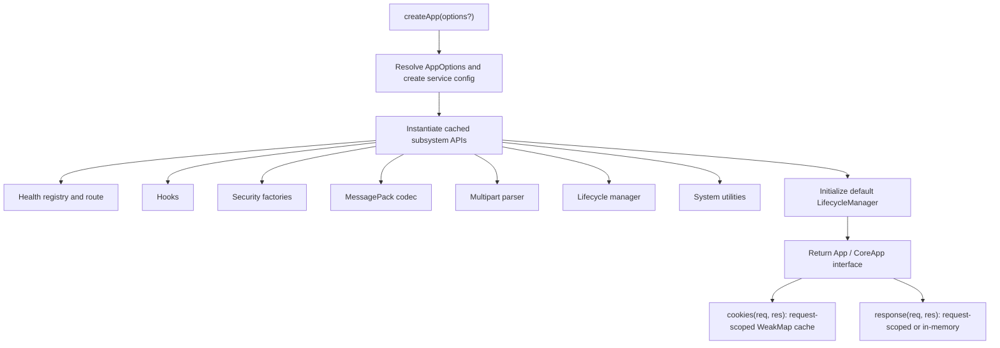

# Architectural Overview

`@oneunit/core` v1.0.0

A definitive technical specification of the `@oneunit/core` backend library: its architectural patterns, component breakdown, module interactions, data flow, technology stack, implementation details, and error model.

---

## Table of Contents

1. [System Design & Architecture](#1-system-design--architecture)

2. [Component Interactions & Data Flow](#2-component-interactions--data-flow)

3. [Technology Stack](#3-technology-stack)

4. [Implementation Details](#4-implementation-details)

5. [Error Model](#5-error-model)

6. [Configuration Model](#6-configuration-model)

7. [Public API Reference](#7-public-api-reference)

8. [Directory Structure](#8-directory-structure)

---

## 1. System Design & Architecture

### 1.1 Purpose and Scope

`@oneunit/core` is a unified Developer Experience (DX) library for Node.js and TypeScript backend services. It consolidates cross-cutting infrastructure—configuration management, security middleware, cookie management, response envelopes, health checks, request-scoped context, lifecycle/plugin orchestration, multipart parsing, MessagePack serialization, system utilities, and structured errors—into a single package. Its core is **\*\*framework-agnostic\*\*** and integrates with **\*\*Express 5\*\***, **\*\*Fastify 5\*\***, **\*\*Koa 3\*\***, and native **\*\*`node:http`\*\*** via framework-organized adapters.

#### In scope

- Application bootstrap and composition via `createApp()`

- Middleware/plugin lifecycle management

- Security middleware (CORS, CSRF, Helmet, compression, HTML sanitization, rate limiting)

- Signed and encrypted cookies with HMAC

- Standardized HTTP response envelopes (`ApiResponse`)

- Health checks (system, Docker, Kubernetes, database/Redis/Kafka)

- `AsyncLocalStorage` request-scoped context

- YAML/env configuration engine with Zod validation and interpolation

- MessagePack binary serialization

- Busboy multipart form/file parsing

- Structured `OneUnitError` hierarchy

#### Out of scope

- Database ORMs and query builders

- Authentication/identity providers beyond CSRF and signed/encrypted cookies

- Templating engines

- CLI tooling

- Distributed tracing backends

- Message brokers (Kafka/Redis health providers are probes only; no client SDKs are bundled)

### 1.2 Core Design Principles

| Principle | Description |

|---|---|

| **\*\*Unified Entry\*\*** | `createApp()` is the single factory entry point; capabilities are exposed through the returned `App` / `CoreApp` interface. |

| **\*\*Facade Pattern\*\*** | `createApp()` hides subsystem wiring behind cached API instances (`health()`, `hooks()`, `config()`, `security()`, `msgpack()`, `multipart()`, `lifecycle()`, `lib()`). |

| **\*\*Framework-Centric Adapters\*\*** | Framework-specific integration (Express, Fastify, Koa, Universal/`node:http`) lives under `src/adapters/<framework>/`, isolating framework detection, request/response binding, and error boundaries. |

| **\*\*Caching by Default\*\*** | Subsystem APIs are instantiated once per `createApp()` call and reused. Request-scoped APIs (`cookies(req, res)` and `response(req, res)`) bind to the current request/response, with cookies cached per `req` via a `WeakMap`. |

| **\*\*Option Override\*\*** | Per-call options shallow-merge over application-level defaults (`{ ...global, ...perCall }`). The shared `secret` propagates to `cookie` and `csrf` unless overridden per call. |

| **\*\*Graduated Lifecycle Safety\*\*** | Three modes (`easy`, `advanced`, `strict`) enforce execution timeouts, middleware/plugin limits, type-conflict detection, and duplicate response-header collision detection. |

| **\*\*Immutable Configuration\*\*** | Resolved configuration is recursively `deepFreeze`d after Zod validation, preventing runtime mutation. |

| **\*\*Prototype-Pollution Resistance\*\*** | Prototype-sensitive keys (`__proto__`, `prototype`, `constructor`) are rejected in YAML parsing, resolver merging, and `envMapping` paths. |

### 1.3 Architectural Pattern Classification

`@oneunit/core` is best described as a **\*\*modular layered architecture with facade and adapter layers\*\***:

- **\*\*Composition layer\*\*** (`src/core.ts`, `src/core/core.ts`): the `createApp()` factories that wire all subsystems together.

- **\*\*Facade layer\*\*** (`src/index.ts`, subpath exports): a unified public API surface that hides internal subsystem complexity.

- **\*\*Domain layers\*\*** (`src/config/`, `src/security/`, `src/cookie/`, etc.): each subsystem owns its state, validation, and error types.

- **\*\*Adapter layer\*\*** (`src/adapters/`): framework-specific bindings that translate framework request/response primitives into the library's domain model.

- **\*\*Cross-cutting layer\*\*** (`src/errors/`, `src/hooks/`): structured errors and event hooks observable by every subsystem.

The library is **\*\*not\*\*** a microservices framework, an event bus, or a full MVC framework. It is an infrastructure core that application authors compose inside their own service boundaries.

---

## 2. Component Interactions & Data Flow

### 2.1 Two-Layer App Factory

#### Layer 1 — `src/core.ts` (`createApp(options?: AppOptions): App`)

The underlying composition root. On invocation it:

1. Resolves `AppOptions` defaults (`serviceName = "app"`, `port = 3000`, `host = "localhost"`).

2. Creates the service `config` via `createConfig()`.

3. Instantiates cached subsystem APIs:

&#x20;  - `health()` — health registry + route

&#x20;  - `hooks()` — event emitter

&#x20;  - `config()` — service config accessor

&#x20;  - `security()` — CORS, CSRF, Helmet, compression, sanitizer factories

&#x20;  - `msgpack()` — MessagePack codec

&#x20;  - `multipart()` — Busboy parser factory

&#x20;  - `lifecycle()` — `LifecycleManager`

&#x20;  - `createLifecycle(opts?)` — independent `LifecycleManager` factory

&#x20;  - `lib()` — formatters + system metrics

4. Initializes the default `LifecycleManager`.

5. Returns the `App` interface.

#### Layer 2 — `src/core/core.ts` (`createApp(options?: AppOptions): CoreApp`)

The simplified DX wrapper re-exported by `src/index.ts`. It:

1. Calls the Layer 1 `createApp()`.

2. Calls `app.lifecycle().initialize()`.

3. Exposes security factories directly on `CoreApp` (`app.cors()`, `app.csrf()`, `app.helmet()`, `app.compression()`, `app.sanitize()`, `app.rateLimit()`).

4. Provides `app.use()` and `app.apply()` for chainable middleware registration.

### 2.2 `App` / `CoreApp` Member Scopes

| Member | Lifecycle | Description |

|---|---|---|

| `health()` | Cached singleton | Health registry, route mounting, system/Docker/K8s providers |

| `hooks()` | Cached singleton | Typed event emitter (`on`, `use`, `off`, `once`, `emit`, `emitSync`) |

| `config()` | Cached singleton | Service config (`port`, `host`, `serviceName`, `nodeEnv`, `get`, `set`, `toJSON`) |

| `cookies(req?, res?)` | Per-request, `WeakMap`-cached by `req` | Cookie store with HMAC signing and encryption |

| `security()` / direct methods | Cached factory wrapper | CORS, CSRF, Helmet, compression, HTML sanitization, rate limiting |

| `msgpack()` | Cached singleton | MessagePack `encode`, `decode`, `encodeSync`, `decodeSync` |

| `multipart()` | Cached factory wrapper | Busboy-based multipart form and file parser |

| `lifecycle()` | Cached singleton | Middleware/plugin manager (`easy`, `advanced`, `strict`) |

| `createLifecycle(opts?)` | Factory | Independent `LifecycleManager` instance |

| `response(req?, res?)` | Per-request (in-memory when omitted) | Standardized response envelope builder |

| `lib()` | Cached singleton | `formatBytes`, `formatTime`, `timestamp`, `getSystemInfo`, `getSystemStatus` |

| `use(middleware)` | Method | Registers middleware onto the lifecycle chain |

### 2.3 Request Processing & Data Flow

An HTTP request travels through the system as follows:

```

┌─────────────────┐

│ Incoming Request │

└────────┬────────┘

&#x20;        ▼

┌─────────────────┐      ┌─────────────────────────────────┐

│ Framework Adapter│─────▶│ detectFramework(req, res, ctx) │

│ (Express/Fastify │      │  → express / fastify / koa / http│

│  / Koa / http)   │      └─────────────────────────────────┘

└────────┬────────┘                  │

&#x20;        ▼                          │

┌─────────────────┐                 │

│ LifecycleManager│◄────────────────┘ (middleware chain:

│ (easy/advanced/ │     use() registrations execute in order;

│  strict)        │      abort() short-circuits the chain)

└────────┬────────┘

&#x20;        ▼

┌─────────────────┐

│ Route Handler   │◄── AsyncLocalStorage RequestContext (optional)

│ (user code)     │

└────────┬────────┘

&#x20;        ▼ (success or thrown error)

┌─────────────────┐      ┌─────────────────────────┐

│ response(req,res)│─────▶│ detectResponseFramework() │

│ (ResponseAPI)   │      │ → express / fastify / koa / http│

└────────┬────────┘      └─────────────────────────┘

&#x20;        ▼                        │

┌─────────────────┐               │

│ ResponseFrameworkManager│───────┘ builds ApiResponse envelope

│ (ok / created / …)     │      enforces bodyless statuses (204, 304…)

└────────┬────────┘      │

&#x20;        ▼               │

┌─────────────────┐      │

│ Framework Adapter │◄───┘ serializes & sends response

│ sends to client │      │

└─────────────────┘      │

&#x20;                        │ (error path)

&#x20;                        ▼

&#x20;                 ┌─────────────────┐

&#x20;                 │ OneUnitError /  │

&#x20;                 │ TryCatch wrapper│ normalizes thrown errors into

&#x20;                 │ Adapter handler │ ApiResponse error envelopes

&#x20;                 └─────────────────┘

```

#### Key flow details

1. **\*\*Framework detection\*\*** — `detectFramework()` inspects the server/request shape to identify Express (`use` + `get` + `locals` + `listen`), Fastify (`register` + `decorateReply` + `addHook`), Koa (`context` + `use` + `callback`), or `node:http` (`on`).

2. **\*\*Middleware chain\*\*** — `LifecycleManager.executeMiddlewareChain()` runs all registered middleware for a phase (`request` \| `response` \| `error`). Each middleware receives a `MiddlewareContext` with `req`, `res`, `next`, `phase`, `abort`, and an optional `AbortSignal` for timeout cooperation.

3. **\*\*Response building\*\*** — `ResponseManager` + `ResponseFrameworkManager` produce a normalized `ApiResponse` envelope. Bodyless statuses (`204 No Content`, `304 Not Modified`) are enforced.

4. **\*\*Error normalization\*\*** — Thrown errors are caught by `withTryCatch` / `createTryCatchMiddleware` / adapter-level error handlers and converted into `OneUnitError` envelopes with `category`, `code`, `severity`, `timestamp`, and `details`.

### 2.4 Subsystem Interaction Matrix

| From → To | Config | Security | Cookie | Response | Health | Lifecycle | Hooks | Context | MsgPack | Multipart | Lib | Errors |

|---|---|---|---|---|---|---|---|---|---|---|---|---|

| `createApp` | ✔ creates | ✔ factories | ✔ store | ✔ manager | ✔ registry | ✔ manager | ✔ emitter | — | ✔ codec | ✔ parser | ✔ helpers | — |

| Security | — | — | shares `secret` | — | — | registers middleware | — | — | — | — | — | ✔ `OneUnitError` |

| Cookie | — | — | — | — | — | — | — | — | — | — | — | ✔ `CookieSignatureError`, `CookieDecryptionError` |

| Response | — | — | — | — | — | — | — | — | — | — | — | ✔ `ResponseValidationError`, `BodylessStatusError` |

| Lifecycle | — | ✔ middleware | — | — | — | — | ✔ plugins | — | — | ✔ middleware | — | ✔ `MiddlewareConflictError`, `HeaderConflictError` |

| Health | — | — | — | — | — | — | — | — | — | — | ✔ system metrics | ✔ health errors |

| Context | — | — | — | — | — | — | — | — | — | — | — | — |

| Multipart | — | — | — | — | — | registers middleware | — | — | — | — | — | ✔ multipart errors |

### 2.5 Lifecycle Modes

The `LifecycleManager` operates in one of three modes, selected via `AppOptions.lifecycle.mode`:

| Mode | `throwOnError` | `executionTimeoutMs` | `maxMiddleware` | `maxPlugins` | `autoRegisterEssential` | Use case |

|---|---|---|---|---|---|---|

| `easy` | `true` | 5000 | 50 | 50 | `true` | Rapid prototyping; errors surface immediately |

| `advanced` (default) | `false` | 5000 | 50 | 50 | `false` | Balanced production default; errors isolated |

| `strict` | `true` | 2000 | 20 | 20 | `false` | Hardened production; tight limits, fast timeouts |

Switching modes after initialization re-applies mode-specific defaults (`easy` → throw on error + auto-register essentials; `strict` → 2s timeout, 20 middleware/plugin caps).

### 2.6 Hooks System

`createHooks()` / `createHooksWithDefaults()` provides a lightweight typed event emitter:

- `on(name, listener)` / `use(name, listener)` — register an async listener

- `once(name, listener)` — register a one-shot listener

- `off(name, listener)` — remove a listener

- `emit(name, context)` — async dispatch to all listeners

- `emitSync(name, context)` — synchronous dispatch

- `has(name)`, `listeners(name)`, `listenerCount(name)`, `clear()`, `clearHook(name)`, `toJSON()` — introspection

Predefined hook sets: `DEFAULT_HOOKS`, `APPLICATION_HOOKS`, `LIFECYCLE_HOOKS`, `SERVER_HOOKS`, `CACHE_HOOKS`, `CONNECTION_HOOKS`.

### 2.7 Request Context

`createRequestContext()` owns a Node.js `AsyncLocalStorage` instance. Each `run()` call creates an isolated `Map` store, so concurrent async operations never leak request-scoped state. Optional `autoTimestamp` stamps each store with an ISO timestamp.

---

## 3. Technology Stack

### 3.1 Language & Runtime

| Attribute | Value | Rationale |

|---|---|---|

| Language | TypeScript `^6.0.3` | Static types catch infrastructure errors at compile time |

| Runtime | Node.js `>= 18.0.0` | Broad LTS coverage; native `AsyncLocalStorage` and Web Streams |

| Module system | ES Modules (`"type": "module"`) | Standard JS syntax, tree-shakable subpath exports |

| Compiler target | ES2022 | Modern syntax with wide Node 18+ support |

| Module resolution | `NodeNext` | Aligns TS resolution with Node ESM semantics |

| Strict mode | `strict: true` | Maximum type safety for infrastructure code |

| `verbatimModuleSyntax` | `true` | Explicit `import type` / `import value` boundaries |

| `isolatedModules` | `true` | Safe transpilation with bundlers and `tsx` |

| Declarations | `declaration: true`, `declarationMap: true` | `.d.ts` emission for consumers |

| Source maps | `sourceMap: true` | Debuggable compiled output |

### 3.2 Runtime Dependencies

| Dependency | Version | Purpose | Rationale |

|---|---|---|---|

| `zod` | `^4.6.7` | Schema validation + static type inference | Single source of truth for config/runtime schemas |

| `@asteasolutions/zod-to-openapi` | `^9.1.0` | OpenAPI generation from Zod | Derive API docs from validation schemas |

| `@msgpack/msgpack` | `^3.1.3` | Binary serialization | Compact, fast wire format for internal caches |

| `busboy` | `^1.6.0` | Streaming `multipart/form-data` | Mature, streaming multipart parser |

| `cookie` | `^2.0.2` | Cookie parsing/serialization | Minimal, spec-compliant cookie handling |

| `cors` | `^2.8.6` | CORS middleware | Industry-standard Express CORS |

| `csrf-csrf` | `^4.1.0` | Double-submit CSRF | Token-based CSRF without session coupling |

| `helmet` | `^8.3.0` | Security HTTP headers | Aggregates secure header defaults |

| `compression` | `^1.8.2` | Response compression | gzip/deflate for HTTP responses |

| `rate-limiter-flexible` | `^11.4.1` | Rate limiting | Token/leaky bucket, Redis-ready |

| `sanitize-html` | `^2.18.2` | HTML sanitization | XSS prevention for user content |

| `prom-client` | `^15.1.3` | Prometheus metrics | Standard Prometheus exposition format |

| `swagger-ui-dist` | `^5.34.1` | Swagger UI static assets | Embedded API documentation UI |

| `dotenv` | `^18.0.10` | `.env` loading | Local development env vars |

| `yaml` | `^2.9.1` | YAML parsing | Human-readable config files |

### 3.3 Optional Framework Dependencies

Installed by the consumer to use a specific adapter:

| Framework | Version | Adapter path |

|---|---|---|

| `express` | `^5.3.0` | `src/adapters/express/` |

| `fastify` | `^5.12.8` | `src/adapters/fastify/` |

| `koa` | `^3.3.0` | `src/adapters/koa/` |

| `node:http` | Native (built-in) | `src/adapters/universal/` |

### 3.4 Development Dependencies

| Dependency | Version | Purpose |

|---|---|---|

| `vitest` | `^5.1.0` | Unit test runner (78 test files under `test/`) |

| `typescript` | `^6.0.3` | Compiler and type checker |

| `tsx` | `^4.23.15` | TypeScript execution for local dev |

| `eslint` | `^10.14.0` | Linting |

| `@typescript-eslint/eslint-plugin` | `^8.72.2` | TypeScript-aware ESLint rules |

| `@typescript-eslint/parser` | `^8.72.2` | TypeScript parser for ESLint |

| `@types/node` | `^22.0.0` | Node.js type definitions |

| `@types/busboy`, `@types/express`, `@types/koa`, `@types/sanitize-html` | — | Framework type stubs |

---

## 4. Implementation Details

### 4.1 Structural Patterns

| Pattern | Where | Description |

|---|---|---|

| **\*\*Facade\*\*** | `src/core.ts`, `src/core/core.ts`, `src/index.ts` | `createApp()` hides subsystem wiring behind cached API accessors |

| **\*\*Composition Root\*\*** | `src/core.ts` | Single point where all subsystems are instantiated and wired |

| **\*\*Adapter\*\*** | `src/adapters/{express,fastify,koa,universal}/` | Framework-specific bindings isolated from domain logic |

| **\*\*Factory\*\*** | Every subsystem (`createCors`, `createHealthRegistry`, `createMsgPack`, …) | Consistent `createX()` constructor convention |

| **\*\*Registry\*\*** | `src/health/` (health registry), `src/lifecycle/` (middleware/plugin registry) | Named-item stores with lifecycle operations |

| **\*\*Emitter\*\*** | `src/hooks/` | Typed pub/sub event system |

| **\*\*AsyncLocalStorage\*\*** | `src/context/` | Request-scoped storage isolated per async chain |

| **\*\*Middleware Chain\*\*** | `src/lifecycle/manager.ts` | Ordered execution with abort/short-circuit support |

| **\*\*Immutable Record\*\*** | `src/config/pipeline.ts` | `deepFreeze` after validation prevents runtime mutation |

| **\*\*Error Hierarchy\*\*** | `src/errors/` | `OneUnitError` base + 11 category-specific subclasses |

### 4.2 Design Principles

- **\*\*Fail fast, typed errors:\*\*** All domain errors extend `OneUnitError` and carry `category`, `code`, `severity`, `timestamp`, and `details`. Severity escalates to `"critical"` when a `cause` is provided.

- **\*\*Defensive defaults:\*\*** `strict: true` TypeScript, prototype-pollution guards, bodyless-status enforcement, middleware/plugin caps, and execution timeouts.

- **\*\*Cache by default, bind per-request:\*\*** Subsystem APIs are cached singletons; `cookies()` and `response()` bind to the current request/response and are weakly cached.

- **\*\*Shallow merge overrides:\*\*** Per-call options merge over `AppOptions` defaults without deep mutation.

- **\*\*Framework isolation:\*\*** No framework imports leak into domain subsystems; adapters are the only framework-aware code.

### 4.3 Directory Organization

```

src/

├── index.ts                  # Top-level barrel export (all modules + createApp)

├── core.ts                   # Composition root: createApp() -> App (Layer 1)

├── core/

│   ├── core.ts               # Simplified DX wrapper: createApp() -> CoreApp (Layer 2)

│   └── index.ts              # CoreApp + App type re-exports

├── adapters/                 # Framework integrations (organized by framework)

│   ├── express/              # Express 5 adapter (cookie, health, middleware, response, types)

│   ├── fastify/              # Fastify 5 plugin adapter (cookie, health, response, types)

│   ├── koa/                  # Koa 3 middleware adapter (cookie, health, response, types)

│   └── universal/            # Auto-detecting adapter (Express, Fastify, Koa, node:http)

├── config/                   # Configuration engine

│   ├── index.ts              # loadConfig, loadConfigSimple, loadConfigSync, createConfig

│   ├── loader.ts             # YAML/config file loading

│   ├── resolver.ts           # Config resolution + prototype-pollution guards

│   ├── interpolation.ts      # ${VAR} / ${VAR:fallback} interpolation

│   ├── pipeline.ts           # runPipeline / runPipelineAsync (resolve → validate → freeze)

│   ├── zod-validator.ts      # Zod validation bridge

│   ├── yaml-source.ts        # YAML ConfigSource implementation

│   ├── env.ts / load-env.ts  # Environment variable helpers

│   ├── facade.ts             # Legacy createConfig facade

│   ├── errors.ts             # Config error classes

│   └── types.ts              # Config types

├── context/                  # AsyncLocalStorage request context

│   ├── registry.ts           # createRequestContext

│   └── types.ts              # RequestContext, RequestContextOptions

├── cookie/                   # Signed & encrypted cookie store

│   ├── index.ts              # createCookieStore, createDetectedCookieStore, defaults

│   ├── types.ts              # CookieOptions, CookieConfig

│   └── ...signing / encryption / detection internals

├── errors/                   # OneUnitError hierarchy

│   ├── base.ts               # OneUnitError base class

│   ├── types.ts              # ErrorCategory, ErrorSeverity, ErrorInfo, ErrorContext

│   ├── response.ts           # Response\* errors

│   ├── cookie.ts             # Cookie\* errors

│   ├── lifecycle.ts          # Lifecycle\* errors

│   ├── multipart.ts          # Multipart\* errors

│   ├── hooks.ts              # Hooks\* errors

│   ├── lib.ts                # Lib\* errors

│   └── core.ts               # Core\* errors

├── health/                   # Health checks

│   ├── index.ts              # createHealthRegistry, createHealthRoute, providers

│   ├── types.ts              # HealthCheckResult, HealthServer, HealthRouteOptions

│   ├── system-health.ts      # createSystemHealthProvider, detectHealthEnvironment

│   └── ...docker, kubernetes, service providers

├── hooks/                    # Typed event hooks

│   ├── registery.ts          # createHooks, createHooksWithDefaults

│   ├── default-hooks.ts      # DEFAULT_HOOKS, APPLICATION_HOOKS, etc.

│   └── type.ts               # HookListener, Hooks, HooksOptions

├── lib/                      # Utilities & system metrics

│   ├── formatter.ts          # formatBytes, formatTime, timestamp

│   ├── system.ts             # getSystemInfo (SystemInfo)

│   ├── system-status.ts      # getSystemStatus, SystemStatus, thresholds

│   ├── docker.ts             # pingDocker, listDockerContainers

│   └── kubernetes.ts         # pingKubernetes, listK8sPods

├── lifecycle/                # Middleware/plugin manager

│   ├── manager.ts            # LifecycleManager class

│   ├── middleware-registry.ts# MiddlewareRegistry (registration + execution)

│   ├── plugin-system.ts      # PluginSystem (namespaced plugins + hooks)

│   └── types.ts              # LifecycleMode, options, registrations, conflicts

├── msgpack/                  # MessagePack codec

│   └── index.ts              # createMsgPack → encode/decode/sync variants

├── multipart/                # Busboy multipart parser

│   ├── index.ts              # createMultipart, parseMultipart, middlewares

│   └── types.ts              # MultipartOptions, limits

├── response-mangement/       # Response envelopes

│   ├── index.ts              # createResponseManager, adapters, detectResponseFramework

│   ├── manager.ts            # ResponseManager (ApiResponse builders)

│   ├── framework-manager.ts  # ResponseFrameworkManager (framework binding)

│   ├── adapters/             # Express/Fastify/Koa/HTTP response adapters

│   ├── try-catch.ts          # withTryCatch, createTryCatchMiddleware

│   └── types.ts              # ResponseOptions, RespondOptions, ErrorOptions

└── security/                 # Security middleware factories

&#x20;   ├── index.ts              # createCors, createCsrf, createHelmet, createCompression, createSanitizer

&#x20;   ├── rate-limit.ts         # createRateLimit

&#x20;   ├── cors.ts / csrf.ts / helmet.ts / compression.ts / sanitize.ts

&#x20;   └── types.ts              # CorsOptions, CsrfOptions, HelmetOptions, …

```

### 4.4 Key Type Definitions

`AppOptions` (in `src/core.ts`):

```ts

interface AppOptions {

&#x20; serviceName?: string;      // default: "app"

&#x20; port?: number;             // default: 3000

&#x20; host?: string;             // default: "localhost"

&#x20; nodeEnv?: string;

&#x20; secret?: string;

&#x20; framework?: "express" | "fastify" | "koa" | "http";

&#x20; security?: {

&#x20;   cors?: CorsOptions;

&#x20;   csrf?: CsrfOptions;

&#x20;   helmet?: HelmetOptions;

&#x20;   compression?: CompressionOptions;

&#x20;   sanitize?: SanitizeOptions;

&#x20; };

&#x20; cookie?: CookieConfig;

&#x20; multipart?: MultipartOptions;

&#x20; health?: { path?: string; };   // default: "/health"

&#x20; lifecycle?: LifecycleOptions;

}

```

`LifecycleOptions` (in `src/lifecycle/types.ts`):

```ts

interface LifecycleOptions {

&#x20; mode?: "easy" | "advanced" | "strict";       // default: "advanced"

&#x20; executionTimeoutMs?: number;                 // default: 5000

&#x20; throwOnError?: boolean;                      // default: true in strict, false otherwise

&#x20; maxMiddleware?: number;                      // default: 50

&#x20; maxPlugins?: number;                         // default: 50

&#x20; allowedMiddlewareTypes?: string[];           // default: [] (all)

&#x20; autoRegisterEssential?: boolean;             // default: false

}

```

### 4.5 Subpath Export Map

Declared in `package.json` `exports`:

| Subpath | Types | Default |

|---|---|---|

| `.` | `./dist/index.d.ts` | `./dist/index.js` |

| `./context` | `./dist/context/index.d.ts` | `./dist/context/index.js` |

| `./config` | `./dist/config/index.d.ts` | `./dist/config/index.js` |

| `./cookie` | `./dist/cookie/index.d.ts` | `./dist/cookie/index.js` |

| `./health` | `./dist/health/index.d.ts` | `./dist/health/index.js` |

| `./security` | `./dist/security/index.d.ts` | `./dist/security/index.js` |

| `./errors` | `./dist/errors/index.d.ts` | `./dist/errors/index.js` |

---

## 5. Error Model

### 5.1 `OneUnitError` Base Class

All domain errors extend `OneUnitError` (`src/errors/base.ts`):

```ts

export type ErrorSeverity = "warning" | "error" | "critical";

export class OneUnitError extends Error {

&#x20;   readonly category: ErrorContext["category"];

&#x20;   readonly code: string;

&#x20;   readonly details?: Record<string, unknown>;

&#x20;   readonly timestamp: string;

&#x20;   readonly severity: ErrorSeverity; // "critical" when options.cause is provided, else "error"

&#x20;   constructor(message: string, options: OneUnitErrorOptions = {});

&#x20;   toJSON(): ErrorInfo & { message: string; stack?: string };

}

```

- `timestamp` is an ISO-8601 string captured at construction.

- `severity` is `"critical"` when a `cause` is provided, otherwise `"error"`.

- `Error.captureStackTrace` is used in V8 for clean stack traces.

- `toJSON()` produces a serializable `ErrorInfo` shape for logging and error-envelope emission.

### 5.2 Error Categories

| Category | Domain | Representative Errors |

|---|---|---|

| `response` | Response status validation, already-sent responses, bodyless status violations | `ResponseManagementError`, `ResponseValidationError`, `InvalidStatusCodeError`, `ResponseAlreadySentError`, `BodylessStatusError` |

| `cookie` | Missing secret, invalid cookie names, `__Secure-`/`SameSite=None` rules, signature/decryption failures | `CookieError`, `CookieSecretRequiredError`, `InvalidCookieNameError`, `CookieSecurePrefixError`, `SameSiteNoneRequiresSecureError`, `CookieDecryptionError`, `CookieSignatureError` |

| `lifecycle` | Uninitialized lifecycle, middleware/plugin limits, disallowed types, timeouts, conflicts, header conflicts | `LifecycleError`, `LifecycleNotInitializedError`, `MiddlewareLimitError`, `MiddlewareTypeNotAllowedError`, `MiddlewareNotFoundError`, `MiddlewareTimeoutError`, `PluginLimitError`, `PluginAlreadyExistsError`, `MiddlewareConflictError`, `MiddlewareTypeConflictError`, `HeaderConflictError` |

| `multipart` | Disabled multipart, file size/count/field limits, invalid MIME types, parse timeouts | `MultipartError`, `MultipartDisabledError`, `MultipartFileTooLargeError`, `MultipartTooManyFilesError`, `MultipartTooManyFieldsError`, `MultipartInvalidMimeTypeError`, `MultipartParseTimeoutError` |

| `hooks` | Hook registration restrictions | `HooksError`, `HookNotAllowedError` |

| `lib` | Invalid bytes, negative bytes/time, invalid dates | `LibError`, `InvalidBytesError`, `NegativeBytesError`, `InvalidTimeError`, `NegativeTimeError`, `InvalidDateError` |

| `core` | App factory and response req/res requirement errors | `CoreError`, `ResponseRequiresRequestResponseError` |

| `security` | CORS, CSRF, Helmet, compression, sanitization, rate limiting | (security error classes) |

| `health` | Health check execution, aggregation, route registration | (health error classes) |

| `config` | Config source, interpolation, validation failures | `ConfigSourceError`, `ConfigInterpolationError`, `ConfigValidationError` |

| `msgpack` | MessagePack encoding/decoding failures | (msgpack error classes) |

### 5.3 Error Flow

1. Domain code throws a typed `OneUnitError` subclass.

2. Adapter-level error handlers (Express 4-arg handler, Fastify `setErrorHandler`, Koa outermost try/catch) catch the error.

3. `withTryCatch` / `createTryCatchMiddleware` wrap route handlers and normalize thrown errors into `ApiResponse` error envelopes.

4. The response envelope carries `category`, `code`, `message`, and HTTP status derived from the error category.

---

## 6. Configuration Model

### 6.1 Two Configuration Layers

**\*\*Layer A — Generic Configuration Engine\*\*** (`src/config/`):

- `loadConfig()` — defaults `configDir` to `src/config/yaml`

- `loadConfigSimple()` — defaults `configDir` to `./config`

- `loadConfigSync()` — synchronous YAML-only loader; defaults `configDir` to `./config`, `env` to `"development"`

- Pipeline: `buildResolvedConfig()` → `applyInterpolation()` → `buildEnvironmentOverrides()` → `resolveConfig()` → Zod validation → `deepFreeze`

- Interpolation: `${NAME}` and `${NAME:fallback}` always produce strings; typed env via `envMapping` with `parseInteger` / `parseBoolean`

- Prototype-sensitive keys (`__proto__`, `prototype`, `constructor`) rejected in YAML, resolver merging, and `envMapping` paths

**\*\*Layer B — Legacy Service Config\*\*** (`createConfig`):

Used internally by `createApp().config()` and exported for backward compatibility, alongside `envString`, `envNumber`, `envBool`, `envList`, `resolveNodeEnv`, `isDevelopment`, `isProduction`, `isTest`, `envFile`, `loadEnv`.

### 6.2 `ConfigAPI` surface (exposed via `app.config()`)

| Member | Type | Description |

|---|---|---|

| `port` | `number` (readonly) | Service port |

| `host` | `string` (readonly) | Service host |

| `serviceName` | `string` (readonly) | Service name |

| `nodeEnv` | `string` (readonly) | Node environment |

| `isDevelopment` / `isProduction` / `isTest` | `boolean` (readonly) | Environment flags |

| `toJSON()` | `Record<string, unknown>` | Serialized config |

| `set(key, value)` | `void` | Set a known config key |

| `get(key)` | `unknown` | Get a known config key |

Only the known keys (`port`, `host`, `serviceName`, `nodeEnv`, `isDevelopment`, `isProduction`, `isTest`) may be set/get; unknown keys throw.

---

## 7. Public API Reference

### 7.1 `createApp(options?): App` — Layer 1 (src/core.ts)

Returns an `App` with cached accessors: `health()`, `hooks()`, `config()`, `cookies()`, `security()`, `msgpack()`, `multipart()`, `lifecycle()`, `createLifecycle()`, `response()`, `lib()`, `use()`.

### 7.2 `createApp(options?): CoreApp` — Layer 2 (src/core/core.ts)

Simplified DX wrapper exposing `cors()`, `csrf()`, `helmet()`, `compression()`, `sanitize()`, `rateLimit()`, `cookies()`, `response()`, `multipart()`, `use()`, `apply()`, plus all Layer 1 accessors.

### 7.3 Subsystem APIs (signatures summarized)

**\*\*HealthAPI:\*\*** `register(name, check, critical?)`, `check()`, `route(server)`, `registerSystem(options?)`, `registerDocker(options?)`, `registerKubernetes(options?)`, `detectEnvironment()`

**\*\*HooksAPI:\*\*** `on(name, listener)`, `use(name, listener)`, `off(name, listener)`, `once(name, listener)`, `emit(name, context)`, `emitSync(name, context)`, `has(name)`, `listeners(name)`, `listenerCount(name)`, `clear()`, `clearHook(name)`, `toJSON()`

**\*\*CookieStoreAPI:\*\*** `get(name)`, `set(name, value, options?)`, `delete(name, options?)`, `has(name)`, `all()`, `clear()`, `setSigned(name, value, options?)`, `setEncrypted(name, value, options?)`, `getSigned(name)`, `getEncrypted(name)`, `serialize(name, value, options?)`, `parse(cookieHeader)`, `createStore(name, config?)`, `getStore(name)`

**\*\*SecurityAPI:\*\*** `cors(options?)`, `csrf(options?)`, `helmet(options?)`, `compression(options?)`, `sanitize(options?)`

**\*\*MultipartAPI:\*\*** `multipart(options?)`

**\*\*LifecycleAPI:\*\*** `mode()`, `setMode(mode)`, `initialize()`, `registerMiddleware(name, type, middleware, options?)`, `unregisterMiddleware(name)`, `registerPlugin(name, namespace, hooks, options?)`, `unregisterPlugin(name, namespace)`, `executeMiddleware(name, req, res, phase?)`, `executeMiddlewareChain(req, res, phase?)`, `executeHook(hookName, context)`, `executeHookIsolated(hookName, context, namespace)`, `getState()`, `getMiddlewareList()`, `getPluginList()`, `getNamespaces()`, `hasMiddleware(name)`, `hasPlugin(name, namespace)`, `clear()`, `isSafe()`, `getValidationReport()`, `createPluginContext(name, namespace)`

**\*\*MsgPackAPI:\*\*** `encode(value)`, `decode<T>(data)`, `encodeSync(value)`, `decodeSync<T>(data)`

**\*\*ResponseAPI:\*\*** `ok<T>(options?)`, `success<T>(options?)`, `created<T>(options?)`, `accepted<T>(options?)`, `noContent()`, `badRequest<T>(options?)`, `unauthorized<T>(options?)`, `forbidden<T>(options?)`, `notFound<T>(options?)`, `conflict<T>(options?)`, `unprocessable<T>(options?)`, `internalServerError<T>(options?)`, `respond<T>(options)`

**\*\*LibAPI:\*\*** `formatBytes(bytes, decimals?)`, `formatTime(ms)`, `timestamp(date)`, `getSystemInfo()`, `getSystemStatus(system, checks, thresholds?)`

---

## 8. Directory Structure

```

core/

├── src/

│   ├── index.ts                  # Top-level barrel export (all modules + createApp)

│   ├── core.ts                   # Composition root: createApp() -> App

│   ├── core/core.ts              # Simplified DX wrapper: createApp() -> CoreApp

│   ├── adapters/                 # Framework integrations (by framework)

│   │   ├── express/              # Express 5 adapter

│   │   ├── fastify/              # Fastify 5 plugin adapter

│   │   ├── koa/                  # Koa 3 middleware adapter

│   │   └── universal/            # Auto-detecting adapter (all four runtimes)

│   ├── config/                   # YAML/env config engine + legacy createConfig

│   ├── context/                  # AsyncLocalStorage request context

│   ├── cookie/                   # Signed/encrypted cookie store

│   ├── errors/                   # OneUnitError hierarchy (11 categories)

│   ├── health/                   # Health registry + system/Docker/K8s providers

│   ├── hooks/                    # Typed event hooks registry

│   ├── lib/                      # Formatters, system metrics, Docker/K8s clients

│   ├── lifecycle/                # LifecycleManager (easy/advanced/strict)

│   ├── msgpack/                  # MessagePack encoder/decoder

│   ├── multipart/                # Busboy multipart parser + middlewares

│   ├── response-mangement/       # ResponseManager + ApiResponse envelopes

│   └── security/                 # CORS, CSRF, Helmet, compression, sanitize, rate-limit

├── test/                         # Vitest test suite (78 test files)

├── docs/                         # Per-module architecture specs & usage guides

├── plan/                         # Implementation plans

├── ARCHITECTURAL_OVERVIEW\.md     # This file

├── CONFIG_MANAGEMENT_ARCHITECTURE.md

├── README.md                     # Developer onboarding guide

├── package.json                  # Manifest, scripts, exports map

├── tsconfig.json                 # TypeScript compiler options

├── eslint.config.js              # ESLint flat config

└── vitest.config.ts              # Vitest configuration

```

Per-module documentation is located under `docs/<module>/` with `architecture-spec.md` and `usage-guide.md` for each subsystem.

---

## 9. Framework Adapter Responsibilities

The adapters isolate framework-specific request/response handling from the framework-agnostic subsystem code:

- **Express (`src/adapters/express/`)**: attaches `app.locals.core`, `app.locals.oneunit`, `app.core`, `app.oneunit`, and `req.core`; can automatically mount `/health`; and can register an outermost four-argument error handler.
- **Fastify (`src/adapters/fastify/`)**: is implemented with `fastify-plugin`; decorates `fastify.core` and `fastify.oneunit`, registers the health route, decorates `reply.respond`, and installs `fastify.setErrorHandler`.
- **Koa (`src/adapters/koa/`)**: attaches `app.context.core`, `app.context.oneunit`, `app.core`, and `app.oneunit`; installs an outermost asynchronous try/catch middleware consistent with Koa's onion model; and mounts the health middleware.
- **Universal (`src/adapters/universal/`)**: detects Fastify, Koa, Express, or native `node:http` from the server object's shape.

## 10. Subsystem Implementation Notes

### 10.1 Cookies

`cookies(req, res)` creates a framework-detected cookie store and caches it per request object using a `WeakMap`. Without request/response objects, the API can use an in-memory store. Signed and encrypted cookie operations share the configured `secret`; signature failures and decryption failures produce typed errors.

### 10.2 Health Checks

The health registry stores named check functions with an optional `critical` flag. `checkAll()` aggregates outcomes into `healthy`, `degraded`, or `unhealthy`. Built-in providers cover system metrics, Docker, Kubernetes, and database/Redis/Kafka dependencies. The default health endpoint is `/health`; it returns `200` for healthy or degraded results and `503` for unhealthy results.

### 10.3 Response Management

`response(req, res)` detects the active framework or uses an in-memory adapter when request/response objects are omitted. Response managers build normalized `ApiResponse` envelopes and enforce bodyless HTTP statuses such as `204` and `304`. The `withTryCatch`, `createTryCatchMiddleware`, and `withTryCatchConditional` helpers normalize thrown route-handler errors.

### 10.4 Security and Multipart

Security factories wrap CORS, CSRF, Helmet, compression, HTML sanitization, and rate limiting. Multipart parsing is built on Busboy and provides framework middleware for Express, Fastify, Koa, and native HTTP. The parser supports limits for file size, file count, field count, MIME type allowlists, and parsing timeouts.

### 10.5 MessagePack and System Utilities

The MessagePack subsystem wraps `@msgpack/msgpack` with asynchronous and synchronous encode/decode methods. The utility subsystem exposes byte/time formatters, timestamps, system information/status, and Docker/Kubernetes probing helpers.

## 11. Application Initialization Flow



## 12. AppOptions Reference

The application factory accepts the following configuration shape (optional properties are shown):

```ts
export interface AppOptions {
  serviceName?: string; // default: "app"
  port?: number; // default: 3000
  host?: string; // default: "localhost"
  nodeEnv?: string;
  secret?: string;
  framework?: "express" | "fastify" | "koa" | "http";

  security?: {
    cors?: CorsOptions;
    csrf?: CsrfOptions;
    helmet?: HelmetOptions;
    compression?: CompressionOptions;
    sanitize?: SanitizeOptions;
  };

  cookie?: CookieConfig;
  multipart?: MultipartOptions;
  health?: { path?: string }; // default: "/health"
  lifecycle?: LifecycleOptions;
}
```

Per-call options for security and multipart factories shallow-merge over application-level defaults. The shared `secret` is used by cookie and CSRF configuration unless overridden for an individual call.

## 13. Runtime Dependency Inventory

| Dependency | Purpose |
|---|---|
| `zod` | Schema validation and type inference |
| `@asteasolutions/zod-to-openapi` | OpenAPI schema generation from Zod schemas |
| `@msgpack/msgpack` | MessagePack binary serialization |
| `busboy` | Streaming multipart parsing |
| `cookie` | Cookie parsing and serialization |
| `cors` | Cross-Origin Resource Sharing middleware |
| `csrf-csrf` | Double-submit CSRF protection |
| `helmet` | Security HTTP headers |
| `compression` | HTTP response compression |
| `rate-limiter-flexible` | Rate limiting |
| `sanitize-html` | HTML sanitization |
| `prom-client` | Prometheus metrics support |
| `swagger-ui-dist` | Swagger UI static assets |
| `dotenv` | `.env` loading |
| `yaml` | YAML configuration parsing |

Optional framework packages are installed by consumers as needed: Express 5, Fastify 5, and Koa 3. Native `node:http` is built into Node.js.

## 14. Consolidated Architectural Summary

`@oneunit/core` is a modular, layered infrastructure library rather than a microservices, MVC, or message-broker framework. Its composition root wires reusable domain subsystems behind a unified facade; adapters bind those subsystems to supported HTTP frameworks; and shared lifecycle, hook, context, and error facilities provide cross-cutting behavior. The library targets Node.js 18 or later and uses strict TypeScript with ES modules.
