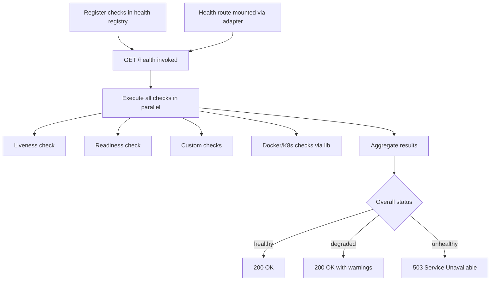
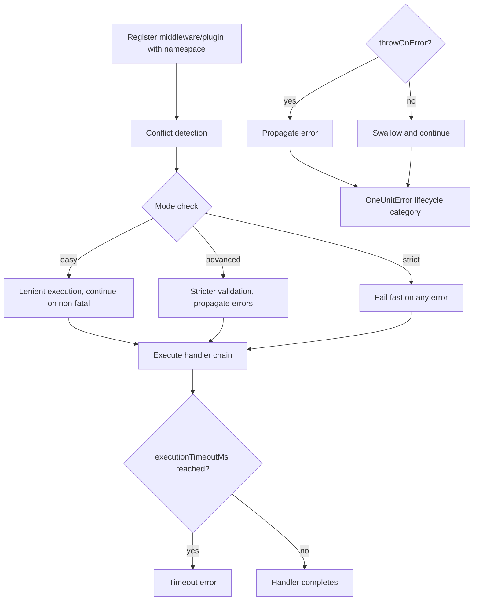

# Architectural Overview

@oneunit/core v1.0.0

---

## 1. High-Level Systemic Analysis

### 1.1 Purpose and Scope

@oneunit/core is a unified Developer Experience (DX) API for Node.js applications. It consolidates cross-cutting concerns—middleware orchestration, security, cookie management, response envelope handling, health checks, lifecycle/plugin management, configuration, serialization, and system utilities—into a single facade-driven package. The library is framework-agnostic at its core and extends to Express, Fastify, Koa, and raw `node:http` through an adapter pattern.

### 1.2 Core Design Philosophy

The package is built around five guiding principles:

| Principle | Description |
|-----------|-------------|
| **Unified Entry** | `createApp()` is the single factory entry point; every capability is reachable through the returned `App` interface. |
| **Facade Pattern** | The `App` interface hides the complexity of individual sub-systems behind cached API instances. |
| **Adapter Pattern** | Framework-specific behavior (cookie serialization, response sending, middleware registration, health route registration) is isolated in adapters. |
| **Caching by Default** | Most API instances are created once and reused; only request-scoped APIs (`cookies(req,res)`, `response(req,res)`) are instantiated per call. |
| **Option Override** | Per-call options shallow-merge over global defaults (`{ ...global, ...perCall }`). |

### 1.3 System Boundaries

- **In scope:** Application bootstrap, middleware lifecycle, security middleware, cookie store, response envelopes, health checks, plugins, configuration loading, MessagePack serialization, multipart parsing, system information utilities.
- **Out of scope:** Database ORMs, authentication providers beyond CSRF, templating engines, CLI tooling, distributed tracing.

---

## 2. Overall Design

### 2.1 Public API Surface

The public API is exported through `src/core.ts` and re-exported via `src/index.ts`.

**Factory:**

```ts
createApp(options?: AppOptions): App
```

**`App` interface:**

| Member | Scope | Description |
|--------|-------|-------------|
| `health()` | Cached singleton | Health check registry and route registration |
| `hooks()` | Cached singleton | Event emitter for application hooks |
| `config()` | Cached singleton | Configuration management engine |
| `cookies(req, res)` | Per-request | Cookie store with signing/encryption |
| `security()` | Cached singleton | CORS, CSRF, Helmet, Compression, Sanitize, RateLimit |
| `msgpack()` | Cached singleton | MessagePack serialization |
| `multipart()` | Cached singleton | Busboy-based multipart parsing |
| `lifecycle()` | Cached singleton | Middleware/plugin manager |
| `createLifecycle()` | Factory | Create an independent lifecycle instance |
| `response(req, res)` | Per-request | Response envelope management |
| `lib()` | Cached singleton | System info, status, formatters, Docker/K8s clients |
| `use(middleware)` | Method | Register middleware on the lifecycle chain |

### 2.2 Directory Structure

```
src/
├── core.ts                 - Unified public API facade (createApp)
├── core/core.ts            - Simplified DX wrapper (createApp shortcuts)
├── index.ts                - Barrel exports
├── config/                 - Configuration management engine
├── cookie/                 - Cookie store with signing/encryption
├── security/               - CORS, CSRF, Helmet, Compression, Sanitize, RateLimit
├── health/                 - Health checks, route registration, Docker/K8s
├── hooks/                  - Event emitter with AsyncLocalStorage-like patterns
├── lib/                    - System info, status, formatters, Docker/K8s clients
├── lifecycle/              - Middleware/plugin manager with modes (easy/advanced/strict)
├── msgpack/                - MessagePack serialization
├── multipart/              - Busboy-based multipart parsing
├── response-mangement/     - Response envelope management with framework adapters
├── context/                - Request-scoped storage (AsyncLocalStorage)
├── errors/                 - OneUnitError hierarchy (category-specific errors)
└── adapters/               - Framework adapters (cookie, response, middleware, health)
```

### 2.3 Supported Frameworks

| Framework | Integration Mechanism |
|-----------|----------------------|
| Express | Middleware adapter, response adapter, health route adapter |
| Fastify | Plugin-style adapter, response adapter |
| Koa | Middleware adapter (ctx-based), response adapter |
| node:http | Native req/res adapter |

---

## 3. Component Interaction Model

### 3.1 Application Initialization Flow

`createApp()` is the composition root. On invocation it:

1. Resolves and normalizes `AppOptions`, applying defaults.
2. Instantiates the configuration engine (`config()`).
3. Instantiates each cached sub-API: `health`, `hooks`, `security`, `msgpack`, `multipart`, `lifecycle`, `lib`.
4. Wires shared state: `config` options are referenced by `security`, `cookie`, and `lifecycle`.
5. Initializes the default lifecycle instance (enabled by default in `createApp()`).
6. Returns the `App` interface with all API instances bound.

Request-scoped instances (`cookies`, `response`) are created lazily on first call with the provided `req`/`res`.

### 3.2 Request Processing Flow

A request traverses the system as follows:

1. Framework adapter receives the incoming HTTP request.
2. Middleware chain executes in registration order (Express-style `(req, res, next)`).
3. The lifecycle manager controls chain execution, honoring the active mode (`easy`/`advanced`/`strict`).
4. Route handlers or controllers execute business logic.
5. `response(req, res)` is invoked to build and send the response envelope.
6. Framework-specific response adapter serializes and transmits the response.

### 3.3 Cookie Set/Get Flow

1. `cookies(req, res)` creates a per-request cookie store.
2. The store detects the framework via the cookie adapter.
3. On `set(name, value, options)`, the store signs/encrypts the value using the configured `secret`, then serializes through the adapter.
4. On `get(name)`, the store reads the raw cookie, verifies signature/decryption, and returns the value.
5. `secret` is shared between the cookie store and CSRF protection.

### 3.4 Health Check Flow

1. Checks are registered into the health registry.
2. On health endpoint invocation, all checks execute in parallel.
3. Results are aggregated into an overall status (healthy/unhealthy/degraded).
4. Framework adapter mounts the health route (default path configurable).
5. Docker/K8s-specific checks can be included via `lib` clients.

### 3.5 Lifecycle Execution Flow

1. Middleware or plugins are registered with a namespace.
2. Conflict detection runs (duplicate registration, mode-specific constraints).
3. Execution proceeds through the chain:
   - `easy` mode: lenient, continues on non-fatal errors.
   - `advanced` mode: stricter validation, error propagation.
   - `strict` mode: fails fast on any error.
4. Execution timeout (`executionTimeoutMs`) is enforced per handler.
5. `throwOnError` controls whether errors propagate or are swallowed.

### 3.6 Response Flow

1. `response(req, res)` creates a per-request response instance.
2. The framework is auto-detected from `req`/`res`/context.
3. The response envelope is built (status, body, headers, metadata).
4. The framework-specific response adapter serializes and sends.
5. Errors are normalized through the `OneUnitError` hierarchy before sending.

---

## 4. Mermaid Data Flow Diagrams

### 4.1 Application Initialization Flow

```mermaid
flowchart TD
    A[User calls createApp(options)] --> B[Resolve & normalize AppOptions]
    B --> C[Instantiate Config Engine]
    C --> D[Instantify cached sub-apis]
    D --> D1[health()]
    D --> D2[hooks()]
    D --> D3[security()]
    D --> D4[msgpack()]
    D --> D5[multipart()]
    D --> D6[lifecycle()]
    D --> D7[lib()]
    D --> D8[createLifecycle()]
    D --> E[Wire shared config across components]
    E --> F[Initialize default lifecycle instance]
    F --> G[Return App interface]
    G --> H[cookies(req,res) - per-request, lazy]
    G --> I[response(req,res) - per-request, lazy]
```

### 4.2 Request Processing Flow

```mermaid
flowchart TD
    A[Incoming HTTP Request] --> B[Framework Adapter receives req/res]
    B --> C[Middleware Chain Execution]
    C --> D[Lifecycle Manager controls chain]
    D --> E{Mode: easy/advanced/strict}
    E --> F[Route Handler / Controller]
    F --> G[response(req,res) - per-request]
    G --> H[Framework auto-detection]
    H --> I[Response Adapter serializes]
    I --> J[Send HTTP Response]
    K[Error at any stage] --> L[OneUnitError hierarchy]
    L --> M[Normalized error response]
    M --> J
```

### 4.3 Cookie Set/Get Flow

```mermaid
flowchart TD
    A[cookies(req,res)] --> B[Per-request cookie store created]
    B --> C[Cookie adapter detects framework]
    C --> D{Operation}
    D -->|set(name,value,opts)| E[Sign/encrypt using shared secret]
    E --> F[Serialize via adapter]
    F --> G[Set Set-Cookie header]
    D -->|get(name)| H[Read raw cookie from request]
    H --> I[Verify signature / decrypt]
    I --> J[Return value or undefined]
    K[secret shared with CSRF] --> E
```

### 4.4 Health Check Flow



### 4.5 Lifecycle Execution Flow



### 4.6 Response Flow

```mermaid
flowchart TD
    A[response(req,res)] --> B[Per-request response instance]
    B --> C[Auto-detect framework from req/res/ctx]
    C --> D[Build response envelope]
    D --> D1[status code]
    D --> D2[body]
    D --> D3[headers]
    D --> D4[metadata]
    D --> E[Select framework response adapter]
    E --> E1[Express adapter]
    E --> E2[Fastify adapter]
    E --> E3[Koa adapter]
    E --> E4[node:http adapter]
    E --> F[Serialize and send]
    G[Error during response] --> H[OneUnitError response category]
    H --> I[Normalized error envelope]
    I --> F
```

---

## 5. Technology Stack Specification

### 5.1 Language and Runtime

| Attribute | Value |
|-----------|-------|
| Language | TypeScript |
| TypeScript mode | strict, `verbatimModuleSyntax`, `isolatedModules` |
| Runtime | Node.js >= 18.0.0 |
| Module system | ES Modules (NodeNext resolution) |
| Package type | `@oneunit/core` (ESM) |

### 5.2 Core Dependencies

| Dependency | Purpose |
|------------|---------|
| zod v4 | Schema validation and type inference |
| @msgpack/msgpack | MessagePack serialization |
| sanitize-html | HTML sanitization (security) |
| busboy | Multipart/form-data parsing |
| cookie | Cookie parsing and serialization |
| prom-client | Prometheus metrics for health/monitoring |
| rate-limiter-flexible | Rate limiting (security) |
| helmet | Security HTTP headers |
| cors | Cross-Origin Resource Sharing |
| csrf-csrf | CSRF token generation and validation |
| compression | Response compression (gzip/deflate/brotli) |
| dotenv | Environment variable loading |
| yaml | YAML configuration parsing |

### 5.3 Optional Dependencies

| Dependency | Purpose |
|------------|---------|
| express | Express framework adapter support |
| fastify | Fastify framework adapter support |
| koa | Koa framework adapter support |

### 5.4 Development Dependencies

| Dependency | Purpose |
|------------|---------|
| vitest | Test runner (696 tests, 57 files) |
| typescript | TypeScript compiler |
| tsx | TypeScript execution for dev |
| eslint | Linting with @typescript-eslint |

### 5.5 Licensing and Engines

- **License:** MIT
- **Node engine:** `>=18.0.0`

---

## 6. Configuration Model

### 6.1 `AppOptions` Interface

The `AppOptions` interface defines the global configuration accepted by `createApp()`. Per-call options shallow-merge over these defaults.

```ts
interface AppOptions {
  serviceName: string;
  port: number;
  host: string;
  nodeEnv: 'development' | 'production' | 'test';
  secret: string;
  framework?: 'express' | 'fastify' | 'koa' | 'node';
  
  security: {
    cors?: CorsOptions;
    csrf?: CsrfOptions;
    helmet?: HelmetOptions;
    compression?: CompressionOptions;
    sanitize?: SanitizeOptions;
  };
  
  cookie: {
    secure?: boolean;
    httpOnly?: boolean;
    sameSite?: 'lax' | 'strict' | 'none';
    maxAge?: number;
    secret?: string;
  };
  
  multipart: {
    maxFileSize?: number;
    maxFiles?: number;
    allowedMimeTypes?: string[];
  };
  
  health: {
    path?: string;
  };
  
  lifecycle: {
    mode: 'easy' | 'advanced' | 'strict';
    executionTimeoutMs: number;
    throwOnError: boolean;
    maxMiddleware: number;
    maxPlugins: number;
  };
}
```

### 6.2 Option Resolution

1. `createApp(options?)` accepts an optional `AppOptions` partial.
2. Missing fields are filled with package-level defaults.
3. `config()` holds the resolved configuration and shares it across sub-apis.
4. Per-call method options (e.g., `security(options)`, `cookies(req,res,options)`) shallow-merge over the global config: `{ ...global, ...perCall }`.

### 6.3 Configuration Sharing

The configuration engine is the single source of truth. Sub-components reference the same `CreateConfigOptions` object:

- `security` reads `security.*` defaults and merges per-call overrides.
- `cookie` reads `cookie.*` defaults; `secret` is shared with CSRF.
- `lifecycle` reads `lifecycle.*` for mode, timeouts, and limits.
- `multipart` reads `multipart.*` for upload constraints.
- `health` reads `health.path` for route registration.

---

## 7. Error Model

### 7.1 `OneUnitError` Hierarchy

All errors in the package extend the base `OneUnitError` class, which carries structured metadata for observability and programmatic handling.

**Base class:**

```ts
class OneUnitError extends Error {
  readonly category: ErrorCategory;
  readonly code: string;
  readonly details?: Record<string, unknown>;
  readonly severity: 'low' | 'medium' | 'high' | 'critical';
  readonly timestamp: string;
}
```

### 7.2 Error Categories

| Category | Description |
|----------|-------------|
| `response` | Response envelope and sending failures |
| `cookie` | Cookie signing, encryption, parsing, serialization |
| `lifecycle` | Middleware/plugin registration, execution, timeout |
| `multipart` | Multipart parsing, file size/mime violations |
| `hooks` | Event emitter and hook registration failures |
| `lib` | System info, Docker/K8s client failures |
| `core` | App factory, facade, initialization errors |
| `security` | CORS, CSRF, Helmet, compression, sanitize, rate limit |
| `health` | Health check execution, aggregation, route registration |
| `config` | Configuration loading, validation, resolution |
| `msgpack` | MessagePack encode/decode failures |

Each category contains specific error classes scoped to its domain, enabling callers to catch and handle errors by category or code.

### 7.3 Error Handling Flow

1. Errors are constructed with a `category`, `code`, optional `details`, and `severity`.
2. A `timestamp` is automatically assigned at construction.
3. The response adapter normalizes `OneUnitError` instances into a consistent error envelope.
4. Callers can inspect `error.category` and `error.code` for programmatic recovery.
5. Lifecycle `throwOnError` determines whether errors propagate to the caller or are swallowed.

---

## 8. Summary

@oneunit/core v1.0.0 provides a cohesive, facade-driven DX layer for Node.js applications. Its architecture emphasizes:

- **Single entry point** via `createApp()`.
- **Cached sub-apis** for performance, with request-scoped instances where needed.
- **Framework neutrality** through adapters.
- **Shallow-merge option resolution** for flexible configuration.
- **Structured error handling** via the `OneUnitError` category hierarchy.
- **Lifecycle modes** (`easy`/`advanced`/`strict`) for graduated operational strictness.

The package is production-ready for Node.js >=18, fully typed in strict TypeScript, and backed by 696 tests across 57 test files.
