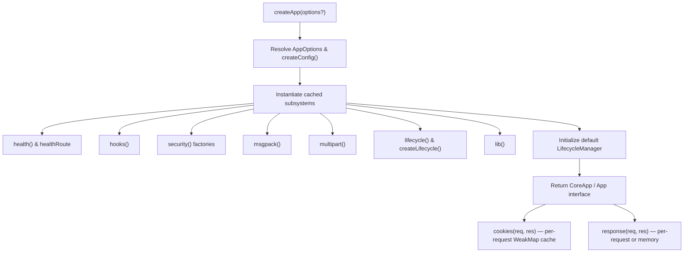
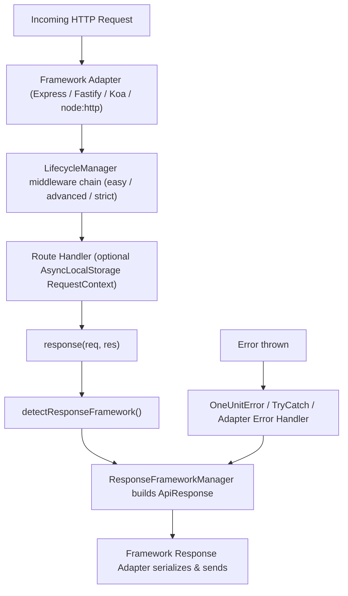

# Architectural Overview

`@oneunit/core` v1.0.0

---

## 1. High-Level Systemic Analysis

### 1.1 Purpose and Scope

`@oneunit/core` is a unified Developer Experience (DX) library for Node.js and TypeScript backend services. It consolidates cross-cutting infrastructure—configuration management, security middleware, cookie management, response envelopes, health checks, request-scoped context, lifecycle/plugin orchestration, multipart parsing, MessagePack serialization, system utilities, and structured errors—into a single package. Its core is framework-agnostic and integrates with **Express 5**, **Fastify 5**, **Koa 3**, and native **`node:http`** via framework-organized adapters.

### 1.2 Core Design Philosophy

| Principle | Description |
|---|---|
| **Unified Entry** | `createApp()` is the single factory entry point; capabilities are exposed through the returned `CoreApp` / `App` interface. |
| **Facade Pattern** | `createApp()` hides subsystem wiring behind cached API instances (`health()`, `hooks()`, `config()`, `security()`, `msgpack()`, `multipart()`, `lifecycle()`, `lib()`). |
| **Framework-Centric Adapters** | Framework-specific integration (Express, Fastify, Koa, Universal/`node:http`) lives under `src/adapters/<framework>/`, isolating framework detection, request/response binding, and error boundaries. |
| **Caching by Default** | Subsystem APIs are instantiated once per `createApp()` call and reused; request-scoped APIs (`cookies(req, res)` and `response(req, res)`) bind to the current request/response (with a `WeakMap` cache on `req` for cookies). |
| **Option Override** | Per-call options shallow-merge over application-level defaults (`{ ...global, ...perCall }`). |

### 1.3 System Boundaries

- **In scope:** Application bootstrap, middleware/plugin lifecycle, security middleware (CORS, CSRF, Helmet, compression, HTML sanitization, rate limiting), signed/encrypted cookies, standardized HTTP response envelopes, health checks (system, Docker, Kubernetes, DB/Redis/Kafka), `AsyncLocalStorage` request context, YAML/env/Zod configuration engine, MessagePack serialization, Busboy multipart parsing, and structured `OneUnitError` hierarchy.
- **Out of scope:** Database ORMs, authentication/identity providers beyond CSRF and signed/encrypted cookies, templating engines, CLI tooling, and distributed tracing backends.

---

## 2. Overall Design

### 2.1 Public API Surface and Subpath Exports

The package exposes a full barrel export at `@oneunit/core` (`src/index.ts`) and 6 targeted subpath exports in `package.json`:

| Subpath | Source Entry | Scope |
|---|---|---|
| `@oneunit/core` | `src/index.ts` | Re-exports all 13 subsystems and `createApp()` |
| `@oneunit/core/config` | `src/config/index.ts` | Generic config engine (`loadConfig`, `loadConfigSimple`, `loadConfigSync`, `runPipeline`, `zodValidator`, `parseInteger`, `parseBoolean`) + legacy `createConfig()` and env helpers |
| `@oneunit/core/context` | `src/context/index.ts` | `createRequestContext()` (`AsyncLocalStorage`) |
| `@oneunit/core/cookie` | `src/cookie/index.ts` | Cookie store, signing/encryption, and framework adapters |
| `@oneunit/core/health` | `src/health/index.ts` | Health registry, route builder, system/Docker/K8s/service providers |
| `@oneunit/core/security` | `src/security/index.ts` | CORS, CSRF, Helmet, compression, sanitizer, rate limiter |
| `@oneunit/core/errors` | `src/errors/index.ts` | `OneUnitError` base class and domain error classes |

### 2.2 Two-Layer App Factory (`src/core.ts` & `src/core/core.ts`)

1. **`src/core.ts` (`createApp(options?: AppOptions): App`)** — The underlying composition root that instantiates `createConfig()`, `createHealthRegistry()`, `createHealthRoute()`, `createHooks()`, `CookieStore` factories, `SecurityAPI`, `MultipartAPI`, `LifecycleManager` (plus `createLifecycle()`), `createMsgPack()`, `ResponseAPI`, and `LibAPI`.
2. **`src/core/core.ts` (`createApp(options?: AppOptions): CoreApp`)** — The simplified DX wrapper re-exported by `src/index.ts`. It initializes the default lifecycle (`app.lifecycle().initialize()`), exposes security and multipart factories directly on the returned `CoreApp` (`app.cors()`, `app.csrf()`, `app.helmet()`, `app.compression()`, `app.sanitize()`, `app.rateLimit()`, `app.multipart()`), and provides `app.use()` and `app.apply()`.

**`App` / `CoreApp` Member Scopes:**

| Member | Scope | Description |
|---|---|---|
| `health()` | Cached singleton | Health check registry, route mounting, system/Docker/K8s providers |
| `hooks()` | Cached singleton | Typed event emitter (`on`, `use`, `off`, `once`, `emit`, `emitSync`) |
| `config()` | Cached singleton | Service config (`port`, `host`, `serviceName`, `nodeEnv`, `get`, `set`, `toJSON`) |
| `cookies(req?, res?)` | Per-request (cached by `req` via `WeakMap`) | Cookie store with HMAC signing and encryption |
| `security()` / direct methods | Cached factory wrapper | CORS, CSRF, Helmet, compression, HTML sanitization, rate limiting |
| `msgpack()` | Cached singleton | MessagePack `encode`, `decode`, `encodeSync`, `decodeSync` |
| `multipart()` | Cached factory wrapper | Busboy-based multipart form and file parser |
| `lifecycle()` | Cached singleton | Middleware/plugin manager (`easy`, `advanced`, `strict` modes) |
| `createLifecycle(opts?)` | Factory (`App`) | Creates an independent `LifecycleManager` instance |
| `response(req?, res?)` | Per-request (or in-memory when omitted) | Standardized response envelope builder (`ok`, `created`, `badRequest`, etc.) |
| `lib()` | Cached singleton | `formatBytes`, `formatTime`, `timestamp`, `getSystemInfo`, `getSystemStatus` |
| `use(middleware)` | Method | Registers middleware onto the lifecycle chain |

### 2.3 Directory Structure

```text
src/
├── index.ts                  # Top-level barrel exports across all modules
├── core.ts                   # Composition root: createApp() -> App
├── core/                     # Simplified DX wrapper: createApp() -> CoreApp
├── adapters/                 # Framework integrations organized by framework
│   ├── express/              # Express 5 adapter (cookie, health, middleware, response, types)
│   ├── fastify/              # Fastify 5 plugin adapter (cookie, health, response, types)
│   ├── koa/                  # Koa 3 middleware adapter (cookie, health, response, types)
│   └── universal/            # Auto-detecting adapter (Express, Fastify, Koa, node:http)
├── config/                   # Configuration engine (YAML, envMapping, interpolation, Zod, freeze) + legacy createConfig
├── context/                  # AsyncLocalStorage-backed request context (createRequestContext)
├── cookie/                   # Cookie store, HMAC signing, encryption, framework detection
├── errors/                   # OneUnitError base class and category-specific error classes
├── health/                   # Health registry, route builder, system/Docker/K8s/service providers
├── hooks/                    # Event hooks registry and default hook name constants
├── lib/                      # Formatters, system info/status, Docker & Kubernetes health clients
├── lifecycle/                # LifecycleManager (easy/advanced/strict modes, conflict & header tracking)
├── msgpack/                  # MessagePack encoder/decoder wrapper (@msgpack/msgpack)
├── multipart/                # Busboy multipart parser and Express/Fastify/Koa/HTTP middlewares
├── response-mangement/       # ResponseManager, ResponseFrameworkManager, HTTP status helpers, try/catch wrappers
└── security/                 # CORS, CSRF, Helmet, compression, HTML sanitize, rate-limit middlewares
```

---

## 3. Subsystem Details & Component Interaction

### 3.1 Framework Adapters (`src/adapters/`)

Adapters are organized by target framework rather than by capability:

- **Express (`src/adapters/express/`)**: Attaches `app.locals.core`, `app.locals.oneunit`, `app.core`, `app.oneunit`, and `req.core`; optionally mounts the `/health` route (`autoRegisterHealthRoute = true`); and registers an outermost 4-argument Express error handler (`tryCatchEnabled = true`).
- **Fastify (`src/adapters/fastify/`)**: Implemented with `fastify-plugin`. Decorates `fastify.core` and `fastify.oneunit`, registers the health route, decorates `reply.respond`, and installs `fastify.setErrorHandler` for normalized error envelopes.
- **Koa (`src/adapters/koa/`)**: Attaches `app.context.core`, `app.context.oneunit`, `app.core`, `app.oneunit`; registers an outermost `async (ctx, next)` try/catch error middleware first (matching Koa's onion model); and mounts the `/health` middleware.
- **Universal (`src/adapters/universal/`)**: Inspects server shape in `detectFramework(server)` to distinguish Fastify (`register` + `decorateReply` + `addHook`), Koa (`context` + `use` + `callback`), Express (`use` + `get` + `locals` + `listen`), and `node:http` (`on`).

### 3.2 Configuration Management Engine (`src/config/`)

`@oneunit/core/config` provides two complementary layers:

1. **Generic Configuration Engine**:
   - **Loaders**: `loadConfig()` (defaults `configDir` to `src/config/yaml`), `loadConfigSimple()` (defaults `configDir` to `./config`), and `loadConfigSync()` (synchronous YAML-only loader; defaults `configDir` to `./config` and `env` to `"development"`).
   - **Pipeline (`runPipeline` / `runPipelineAsync`)**: Calls `buildResolvedConfig()` (`applyInterpolation` -> `buildEnvironmentOverrides` -> `resolveConfig`), validates once via `ConfigValidator` (`zodValidator`), and recursively freezes the output with `deepFreeze`.
   - **Interpolation & Mapping**: `${NAME}` and `${NAME:fallback}` always produce strings; typed environment variables use `envMapping` with `parseInteger` / `parseBoolean`. Prototype-sensitive keys (`__proto__`, `prototype`, `constructor`) are rejected in YAML parsing, resolver merging, and `envMapping` paths.
   - See [docs/config/ARCHITECTURE.md](docs/config/ARCHITECTURE.md) and [docs/config/quickstart.md](docs/config/quickstart.md) for full details.
2. **Legacy Service Config (`createConfig`)**: Used internally by `createApp().config()` and exported for backward compatibility alongside `envString`, `envNumber`, `envBool`, `envList`, `resolveNodeEnv`, `isDevelopment`, `isProduction`, `isTest`, `envFile`, and `loadEnv`.

### 3.3 Cookie Store (`src/cookie/`)

1. `cookies(req, res)` uses `createDetectedCookieStore()` (cached per `req` object via `WeakMap` inside `createApp()`), falling back to an in-memory store when `req`/`res` are omitted.
2. Framework detection inspects `req`/`res` to select the Express, Fastify, Koa, or `node:http` cookie adapter.
3. `setSigned()` and `setEncrypted()` use the shared `secret`; `getSigned()` and `getEncrypted()` verify signatures or decrypt values and throw typed `CookieSignatureError` / `CookieDecryptionError` on tampering or missing secrets.

### 3.4 Health Checks (`src/health/`)

1. `createHealthRegistry()` stores named check functions with an optional `critical` flag.
2. `checkAll()` runs registered checks and aggregates results (`healthy`, `degraded`, `unhealthy`).
3. Built-in providers cover system metrics (`createSystemHealthProvider`), Docker (`createDockerHealthProvider`), Kubernetes (`createKubernetesHealthProvider`), and service dependencies (`createDatabaseHealthProvider`, `createRedisHealthProvider`, `createKafkaHealthProvider`).
4. `createHealthRoute()` and framework health adapters (`expressHealth`, `fastifyHealth`, `koaHealth`) expose the HTTP endpoint (default `/health`, returning `200` for healthy/degraded and `503` for unhealthy).

### 3.5 Lifecycle & Hooks (`src/lifecycle/` & `src/hooks/`)

- **Lifecycle (`LifecycleManager`)**: Manages middleware and namespaced plugins across three modes (`easy`, `advanced`, `strict`). Enforces `executionTimeoutMs` (default `5000`), `maxMiddleware` (default `50`), `maxPlugins` (default `50`), `throwOnError` (`true` in `strict`, `false` otherwise), `allowedMiddlewareTypes`, and `autoRegisterEssential`. Detects middleware type conflicts and duplicate response header writes (`HeaderConflict`).
- **Hooks (`createHooks` / `createHooksWithDefaults`)**: Lightweight event emitter supporting `on`, `once`, `off`, `emit` (async), `emitSync`, and predefined hook sets (`DEFAULT_HOOKS`, `APPLICATION_HOOKS`, `LIFECYCLE_HOOKS`, `SERVER_HOOKS`, `CACHE_HOOKS`, `CONNECTION_HOOKS`).

### 3.6 Response Management (`src/response-mangement/`)

1. `response(req, res)` auto-detects Express, Fastify, Koa, or `node:http` via `detectResponseFramework()` (or uses a memory adapter when `req`/`res` are omitted).
2. `ResponseManager` and `ResponseFrameworkManager` build normalized `ApiResponse` envelopes (`ok`, `success`, `created`, `accepted`, `noContent`, `badRequest`, `unauthorized`, `forbidden`, `notFound`, `conflict`, `unprocessable`, `internalServerError`, `respond`), enforcing bodyless HTTP statuses (`204`, `304`, etc.).
3. `withTryCatch`, `createTryCatchMiddleware`, and `withTryCatchConditional` wrap route handlers to normalize thrown errors.

### 3.7 Security, Multipart, Context, MsgPack, and Lib

- **Security (`src/security/`)**: Wraps `cors`, `csrf-csrf`, `helmet`, `compression`, `sanitize-html`, and `rate-limiter-flexible` behind consistent middleware/sanitizer factories (`createCors`, `createCsrf`, `createHelmet`, `createCompression`, `createSanitizer`, `createRateLimit`).
- **Multipart (`src/multipart/`)**: Built on `busboy`; exports `createMultipart`, `parseMultipart`, and framework middlewares (`expressMultipartMiddleware`, `fastifyMultipartMiddleware`, `koaMultipartMiddleware`, `httpMultipartMiddleware`) enforcing file size, file count, field count, MIME type allowlists, and parse timeouts.
- **Request Context (`src/context/`)**: `createRequestContext()` owns a Node.js `AsyncLocalStorage` instance; each `run()` call creates an isolated `Map` store so concurrent async operations never leak state, with optional `autoTimestamp`.
- **MsgPack (`src/msgpack/`)**: `createMsgPack()` wraps `@msgpack/msgpack` for binary `encode`/`decode` and `encodeSync`/`decodeSync`.
- **Lib (`src/lib/`)**: `formatBytes`, `formatTime`, `timestamp`, `getSystemInfo`, `getSystemStatus`, `pingDocker`, `listDockerContainers`, `pingKubernetes`, `listK8sPods`.

---

## 4. Data Flow Diagrams

### 4.1 Application Initialization Flow (`createApp`)



### 4.2 Request Processing & Response Flow



---

## 5. Technology Stack Specification

### 5.1 Language and Runtime

| Attribute | Value |
|---|---|
| Language | TypeScript (`^6.0.3`) |
| Compiler Settings | `strict: true`, `target: ES2022`, `module: NodeNext`, `moduleResolution: NodeNext`, `verbatimModuleSyntax: true`, `isolatedModules: true`, `declaration: true`, `declarationMap: true`, `sourceMap: true` |
| Runtime | Node.js `>= 18.0.0` |
| Module System | ES Modules (`"type": "module"`) |

### 5.2 Runtime Dependencies (`package.json`)

| Dependency | Purpose |
|---|---|
| `zod` (`^4.6.7`) | Schema validation and type inference |
| `@asteasolutions/zod-to-openapi` (`^9.1.0`) | OpenAPI schema generation from Zod schemas |
| `@msgpack/msgpack` (`^3.1.3`) | MessagePack binary serialization |
| `busboy` (`^1.6.0`) | Streaming `multipart/form-data` parsing |
| `cookie` (`^2.0.2`) | Cookie parsing and serialization |
| `cors` (`^2.8.6`) | Cross-Origin Resource Sharing middleware |
| `csrf-csrf` (`^4.1.0`) | Double-submit CSRF protection |
| `helmet` (`^8.3.0`) | Security HTTP headers |
| `compression` (`^1.8.2`) | Response compression |
| `rate-limiter-flexible` (`^11.4.1`) | Rate limiting |
| `sanitize-html` (`^2.18.2`) | HTML sanitization |
| `prom-client` (`^15.1.3`) | Prometheus metrics support |
| `swagger-ui-dist` (`^5.34.1`) | Swagger UI static assets |
| `dotenv` (`^18.0.10`) | `.env` file loading |
| `yaml` (`^2.9.1`) | YAML configuration parsing |

### 5.3 Optional & Development Dependencies

- **Optional framework dependencies**: `express` (`^5.3.0`), `fastify` (`^5.12.8`), `koa` (`^3.3.0`).
- **Development dependencies**: `vitest` (`^5.1.0`) with **78** test files under `test/`, `typescript` (`^6.0.3`), `tsx` (`^4.23.15`), `eslint` (`^10.14.0`), `@typescript-eslint/parser`, `@typescript-eslint/eslint-plugin`.

---

## 6. Configuration Model (`AppOptions`)

In `src/core.ts`, `createApp(options?: AppOptions)` accepts:

```ts
export interface AppOptions {
    serviceName?: string;        // default: "app"
    port?: number;               // default: 3000
    host?: string;               // default: "localhost"
    nodeEnv?: string;
    secret?: string;
    framework?: "express" | "fastify" | "koa" | "http";

    security?: {
        cors?: CorsOptions;
        csrf?: CsrfOptions;
        helmet?: HelmetOptions;
        compression?: CompressionOptions;
        sanitize?: SanitizeOptions;
    };
    cookie?: CookieConfig;
    multipart?: MultipartOptions;
    health?: {
        path?: string;           // default: "/health"
    };
    lifecycle?: LifecycleOptions;
}
```

Per-call options passed to `app.security().cors(opts)` (or `app.cors(opts)` on `CoreApp`), `csrf(opts)`, `helmet(opts)`, `compression(opts)`, `sanitize(opts)`, and `multipart(opts)` shallow-merge over the global `AppOptions` defaults. `secret` is shared with `cookie` and `csrf` when not overridden per call.

---

## 7. Error Model (`src/errors/`)

### 7.1 `OneUnitError` Base Class

All domain errors extend `OneUnitError` (`src/errors/base.ts`):

```ts
export type ErrorSeverity = "warning" | "error" | "critical";

export class OneUnitError extends Error {
    readonly category: ErrorCategory;
    readonly code: string;
    readonly details?: Record<string, unknown>;
    readonly timestamp: string;
    readonly severity: ErrorSeverity; // "critical" when options.cause is provided, else "error"

    toJSON(): ErrorInfo & { message: string; stack?: string };
}
```

### 7.2 Error Categories (`ErrorCategory`)

| Category | Domain |
|---|---|
| `response` | Response status validation, already-sent responses, bodyless status violations |
| `cookie` | Missing secret, invalid cookie names, `__Secure-` / `SameSite=None` rules, signature/decryption failures |
| `lifecycle` | Uninitialized lifecycle, middleware/plugin limits, disallowed types, timeouts, conflicts, header conflicts |
| `multipart` | Disabled multipart, file size/count/field limits, invalid MIME types, parse timeouts |
| `hooks` | Hook registration restrictions (`HookNotAllowedError`) |
| `lib` | Invalid bytes, negative bytes/time, invalid dates |
| `core` | App factory and response req/res requirement errors |
| `security` | CORS, CSRF, Helmet, compression, sanitization, rate limiting |
| `health` | Health check execution, aggregation, and route registration |
| `config` | `ConfigSourceError`, `ConfigInterpolationError`, `ConfigValidationError` |
| `msgpack` | MessagePack encoding/decoding failures |

---

## 8. Summary

`@oneunit/core` v1.0.0 delivers a cohesive, strict-TypeScript backend core for Node.js `>= 18.0.0`:

- **Unified facade** via `createApp()` with cached subsystem APIs and per-request `cookies()` / `response()`.
- **Framework-organized adapters** for Express 5, Fastify 5, Koa 3, and `node:http` under `src/adapters/`.
- **7 subpath exports** allowing targeted imports (`@oneunit/core/config`, `/context`, `/cookie`, `/health`, `/security`, `/errors`).
- **Structured error handling** via `OneUnitError` across 11 domain categories.
- **Graduated lifecycle safety** (`easy`, `advanced`, `strict`) with conflict and header-collision detection.
