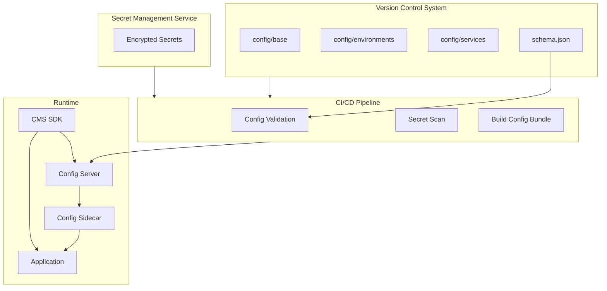
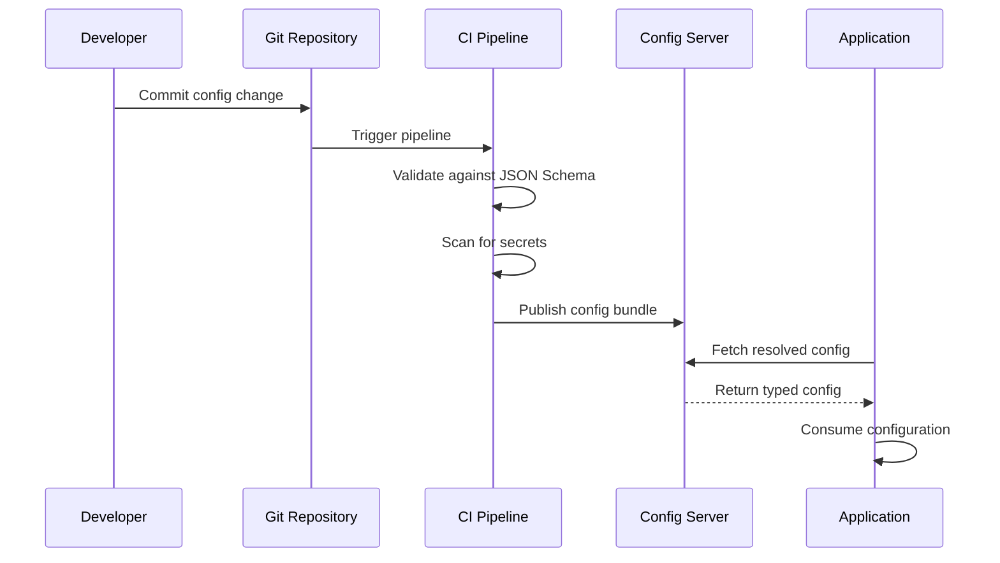
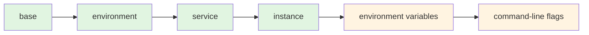
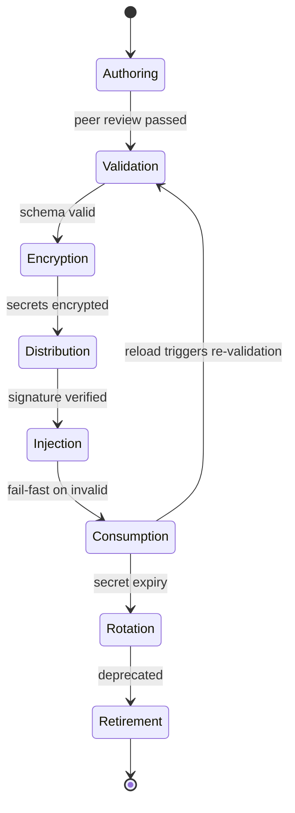

# Configuration Management Architecture

## 1. Core Definition and Problem Statement

### 1.1 Fundamental Principles

This architecture defines a **Configuration Management System (CMS)** built on six core principles:

| Principle | Description |
|-----------|-------------|
| **Declarative Configuration** | Configuration describes the desired state, not the procedure to reach it. Applications declare what they need; the system resolves how to provide it. |
| **Immutability** | Configuration artifacts are versioned and never mutated in place. Changes produce new versions; old versions remain accessible for rollback. |
| **Separation of Concerns** | Configuration logic is decoupled from business logic. The application consumes resolved configuration; the CMS handles loading, validation, decryption, and distribution. |
| **Environment Parity** | Identical configuration schemas and merge rules apply across development, staging, and production. Only values differ, not structure. |
| **Single Source of Truth** | One canonical configuration repository governs all environments. Derived artifacts (environment files, secrets stores) are generated, not hand-edited. |
| **Fail-Fast Validation** | Invalid configuration is rejected at load time and CI/CD gates before reaching runtime, preventing cascading failures. |

### 1.2 Technical Challenges Mitigated

| Challenge | Impact | Mitigation |
|-----------|--------|------------|
| Configuration drift | Services in the same environment behave differently due to diverged config | Single source of truth with schema enforcement and drift detection |
| Secret leakage | Credentials committed to VCS or logged in plaintext | Encrypted secret layer, no secrets in VCS, runtime secret injection |
| Environment inconsistency | Staging passes, production fails due to config mismatch | Environment parity and identical validation gates across environments |
| Runtime validation failures | Malformed config crashes applications after deployment | JSON Schema validation at load time and CI/CD pre-deployment gates |
| Lack of auditability | Cannot determine who changed a config value or when | Versioned config with change logs, diff tracking, and signed commits |
| Cascading failures from bad config | One bad config value takes down multiple services | Modular config with blast-radius isolation, circuit breakers on reload failure |

### 1.3 Formal Problem Statement

Given a set of services $S = \{s_1, s_2, ..., s_n\}$ deployed across environments $E = \{dev, staging, prod\}$, each requiring configuration $C_{s,e}$, the Configuration Management System must guarantee:

1. **Consistency**: $\forall s \in S, \forall e \in E$: $C_{s,e}$ is derived from a single canonical source with environment-specific overlays only.
2. **Correctness**: $\forall C_{s,e}$: validation against JSON Schema $\Sigma_s$ passes before injection.
3. **Confidentiality**: No plaintext secret $k \in C_{s,e}$ is stored in version control.
4. **Recoverability**: $\forall$ version $v$ of $C_{s,e}$, rollback to $v-1$ is possible in bounded time.
5. **Observability**: Every change to $C_{s,e}$ is attributable to an actor, timestamp, and rationale.

## 2. Target Use Cases

### 2.1 Operational Environments

| Environment | Configuration Pattern | CMS Integration |
|-------------|----------------------|-----------------|
| Microservices | Per-service config with shared base | Sidecar or SDK loading per service |
| Serverless | Environment-variable injection | Remote config server at cold start |
| Monoliths | Single aggregated config file | File-based loading at startup |
| Edge deployments | Read-only config baked into image | File-based, immutable config maps |
| Hybrid cloud | Multi-region config with regional overrides | Hierarchical inheritance with region layer |

### 2.2 Deployment Scales

| Scale | Service Count | Config Complexity | Recommended Pattern |
|-------|--------------|-------------------|---------------------|
| Startup | 1-5 services | Low | Single repo, file-based, env var injection |
| Growth | 10-50 services | Medium | Modular config, remote config server, SDK |
| Enterprise | 100+ services, multi-region | High | Hierarchical inheritance, sidecar model, automated drift detection |

### 2.3 Architectural Patterns

- **12-factor apps**: Configuration stored in environment variables; CMS provides env var mapping and injection.
- **Domain-Driven Design**: Bounded contexts own their configuration subtrees; config boundaries align with domain boundaries.
- **Hexagonal Architecture**: Configuration port abstracts the source; adapters implement file, env, remote, and API loading.
- **Event-driven**: Config change events trigger reloads in consuming services via sidecar or SDK.
- **Service mesh**: Sidecar proxies consume config for routing, retries, and circuit breaker tuning.

### 2.4 Maximum Utility Scenarios

- Onboarding a new service with standardized config scaffolding
- Rolling out a feature flag across dozens of services atomically
- Rotating database credentials without service restart
- Auditing a production incident to identify the config change that caused it
- Recovering from a bad config deploy by rolling back to the previous version

## 3. Technical Implementation Framework

### 3.1 File Structure

```
config/
├── base/                         # Environment-agnostic defaults
│   ├── app.yaml
│   ├── server.yaml
│   ├── database.yaml
│   └── schema.json               # JSON Schema for base config
├── environments/                 # Environment-specific overlays
│   ├── development/
│   │   └── overlay.yaml
│   ├── staging/
│   │   └── overlay.yaml
│   └── production/
│       └── overlay.yaml
├── services/                     # Per-service configuration
│   ├── auth-service/
│   │   ├── config.yaml
│   │   └── schema.json
│   └── payment-service/
│       ├── config.yaml
│       └── schema.json
├── secrets/                      # Encrypted secrets (not in VCS)
│   ├── development/
│   │   └── secrets.enc.yaml
│   └── production/
│       └── secrets.enc.yaml
├── local/                        # Developer-local overrides (gitignored)
│   └── local.yaml
├── includes/                     # Reusable config fragments
│   └── database-cluster.yaml
└── migrations/                   # Config schema migrations
    └── v1_to_v2/
```

### 3.2 Integration Protocols

| Protocol | Description | Use Case |
|----------|-------------|----------|
| File-based loading | Read YAML files from disk at startup | Monoliths, edge, local dev |
| Environment variable injection | Flatten config to env vars before process start | 12-factor apps, serverless |
| Remote config server | HTTP/gRPC endpoint serving resolved config | Microservices, dynamic reload |
| API-based retrieval | On-demand config fetch via REST/GraphQL | Serverless cold starts, edge |
| SDK integration | Language-native client with caching and reload | Application code consumption |
| Middleware pattern | Framework middleware injects config into request context | Web frameworks |
| Sidecar model | Separate process serves config to local applications | Service mesh, polyglot environments |

### 3.3 Lifecycle of Configuration Data

| Phase | Responsibility | Artifacts | Gates |
|-------|---------------|-----------|-------|
| Authoring | Developers / platform team | YAML files, schema.json | Peer review, schema lint |
| Validation | CI pipeline | Validation report | JSON Schema validation, secret scan |
| Encryption | Secret management service | Encrypted secret blob | KMS key access, least privilege |
| Distribution | Config server / CD pipeline | Versioned config bundle | Signature verification, environment parity check |
| Injection | Runtime loader / sidecar | Resolved config object | Fail-fast on invalid config |
| Consumption | Application code | Typed config access | Schema-validated accessors |
| Rotation | Secret management service | New secret version | Zero-downtime reload, old version retention |
| Retirement | Platform team | Deprecation notice | Graceful period, consumer notification |

## 4. Architectural Rationale

### 4.1 Data Format Comparison

| Format | Human Readability | Comments | Schema Support | Tooling | Nesting | Best For |
|--------|-------------------|----------|----------------|---------|---------|----------|
| YAML | High | Yes | JSON Schema (via JSON) | Excellent | Deep | General config, this architecture |
| JSON | Medium | No | Native JSON Schema | Excellent | Deep | APIs, machine-generated config |
| TOML | High | Yes | Limited (custom) | Good | Moderate | Simple app config, Rust/Go projects |

**Recommendation: YAML with JSON schema.** YAML offers the best balance of human readability, comment support, and nesting depth for operational configuration. JSON Schema provides industry-standard validation with broad tooling support. JSON is used for machine-generated portions and the schema document itself. TOML is considered but rejected due to weaker ecosystem tooling for schema validation and limited nesting expressiveness.

### 4.2 Structural Hierarchy Justification

Configuration resolution follows a strict precedence hierarchy:

**base → environment → service → instance → override**

- **base**: Defaults applicable to all environments and services (timeouts, retry policies, log format).
- **environment**: Values that differ by deployment target (database host, feature flags, log level).
- **service**: Service-specific values (port, database name, cache TTL).
- **instance**: Per-instance values (pod ID, availability zone, instance index).
- **override**: Runtime overrides (environment variables, command-line flags, remote config updates).

Each layer deep-merges into the next, with higher layers winning on key conflicts. Arrays are replaced, not merged, to avoid ambiguity.

## 5. Scalability, Extensibility, and Versioning

### 5.1 Managing Configuration Complexity

- **Modular config**: Split monolithic config into domain-specific files (app, server, database, cache, security, features, logging, integrations, resources).
- **Includes**: YAML anchors/aliases and explicit `!include` directives for reusable fragments.
- **References**: Cross-references within config using `${ref:path}` syntax resolved at load time.

### 5.2 Hierarchical Inheritance

Merge precedence (lowest to highest):

1. base defaults
2. environment overlay
3. service config
4. instance overlay
5. environment variables (prefixed `CFG_`)
6. command-line flags

Deep merge semantics: objects merge recursively; scalars and arrays from higher layers replace lower layers entirely.

### 5.3 Schema Evolution

- **Semantic versioning for config schemas**: `apiVersion: config.v1`; breaking changes increment major version.
- **Backward compatibility**: New fields optional; removed fields deprecated for one major version before removal.
- **Forward compatibility**: Unknown fields preserved but ignored (strict mode optional).
- **Migration paths**: Versioned migration scripts in `config/migrations/` transform config between schema versions.

### 5.4 Multi-Region and Multi-Tenant Considerations

- **Multi-region**: Regional overlay layer between environment and service; region-specific endpoints, timeouts, and compliance settings.
- **Multi-tenant**: Tenant ID namespacing in config keys; tenant-specific overlays loaded dynamically; isolation enforced at the config server layer.

## 6. Operational Best Practices

### 6.1 Configuration Validation

- Schema validation at load time using JSON Schema draft-07.
- CI/CD gate: `config-validate` step blocks deploy on schema violation or secret detection.
- Strict mode: unknown fields rejected in production.
- Type coercion validated (e.g., port must be integer, not string).

### 6.2 Security Hardening

- **No secrets in VCS**: `config/secrets/` is gitignored; secrets stored in encrypted secret management service.
- **Encryption at rest**: Secret files encrypted with KMS-managed keys.
- **Encryption in transit**: Config server served over TLS; SDK connections use mTLS.
- **Least privilege**: Service accounts read only their own config subtree.
- **Secret injection**: Secrets injected at runtime via env vars or mounted volumes, never written to disk by the application.

### 6.3 Auditing

- Change logs: every config commit records who, what, when, and why (via commit message template).
- Diff tracking: config diffs generated between versions; reviewed in pull requests.
- Rollback procedures: `config-rollback <service> <version>` restores previous version; zero-downtime where possible.
- Access logs: config server logs all reads with actor, timestamp, and config path.

### 6.4 Long-Term Maintenance

- **Deprecation policies**: Deprecated config fields announced one major version in advance; removal after two major versions.
- **Config hygiene**: Quarterly review of unused fields; automated detection of dead config.
- **Automated drift detection**: Periodic comparison of live config against canonical source; alerts on divergence.

---

## Required Artifact: Formal Schema and File Template

### 6.5 Configuration File Template (YAML)

```yaml
# Configuration schema version
apiVersion: config.v1
kind: Configuration
metadata:
  name: payment-service
  namespace: payments
  environment: production
  version: "1.2.0"
  labels:
    team: platform
    tier: backend
    managed-by: config-management-system
  annotations:
    description: "Payment service runtime configuration"
    owner: platform-team@example.com
    last-validated: "2026-11-19T14:20:00Z"
spec:
  # Application settings
  app:
    name: payment-service
    version: "1.2.0"
    instance-id: null
    timezone: UTC
    graceful-shutdown-timeout: 30s

  # Server settings
  server:
    host: "0.0.0.0"
    port: 8080
    read-timeout: 10s
    write-timeout: 10s
    idle-timeout: 120s
    max-connections: 1000
    tls:
      enabled: true
      min-version: "1.2"
      cert-path: /etc/tls/cert.pem
      key-path: /etc/tls/key.pem

  # Database settings
  database:
    primary:
      host: db-primary.payments.svc.cluster.local
      port: 5432
      name: payments
      username: payments_app
      password: ${SECRET:DB_PASSWORD}
      pool:
        max-open: 25
        max-idle: 5
        max-lifetime: 1h
        conn-max-idle-time: 5m
      ssl-mode: require
    read-replicas:
      - host: db-replica-1.payments.svc.cluster.local
        port: 5432
        weight: 2
      - host: db-replica-2.payments.svc.cluster.local
        port: 5432
        weight: 1

  # Cache settings
  cache:
    provider: redis
    host: cache.payments.svc.cluster.local
    port: 6379
    password: ${SECRET:REDIS_PASSWORD}
    db: 0
    ttl: 5m
    max-connections: 50

  # Security settings
  security:
    authentication:
      enabled: true
      provider: oidc
      issuer-url: https://auth.example.com
      jwks-url: https://auth.example.com/.well-known/jwks.json
    authorization:
      enabled: true
      mode: rbac
    encryption:
      algorithm: AES-256-GCM
      key-rotation-period: 90d
    allowed-origins:
      - https://app.example.com
      - https://admin.example.com

  # Feature flags
  features:
    new-payment-flow: true
    legacy-endpoints: false
    experimental-retries: false
    rollout-percentage: 50

  # Logging
  logging:
    level: info
    format: json
    output: stdout
    fields:
      - service
      - environment
      - trace-id
    sampling:
      enabled: true
      rate: 0.1

  # External service integrations
  integrations:
    stripe:
      api-key: ${SECRET:STRIPE_API_KEY}
      api-version: "2026-11-01"
      webhook-secret: ${SECRET:STRIPE_WEBHOOK_SECRET}
      timeout: 15s
      retries: 3
    fraud-detection:
      endpoint: https://fraud.example.com/v1/score
      api-key: ${SECRET:FRAUD_API_KEY}
      timeout: 5s
      circuit-breaker:
        enabled: true
        failure-threshold: 5
        recovery-timeout: 30s

  # Resource limits
  resources:
    cpu:
      request: 250m
      limit: 1000m
    memory:
      request: 256Mi
      limit: 512Mi
    ephemeral-storage:
      request: 1Gi
      limit: 5Gi
```

### 6.6 JSON Schema for Validation

```json
{
  "$schema": "http://json-schema.org/draft-07/schema#",
  "$id": "config.v1.schema.json",
  "title": "Configuration Schema v1",
  "type": "object",
  "required": ["apiVersion", "kind", "metadata", "spec"],
  "properties": {
    "apiVersion": {
      "type": "string",
      "enum": ["config.v1"]
    },
    "kind": {
      "type": "string",
      "enum": ["Configuration"]
    },
    "metadata": {
      "type": "object",
      "required": ["name", "namespace", "environment", "version"],
      "properties": {
        "name": { "type": "string", "minLength": 1 },
        "namespace": { "type": "string", "minLength": 1 },
        "environment": { "type": "string", "enum": ["development", "staging", "production"] },
        "version": { "type": "string", "pattern": "^\\d+\\.\\d+\\.\\d+$" },
        "labels": { "type": "object", "additionalProperties": { "type": "string" } },
        "annotations": { "type": "object", "additionalProperties": { "type": "string" } }
      }
    },
    "spec": {
      "type": "object",
      "required": ["app", "server", "database", "cache", "security", "features", "logging", "integrations", "resources"],
      "properties": {
        "app": {
          "type": "object",
          "required": ["name", "version"],
          "properties": {
            "name": { "type": "string" },
            "version": { "type": "string" },
            "instance-id": { "type": ["string", "null"] },
            "timezone": { "type": "string", "pattern": "^[A-Za-z_]+/[A-Za-z_]+$" },
            "graceful-shutdown-timeout": { "type": "string", "pattern": "^\\d+s$" }
          }
        },
        "server": {
          "type": "object",
          "required": ["host", "port"],
          "properties": {
            "host": { "type": "string" },
            "port": { "type": "integer", "minimum": 1, "maximum": 65535 },
            "read-timeout": { "type": "string", "pattern": "^\\d+s$" },
            "write-timeout": { "type": "string", "pattern": "^\\d+s$" },
            "idle-timeout": { "type": "string", "pattern": "^\\d+s$" },
            "max-connections": { "type": "integer", "minimum": 1 },
            "tls": {
              "type": "object",
              "properties": {
                "enabled": { "type": "boolean" },
                "min-version": { "type": "string", "enum": ["1.2", "1.3"] },
                "cert-path": { "type": "string" },
                "key-path": { "type": "string" }
              }
            }
          }
        },
        "database": {
          "type": "object",
          "required": ["primary"],
          "properties": {
            "primary": {
              "type": "object",
              "required": ["host", "port", "name", "username"],
              "properties": {
                "host": { "type": "string" },
                "port": { "type": "integer", "minimum": 1, "maximum": 65535 },
                "name": { "type": "string" },
                "username": { "type": "string" },
                "password": { "type": "string" },
                "ssl-mode": { "type": "string", "enum": ["disable", "require", "verify-ca", "verify-full"] },
                "pool": {
                  "type": "object",
                  "properties": {
                    "max-open": { "type": "integer", "minimum": 1 },
                    "max-idle": { "type": "integer", "minimum": 0 },
                    "max-lifetime": { "type": "string", "pattern": "^\\d+[hms]$" },
                    "conn-max-idle-time": { "type": "string", "pattern": "^\\d+[hms]$" }
                  }
                }
              }
            },
            "read-replicas": {
              "type": "array",
              "items": {
                "type": "object",
                "required": ["host", "port"],
                "properties": {
                  "host": { "type": "string" },
                  "port": { "type": "integer" },
                  "weight": { "type": "integer", "minimum": 1 }
                }
              }
            }
          }
        },
        "cache": {
          "type": "object",
          "required": ["provider", "host", "port"],
          "properties": {
            "provider": { "type": "string", "enum": ["redis", "memcached", "none"] },
            "host": { "type": "string" },
            "port": { "type": "integer" },
            "password": { "type": "string" },
            "db": { "type": "integer", "minimum": 0 },
            "ttl": { "type": "string", "pattern": "^\\d+[hms]$" },
            "max-connections": { "type": "integer", "minimum": 1 }
          }
        },
        "security": {
          "type": "object",
          "properties": {
            "authentication": {
              "type": "object",
              "properties": {
                "enabled": { "type": "boolean" },
                "provider": { "type": "string" },
                "issuer-url": { "type": "string", "format": "uri" },
                "jwks-url": { "type": "string", "format": "uri" }
              }
            },
            "authorization": {
              "type": "object",
              "properties": {
                "enabled": { "type": "boolean" },
                "mode": { "type": "string", "enum": ["rbac", "abac", "none"] }
              }
            },
            "encryption": {
              "type": "object",
              "properties": {
                "algorithm": { "type": "string" },
                "key-rotation-period": { "type": "string", "pattern": "^\\d+d$" }
              }
            },
            "allowed-origins": { "type": "array", "items": { "type": "string" } }
          }
        },
        "features": {
          "type": "object",
          "additionalProperties": { "type": ["boolean", "integer"] },
          "required": ["new-payment-flow"],
          "properties": {
            "new-payment-flow": { "type": "boolean" },
            "rollout-percentage": { "type": "integer", "minimum": 0, "maximum": 100 }
          }
        },
        "logging": {
          "type": "object",
          "properties": {
            "level": { "type": "string", "enum": ["debug", "info", "warn", "error"] },
            "format": { "type": "string", "enum": ["json", "text"] },
            "output": { "type": "string", "enum": ["stdout", "stderr", "file"] },
            "fields": { "type": "array", "items": { "type": "string" } }
          }
        },
        "integrations": {
          "type": "object",
          "additionalProperties": true
        },
        "resources": {
          "type": "object",
          "properties": {
            "cpu": {
              "type": "object",
              "properties": {
                "request": { "type": "string" },
                "limit": { "type": "string" }
              }
            },
            "memory": {
              "type": "object",
              "properties": {
                "request": { "type": "string" },
                "limit": { "type": "string" }
              }
            },
            "ephemeral-storage": {
              "type": "object",
              "properties": {
                "request": { "type": "string" },
                "limit": { "type": "string" }
              }
            }
          }
        }
      }
    }
  },
  "additionalProperties": false
}
```

### 6.7 TOML Equivalent (Optional)

```toml
apiVersion = "config.v1"
kind = "Configuration"

[metadata]
name = "payment-service"
namespace = "payments"
environment = "production"
version = "1.2.0"

[metadata.labels]
team = "platform"

[spec.app]
name = "payment-service"
version = "1.2.0"
timezone = "UTC"
graceful-shutdown-timeout = "30s"

[spec.server]
host = "0.0.0.0"
port = 8080
read-timeout = "10s"
max-connections = 1000

[spec.database.primary]
host = "db-primary.payments.svc.cluster.local"
port = 5432
name = "payments"
username = "payments_app"
password = "${SECRET:DB_PASSWORD}"

[spec.cache]
provider = "redis"
host = "cache.payments.svc.cluster.local"
port = 6379
ttl = "5m"
```

### 6.8 Environment Variable Mapping Table

| Config Path | Environment Variable | Prefix |
|-------------|---------------------|--------|
| spec.server.port | CFG_SERVER_PORT | CFG_ |
| spec.database.primary.host | CFG_DATABASE_PRIMARY_HOST | CFG_ |
| spec.database.primary.password | CFG_DATABASE_PRIMARY_PASSWORD | CFG_ |
| spec.cache.host | CFG_CACHE_HOST | CFG_ |
| spec.logging.level | CFG_LOGGING_LEVEL | CFG_ |
| spec.features.new-payment-flow | CFG_FEATURES_NEW_PAYMENT_FLOW | CFG_ |
| spec.integrations.stripe.api-key | CFG_INTEGRATIONS_STRIPE_API_KEY | CFG_ |

Mapping rules: dots become underscores, all uppercase, nested paths joined with `_`. Secret references (`${SECRET:...}`) are resolved from the secret store, not environment variables.

### 6.9 Precedence Rules for Merge Order

| Order | Layer | Source | Overrides |
|-------|-------|--------|-----------|
| 1 | base | `config/base/*.yaml` | — |
| 2 | environment | `config/environments/<env>/overlay.yaml` | base |
| 3 | service | `config/services/<svc>/config.yaml` | environment |
| 4 | instance | `config/instances/<instance>/overlay.yaml` | service |
| 5 | environment variables | `CFG_*` prefixed vars | instance |
| 6 | command-line flags | `--cfg-*` flags | environment variables |

---

## Code Examples

### Loading Configuration (TypeScript)

```typescript
import { ConfigLoader } from '@cms/sdk';
import { validate } from '@cms/validator';

const loader = new ConfigLoader({
  service: 'payment-service',
  environment: 'production',
  basePath: '/config',
  secretResolver: (ref: string) => secretStore.get(ref),
});

const raw = await loader.load(); // merges base → env → service → instance → env vars
const config = validate(raw, schema); // throws on schema violation
console.log(config.spec.server.port);
```

### Validating Configuration (CLI)

```bash
# Validate a single config file
cms validate config/services/payment-service/config.yaml \
  --schema config/services/payment-service/schema.json \
  --environment production

# Validate all configs in CI (fails fast on error)
cms validate --all --strict --ci
```

### Accessing Config in Application Code

```go
type Config struct {
    Server struct {
        Port int `cfg:"server.port"`
    }
    Database struct {
        Host string `cfg:"database.primary.host"`
    }
}

var cfg Config
cms.Unmarshal(&cfg) // populates from resolved config, validates types
```

---

## Mermaid Diagrams

### Architecture Overview



### Config Data Flow



### Merge Precedence



### Lifecycle



---

## Decision Register

| ADR ID | Title | Decision | Status | Rationale |
|--------|-------|----------|--------|-----------|
| ADR-001 | Configuration data format | YAML with JSON Schema validation | Accepted | Best human readability, comment support, nesting depth; JSON Schema is industry-standard with broad tooling |
| ADR-002 | Secret storage | Encrypted secret management service; no secrets in VCS | Accepted | Prevents secret leakage; enables rotation and audit |
| ADR-003 | Merge strategy | Deep merge with array replacement; precedence base → env → service → instance → env vars → flags | Accepted | Predictable, unambiguous precedence; arrays replaced to avoid merge ambiguity |
| ADR-004 | Schema versioning | Semantic versioning via `apiVersion: config.v1` | Accepted | Enables backward/forward compatibility and migration paths |
| ADR-005 | Validation timing | Load-time validation + CI/CD gates | Accepted | Fail-fast prevents bad config from reaching runtime |
| ADR-006 | Runtime consumption model | SDK with optional sidecar | Accepted | SDK for simplicity; sidecar for polyglot/service-mesh environments |
