# Adapters — Architecture Specification

@oneunit/core v1.0.0

## Component Overview

**Purpose:** Provide framework-agnostic I/O abstractions (cookie, response, middleware, health) that adapt framework-specific APIs behind unified interfaces, managed through a centralized lifecycle registry.

**Scope:** The Adapters feature covers four adapter categories (Cookie, Response, Middleware, Health), each with an abstract base class and framework-specific implementations for Express, Fastify, Koa, and Node.js native HTTP.

**Responsibilities:**
- Register, lookup, initialize, and dispose adapters via `AdapterRegistry`.
- Normalize framework-specific I/O (cookies, responses, middleware, health checks) behind common interfaces.
- Manage adapter lifecycle (initialize/dispose) across all registered adapters.
- Provide typed error handling for adapter lifecycle failures.

---

## Source File Map

| File path | Responsibility | Key exports |
|-----------|----------------|-------------|
| `src/adapters/index.ts` | Barrel exports for the Adapters feature | All public adapter types and classes |
| `src/adapters/types.ts` | Core type definitions for all adapters | `Adapter`, `AdapterOptions`, `AdapterResult`, `InitializeResult`, `DisposeResult` |
| `src/adapters/registry.ts` | Central registry managing adapter registration and lifecycle | `AdapterRegistry` |
| `src/adapters/errors.ts` | Error classes for adapter operations | `AdapterError`, `AdapterNotFoundError`, `AdapterAlreadyRegisteredError`, `AdapterNotInitializedError` |
| `src/adapters/cookie/base.ts` | Abstract base for cookie adapters | `BaseCookieAdapter` |
| `src/adapters/cookie/express.ts` | Express framework cookie adapter | `ExpressCookieAdapter` |
| `src/adapters/cookie/fastify.ts` | Fastify framework cookie adapter | `FastifyCookieAdapter` |
| `src/adapters/cookie/koa.ts` | Koa framework cookie adapter | `KoaCookieAdapter` |
| `src/adapters/cookie/http.ts` | Node.js native HTTP cookie adapter | `HttpCookieAdapter` |
| `src/adapters/response/base.ts` | Abstract base for response adapters | `BaseResponseAdapter` |
| `src/adapters/response/express.ts` | Express framework response adapter | `ExpressResponseAdapter` |
| `src/adapters/response/fastify.ts` | Fastify framework response adapter | `FastifyResponseAdapter` |
| `src/adapters/response/koa.ts` | Koa framework response adapter | `KoaResponseAdapter` |
| `src/adapters/response/http.ts` | Node.js native HTTP response adapter | `HttpResponseAdapter` |
| `src/adapters/middleware/base.ts` | Abstract base for middleware adapters | `BaseMiddlewareAdapter` |
| `src/adapters/middleware/express.ts` | Express framework middleware adapter | `ExpressMiddlewareAdapter` |
| `src/adapters/middleware/fastify.ts` | Fastify framework middleware adapter | `FastifyMiddlewareAdapter` |
| `src/adapters/middleware/koa.ts` | Koa framework middleware adapter | `KoaMiddlewareAdapter` |
| `src/adapters/middleware/http.ts` | Node.js native HTTP middleware adapter | `HttpMiddlewareAdapter` |
| `src/adapters/health/base.ts` | Abstract base for health adapters | `BaseHealthAdapter` |
| `src/adapters/health/express.ts` | Express framework health adapter | `ExpressHealthAdapter` |
| `src/adapters/health/fastify.ts` | Fastify framework health adapter | `FastifyHealthAdapter` |
| `src/adapters/health/koa.ts` | Koa framework health adapter | `KoaHealthAdapter` |
| `src/adapters/health/http.ts` | Node.js native HTTP health adapter | `HttpHealthAdapter` |

---

## Component Relationships Diagram

```mermaid
graph TD
    Registry[AdapterRegistry]
    AdaptersMap[adapters: Map&lt;name, Map&lt;framework, Adapter&gt;&gt;]

    Registry --> AdaptersMap

    BaseCookie[BaseCookieAdapter abstract]
    ExpressCookie[ExpressCookieAdapter]
    FastifyCookie[FastifyCookieAdapter]
    KoaCookie[KoaCookieAdapter]
    HttpCookie[HttpCookieAdapter]

    BaseResponse[BaseResponseAdapter abstract]
    ExpressResponse[ExpressResponseAdapter]
    FastifyResponse[FastifyResponseAdapter]
    KoaResponse[KoaResponseAdapter]
    HttpResponse[HttpResponseAdapter]

    BaseMiddleware[BaseMiddlewareAdapter abstract]
    ExpressMiddleware[ExpressMiddlewareAdapter]
    FastifyMiddleware[FastifyMiddlewareAdapter]
    KoaMiddleware[KoaMiddlewareAdapter]
    HttpMiddleware[HttpMiddlewareAdapter]

    BaseHealth[BaseHealthAdapter abstract]
    ExpressHealth[ExpressHealthAdapter]
    FastifyHealth[FastifyHealthAdapter]
    KoaHealth[KoaHealthAdapter]
    HttpHealth[HttpHealthAdapter]

    BaseCookie --> ExpressCookie
    BaseCookie --> FastifyCookie
    BaseCookie --> KoaCookie
    BaseCookie --> HttpCookie

    BaseResponse --> ExpressResponse
    BaseResponse --> FastifyResponse
    BaseResponse --> KoaResponse
    BaseResponse --> HttpResponse

    BaseMiddleware --> ExpressMiddleware
    BaseMiddleware --> FastifyMiddleware
    BaseMiddleware --> KoaMiddleware
    BaseMiddleware --> HttpMiddleware

    BaseHealth --> ExpressHealth
    BaseHealth --> FastifyHealth
    BaseHealth --> KoaHealth
    BaseHealth --> HttpHealth

    ExpressCookie --> Adapter
    FastifyCookie --> Adapter
    KoaCookie --> Adapter
    HttpCookie --> Adapter

    ExpressResponse --> Adapter
    FastifyResponse --> Adapter
    KoaResponse --> Adapter
    HttpResponse --> Adapter

    ExpressMiddleware --> Adapter
    FastifyMiddleware --> Adapter
    KoaMiddleware --> Adapter
    HttpMiddleware --> Adapter

    ExpressHealth --> Adapter
    FastifyHealth --> Adapter
    KoaHealth --> Adapter
    HttpHealth --> Adapter

    Registry -.->|stores| ExpressCookie
    Registry -.->|stores| FastifyCookie
    Registry -.->|stores| KoaCookie
    Registry -.->|stores| HttpCookie
    Registry -.->|stores| ExpressResponse
    Registry -.->|stores| FastifyResponse
    Registry -.->|stores| KoaResponse
    Registry -.->|stores| HttpResponse
    Registry -.->|stores| ExpressMiddleware
    Registry -.->|stores| FastifyMiddleware
    Registry -.->|stores| KoaMiddleware
    Registry -.->|stores| HttpMiddleware
    Registry -.->|stores| ExpressHealth
    Registry -.->|stores| FastifyHealth
    Registry -.->|stores| KoaHealth
    Registry -.->|stores| HttpHealth

    classDef abstract fill:#f9f,stroke:#333,stroke-width:2px,stroke-dasharray: 5 5
    class BaseCookie,BaseResponse,BaseMiddleware,BaseHealth abstract
```



---

## Data Flow Diagrams

### 1. register(adapter)

```mermaid
flowchart TD
    A[register(adapter)] --> B[Compute key: adapter.name + framework]
    B --> C[Check duplicates in nested map]
    C -->|Duplicate| D[Throw AdapterAlreadyRegisteredError]
    C -->|No duplicate| E[Store in adapters[name][framework]]
    E --> F[Return AdapterResult]
```

**Steps:**
1. Compute the registration key from `adapter.name` and its framework.
2. Check the nested `adapters` map for an existing entry under `name → framework`.
3. If a duplicate exists, throw `AdapterAlreadyRegisteredError`.
4. Otherwise, store the adapter in `adapters[name][framework]`.
5. Return an `AdapterResult` indicating success.

### 2. get(name, framework)

```mermaid
flowchart TD
    A[get(name, framework)] --> B[Lookup adapters[name]]
    B -->|Missing| C[Return undefined]
    B -->|Found| D[Lookup adapters[name][framework]]
    D -->|Missing| C
    D -->|Found| E[Return Adapter instance]
```

**Steps:**
1. Look up the outer map by adapter `name`.
2. If no entry exists for the name, return `undefined`.
3. Look up the inner map by `framework`.
4. If no entry exists for the framework, return `undefined`.
5. Otherwise, return the `Adapter` instance.

### 3. remove(name, framework)

```mermaid
flowchart TD
    A[remove(name, framework)] --> B[Lookup adapter in nested map]
    B -->|Missing| C[Throw AdapterNotFoundError]
    B -->|Found| D[Call adapter.dispose() in try/catch]
    D -->|Error| E[Log/swallow dispose error, continue]
    D -->|Success| F[Continue]
    E --> G[Delete entry from nested map]
    F --> G
    G --> H[Return removal result]
```

**Steps:**
1. Look up the adapter in `adapters[name][framework]`.
2. If not found, throw `AdapterNotFoundError`.
3. Call `adapter.dispose()` wrapped in try/catch.
4. If `dispose()` throws, the error is caught and swallowed; removal continues.
5. Delete the entry from the nested map.
6. Return the removal result.

### 4. initializeAll()

```mermaid
flowchart TD
    A[initializeAll()] --> B[Flatten all adapters via getAll()]
    B --> C[Iterate over each adapter]
    C --> D[Call adapter.initialize() synchronously]
    D --> E[Collect InitializeResult for each]
    E --> F[Return array of results]
```

**Steps:**
1. Retrieve all adapters via `getAll()` (flattened from the nested map).
2. Iterate over each adapter synchronously.
3. Call `adapter.initialize()` on each adapter.
4. Collect each `InitializeResult`.
5. Return the array of results.

### 5. disposeAll()

```mermaid
flowchart TD
    A[disposeAll()] --> B[Flatten all adapters via getAll()]
    B --> C[Iterate over each adapter]
    C --> D[Call adapter.dispose() synchronously]
    D --> E[Collect DisposeResult for each]
    E --> F[Return array of results]
```

**Steps:**
1. Retrieve all adapters via `getAll()` (flattened from the nested map).
2. Iterate over each adapter synchronously.
3. Call `adapter.dispose()` on each adapter.
4. Collect each `DisposeResult`.
5. Return the array of results.

---

## Internal State Model

| State | Type | Description |
|-------|------|-------------|
| `adapters` | `Map<string, Map<string, Adapter>>` | Nested map: outer key is adapter name, inner key is framework identifier |
| `count` | `number` (derived) | Total number of registered adapters across all names and frameworks |

**State invariants:**
- Each `(name, framework)` pair maps to at most one `Adapter` instance.
- `count` equals the sum of `innerMap.size` across all entries in the outer map.
- An adapter must be initialized via `initialize()` before its framework-specific I/O methods are relied upon (enforced by throwing `AdapterNotInitializedError`).

---

## Design Patterns

| Pattern | Role in Adapters feature |
|---------|--------------------------|
| Adapter Pattern | Framework-specific I/O (cookies, responses, middleware, health) is encapsulated behind unified interfaces so consumers do not depend on framework internals. |
| Registry Pattern | `AdapterRegistry` is the single point of registration, lookup, lifecycle management, and removal for all adapters. |
| Factory Pattern | Abstract base classes (`BaseCookieAdapter`, `BaseResponseAdapter`, `BaseMiddlewareAdapter`, `BaseHealthAdapter`) define the contract; framework-specific subclasses provide concrete implementations. |
| Lifecycle Pattern | Every adapter exposes `initialize()` and `dispose()`; the registry drives `initializeAll()` and `disposeAll()` across all registered adapters. |

---

## Technical Implementation Details

### Nested Map Structure

`adapters: Map<string, Map<string, Adapter>>`

- Outer map key: adapter `name` (string).
- Inner map key: framework identifier (e.g., `"express"`, `"fastify"`, `"koa"`, `"http"`).
- Inner map value: the `Adapter` instance.

### dispose() Error Handling in remove()

`remove(name, framework)` wraps `adapter.dispose()` in a try/catch block. If `dispose()` throws, the error is caught and suppressed, and the adapter is still removed from the map. This guarantees removal proceeds even when disposal fails.

### Framework-Specific I/O Methods

Abstract methods in base classes are implemented by framework-specific subclasses:
- `BaseCookieAdapter`: cookie read/write/clear operations.
- `BaseResponseAdapter`: response status, headers, body, redirect operations.
- `BaseMiddlewareAdapter`: request/response middleware wrapping.
- `BaseHealthAdapter`: health check endpoint registration and reporting.

### Lifecycle

- `initialize()`: prepares the adapter for use (e.g., registering middleware, opening connections).
- `dispose()`: tears down the adapter (e.g., unregistering middleware, closing connections).
- `initializeAll()` / `disposeAll()`: registry-level operations that invoke the lifecycle method on every registered adapter synchronously.

---

## Concurrency Considerations

- JavaScript `Map` is not thread-safe; Node.js is single-threaded, so concurrent map mutations from multiple threads are not a concern within a single Node.js process.
- `initializeAll()` and `disposeAll()` iterate synchronously over the flattened adapter list. Modifications to the registry during iteration are not protected and may cause undefined behavior.
- If asynchronous work is required inside `initialize()` or `dispose()`, individual adapters may return promises, but the registry orchestrates them synchronously unless explicitly awaited by the caller.

---

## Error Model

| Error class | Base | Additional properties | When thrown |
|-------------|------|----------------------|-------------|
| `AdapterError` | `Error` | `adapterName: string`, `framework: string`, `code: string` | Base class for all adapter errors |
| `AdapterNotFoundError` | `AdapterError` | `adapterName`, `framework`, `code: "ADAPTER_NOT_FOUND"` | `get()` or `remove()` called for an unregistered `(name, framework)` pair |
| `AdapterAlreadyRegisteredError` | `AdapterError` | `adapterName`, `framework`, `code: "ADAPTER_ALREADY_REGISTERED"` | `register()` called with a duplicate `(name, framework)` pair |
| `AdapterNotInitializedError` | `AdapterError` | `adapterName`, `framework`, `code: "ADAPTER_NOT_INITIALIZED"` | Adapter I/O methods called before `initialize()` completes |

---

## Complexity Analysis

| Operation | Time complexity | Space complexity | Notes |
|-----------|-----------------|------------------|-------|
| `register(adapter)` | O(1) average | O(1) | Map insertion; duplicate check is O(1) |
| `get(name, framework)` | O(1) average | O(1) | Two nested map lookups |
| `has(name, framework)` | O(1) average | O(1) | Two nested map `has` checks |
| `remove(name, framework)` | O(1) average + dispose cost | O(1) | Map deletion; dispose() cost depends on adapter |
| `getAll()` | O(N) where N = total adapters | O(N) | Flattens all entries into an array |
| `getByFramework(framework)` | O(N) | O(N) | Iterates all entries, filters by framework |
| `initializeAll()` | O(N) + sum of initialize costs | O(N) | Synchronously initializes all adapters |
| `disposeAll()` | O(N) + sum of dispose costs | O(N) | Synchronously disposes all adapters |
| `count` (derived) | O(1) to O(K) where K = outer map size | O(1) | Sum of inner map sizes |

Where N is the total number of registered adapters across all names and frameworks.
