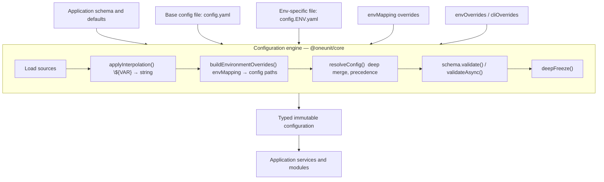

# Configuration Management Engine

## Architecture and implementation reference for `@oneunit/core`

- **Version:** 1.1
- **Date:** 2026-11-14
- **Status:** Implementated
- **Scope:** Reusable Node.js and TypeScript package infrastructure

---

## 1. Overview

`@oneunit/core` includes a configuration engine for Node.js and TypeScript applications. It loads configuration from supported sources, applies overrides, resolves environment-variable references, validates the result, and returns an immutable configuration object.

The engine is intentionally independent of application-specific settings. It does not define keys such as `service`, `cookie`, `security`, `health`, or `features`. Each application defines its own configuration shape and supplies the schema used to validate it.

The boundary is:

- `@oneunit/core` implements configuration loading and resolution.
- The consuming application defines the configuration contract and its validation rules.

The current implementation supports:

- YAML configuration files, with a source interface that can be used for other formats.
- A base configuration file and an optional environment-specific file.
- Defined merge precedence and recursive merging of plain objects.
- Explicit environment-variable mapping through `envMapping`.
- `${VAR}` and `${VAR:fallback}` interpolation.
- Schema validation through the `ConfigValidator` interface, with a Zod adapter.
- Synchronous and asynchronous validation paths.
- Deep-freezing of validated configuration data.
- Typed configuration errors and injectable sources for testing.
- Compatibility with the existing configuration API, including `createConfig()` and the environment helper functions.

Remote configuration, automatic reload, cloud secret-provider implementations, encrypted configuration files, and configuration management UIs are not part of this release.

---

## 2. Goals and implementation status**

### 2.1 Goals**

1\.  Provide a reusable configuration engine for different Node.js

    applications.

2\.  Keep application-specific configuration keys out of the core

    package.

3\.  Load base and environment-specific configuration files.

4\.  Apply a deterministic precedence order.

5\.  Support YAML in the initial release.

6\.  Support schema validation through an adapter, with Zod as the

    first-class implementation.

7\.  Provide explicit environment-variable mapping and interpolation.

8\.  Return an immutable, typed configuration snapshot.

9\.  Preserve existing public APIs.

10\. Make the engine independently testable without filesystem or

    process-global dependencies.

### 2.2 Implementation status**

| Feature | Status |

|---------|--------|

| YAML source loading (sync + async) | Implemented |

| Base + environment overlay | Implemented |

| Deterministic precedence and deep merge | Implemented |

| `${VAR}` placeholder interpolation | Implemented |

| `${VAR:fallback}` fallback interpolation | Implemented — fallback always produces a string |

| Typed complete-placeholder fallback | **\*\*Not implemented\*\*** — placeholders always produce strings; use `envMapping` with a parser for typed values |

| Explicit `envMapping` with typed parsers | Implemented (`parseInteger`, `parseBoolean`) |

| Zod adapter (sync + async) | Implemented (`zodValidator`) |

| Deep freeze immutable result | Implemented |

| Legacy `createConfig()` compatibility | Implemented |

| Secret resolver interface | Not implemented (out of scope for initial release) |

| Remote configuration / hot reload | Not implemented (future extension) |

---

## 3. Package structure**

### 3.1 File tree**

```text

src/

└── config/

    ├── index.ts              # Barrel exports (legacy + engine + facade)

    ├── types.ts              # All types (engine + legacy, consolidated)

    ├── errors.ts             # Config error classes (extends OneUnitError)

    ├── env.ts                # Environment variable parsing utilities

    ├── load-env.ts           # Dotenv file loader

    ├── create-config.ts      # Legacy createConfig() factory (backward compat)

    ├── pipeline.ts           # Shared pipeline: interpolate → merge → validate → freeze

    ├── resolver.ts           # deepMerge, deepClone, resolveConfig, deepFreeze

    ├── interpolation.ts      # ${VAR} and ${VAR:fallback} placeholder interpolation

    ├── yaml-source.ts        # YAML file reading (sync + async), parsing, environment name validation

    ├── loader.ts             # Async config orchestration: load → pipeline

    ├── zod-validator.ts      # zodValidator() adapter (sync + async)

    └── facade.ts             # loadConfigSimple(), loadConfigSync() — simplified API

```

### 3.2 Module responsibilities**

| Module | Responsibility |

|--------|----------------|

| `env.ts` | Legacy environment variable parsing: `envString`, `envNumber`, `envBool`, `envList`, `envFile`, `resolveNodeEnv`, `isDevelopment`, `isProduction`, `isTest` |

| `load-env.ts` | Dotenv file loading (`loadEnv`) |

| `create-config.ts` | Legacy `createConfig()` factory (backward compatibility) |

| `pipeline.ts` | Shared pipeline: `buildEnvironmentOverrides`, `buildResolvedConfig`, `runPipeline`, `runPipelineAsync`, `parseInteger`, `parseBoolean` |

| `resolver.ts` | Deep merge, precedence resolution, deep clone, `resolveConfig`, `deepFreeze` (both are public API exports) |

| `interpolation.ts` | `applyInterpolation` — traverses values recursively; `interpolateString` (internal) always returns `string` |

| `yaml-source.ts` | YAML file reading (`readYamlSync`, async `YamlSource`), `parseYaml`, `createDefaultYamlSources`, `validateEnvironmentName` |

| `loader.ts` | Async config orchestration (`loadConfig`); default `configDir` is `src/config/yaml` |

| `zod-validator.ts` | Zod schema adapter implementing `ConfigValidator\<T>` (wraps `safeParse` / `safeParseAsync`) |

| `facade.ts` | Simplified API: `loadConfigSimple`, `loadConfigSync`; default `configDir` is `config`. Also re-exports: `zodValidator`, `YamlSource`, `validateEnvironmentName`, `ConfigSourceError`, `ConfigInterpolationError`, `ConfigValidationError`, `ConfigValidator`, `LoadConfigOptions` |

| `errors.ts` | Typed config errors: `ConfigSourceError`, `ConfigInterpolationError`, `ConfigValidationError`, `ConfigErrorCode` |

| `types.ts` | All types: engine interfaces (`ConfigValidator`, `ConfigSource`, `ConfigSourceContext`, `LoadConfigOptions`, `PipelineInput`, `EnvironmentMapping`, `EnvironmentMappingEntry`) + legacy types (`ServiceConfig`, `Config`, `NodeEnv`, etc.) |

### 3.3 Dependencies**

-   **\*\*`yaml`\*\***: YAML parser. The only file-format dependency.

-   **\*\*`zod`\*\***: First-class validator; consumed by `zod-validator.ts`

    and imported directly. Not behind an optional peer dependency in

    the initial release.

-   No cloud secret SDK is required by the core package.

---

## 4. Architecture**



The engine handles the generic configuration workflow. It does not interpret application-specific settings such as

`database.url`, `cookie.secret`, or `worker.concurrency`.

---

## 5. Contracts and types**

### 5.1 Validator contract**

```ts

export interface ConfigValidator\<T> {

  validate(input: unknown): T;

  validateAsync?(input: unknown): Promise\<T>;

}

```

The optional `validateAsync` method is used by `runPipelineAsync`.

When absent, `runPipelineAsync` awaits the result of `validate`

(allowing validators that return a `Promise` from `validate`).

### 5.2 Source contract**

```ts

export interface ConfigSource {

  readonly name: string;

  load(context: ConfigSourceContext): Promise\<unknown>;

}

export interface ConfigSourceContext {

  readonly environment: string;

  readonly configDir?: string;

}

```

A source returns plain JSON-like data; it must not return class

instances, executable objects, or other non-plain values.

### 5.3 Environment mapping**

```ts

export interface EnvironmentMappingEntry {

  readonly path: readonly string[];

  readonly parse?: (value: string) => unknown;

}

export type EnvironmentMapping = Record\<string, EnvironmentMappingEntry>;

```

`parse` converts the raw string from `process.env` into a typed value.

When absent the raw string is used. `buildEnvironmentOverrides` builds a

nested object from the mapping and merges it at the `envOverrides` layer.

### 5.4 Loader options**

```ts

export interface LoadConfigOptions\<T> {

  schema: ConfigValidator\<T>;

  sources?: ConfigSource[];

  configDir?: string;

  env?: string;

  defaults?: unknown;

  envOverrides?: unknown;

  cliOverrides?: unknown;

  environment?: Record\<string, string | undefined>;

  requireEnvironmentFile?: boolean;

  envMapping?: EnvironmentMapping;

}

```

| Option | Description |

|--------|-------------|

| `schema` | Consumer-supplied validator. Required. |

| `sources` | Explicit ordered sources. When non-empty, overrides default YAML sources. |

| `configDir` | Base directory for the default YAML sources. Each loader function has a different default — see §5.6 and §5.7. |

| `env` | Environment name. Falls back to `NODE_ENV`, then `"development"`. |

| `defaults` | Consumer defaults, lowest precedence. |

| `envOverrides` | Programmatic overrides merged before CLI overrides. |

| `cliOverrides` | Highest-precedence programmatic overrides. |

| `environment` | Injectable environment record. Defaults to `process.env`. Inject a plain object for deterministic tests. |

| `requireEnvironmentFile` | When `true`, missing `config.\<env>.yaml` throws `ConfigSourceError`. Defaults to `false`. |

| `envMapping` | Typed environment-variable-to-path mapping. |

### 5.5 Pipeline input**

```ts

export interface PipelineInput\<T> {

  schema: ConfigValidator\<T>;

  defaults?: unknown;

  envOverrides?: unknown;

  cliOverrides?: unknown;

  environment?: Record\<string, string | undefined>;

  envMapping?: EnvironmentMapping;

}

```

`PipelineInput` is a subset of `LoadConfigOptions` consumed directly by

`runPipeline` and `runPipelineAsync`.

### 5.6 `loadConfig` — primary async loader (`loader.ts`)**

```ts

export async function loadConfig\<T>(

  options: LoadConfigOptions\<T>,

): Promise\<T>

```

**\*\*Default `configDir`:\*\*** `path.resolve(process.cwd(), "src/config/yaml")`

When `options.sources` is non-empty, `configDir` is ignored and no

default YAML sources are created. When `options.sources` is empty or

omitted, `createDefaultYamlSources` is called with the resolved

`configDir`.

**\*\*Environment name resolution:\*\*** `options.env` → `environment.NODE_ENV` → `"development"`.

### 5.7 `loadConfigSimple` and `loadConfigSync` — simplified facade (`facade.ts`)**

```ts

export async function loadConfigSimple\<T>(

  schema: ConfigValidator\<T>,

  options?: Omit\<LoadConfigOptions\<T>, "schema">,

): Promise\<T>

export function loadConfigSync\<T>(

  schema: ConfigValidator\<T>,

  options?: Omit\<LoadConfigOptions\<T>, "schema" | "sources">,

): T

```

**\*\*Default `configDir` for both:\*\*** `path.resolve(process.cwd(), "config")`

> [!IMPORTANT]

> `loadConfig` (in `loader.ts`) defaults to **\*\*`src/config/yaml`\*\***.

> `loadConfigSimple` and `loadConfigSync` (in `facade.ts`) default to **\*\*`config`\*\***.

> These are different defaults. Always pass `configDir` explicitly in

> production code to avoid surprises.

`loadConfigSync` does not accept custom `sources` and cannot be used

with async validators. It calls `runPipeline`, which throws if the

validator's `validate` method returns a `Promise`.

---

## 6. Pipeline internals**

### 6.1 Steps**

```text

loadConfig() / loadConfigSimple() / loadConfigSync()

└─ runPipeline() / runPipelineAsync()

    ├─ buildResolvedConfig()

    │   ├─ applyInterpolation()      ${NAME} → env value or fallback (always string)

    │   ├─ buildEnvironmentOverrides()   envMapping entries → nested config object

    │   └─ resolveConfig()           deep merge in precedence order

    ├─ schema.validate() / schema.validateAsync()

    └─ deepFreeze()

```

### 6.2 Exported pipeline functions**

| Export | Signature | Description |

|--------|-----------|-------------|

| `buildEnvironmentOverrides` | `(mapping, environment) => unknown` | Converts `envMapping` entries into a nested plain object using the declared `parse` function (or raw string). Rejects unsafe path segments (`__proto__`, `prototype`, `constructor`). |

| `buildResolvedConfig` | `(sources, input) => unknown` | Applies interpolation to all sources, builds env overrides, then deep-merges everything in precedence order. |

| `runPipeline` | `\<T>(sources, input) => T` | Calls `buildResolvedConfig`, validates synchronously, deep-freezes, and returns `T`. Throws if the validator returns a `Promise`. |

| `runPipelineAsync` | `\<T>(sources, input) => Promise\<T>` | Like `runPipeline` but awaits `validateAsync` (or `validate` when `validateAsync` is absent). |

| `parseInteger` | `(value: string) => number` | Strict integer parser; rejects non-integer strings and values outside `Number.isSafeInteger`. |

| `parseBoolean` | `(value: string) => boolean` | Accepts `true/1/yes/on` → `true` and `false/0/no/off` → `false` (case-insensitive). Throws on unrecognised values. |

### 6.3 Precedence order**

```text

consumer defaults          (lowest)

  < base file sources      (config.yaml)

  < env-specific source    (config.\<env>.yaml)

  < envMapping overrides   (buildEnvironmentOverrides result)

  < envOverrides           (programmatic)

  < cliOverrides           (highest)

```

The schema is a validation contract applied after all merging; it is

not a configuration source.

### 6.4 Deep-merge rules (`resolver.ts`)**

-   Plain objects merge recursively.

-   A later scalar replaces an earlier scalar.

-   Arrays replace as a whole; they are **\*\*not\*\*** concatenated.

-   `undefined` values are skipped (treated as no override).

-   `null` is a value; it replaces the target and is accepted or

    rejected by the consumer's schema.

-   Only plain objects (not class instances, `Date`, `Map`, `Set`,

    arrays) are recursively merged.

-   Keys `__proto__`, `prototype`, and `constructor` are silently

    skipped in `deepMerge` and thrown on in `buildEnvironmentOverrides`.

-   Inputs are never mutated; `deepClone` is applied before merging.

---

## 7. Interpolation**

### 7.1 Supported syntax**

| Syntax | Meaning |

|--------|---------|

| `${NAME}` | Required variable; throws `ConfigInterpolationError` when absent |

| `${NAME:fallback}` | Use `fallback` when `NAME` is absent |

| `${NAME:}` | Explicit empty-string fallback; discouraged for secrets |

### 7.2 Traversal**

`applyInterpolation` recurses into plain objects and arrays. Non-string

leaf values (numbers, booleans, `null`) are returned unchanged. Only

string values are passed to `interpolateString`.

### 7.3 Return type — always `string`**

`interpolateString` is implemented with `String.prototype.replace`,

which always returns a `string`. This means:

-   `"${PORT:3000}"` resolves to the string `"3000"`, not the number `3000`.

-   There is **\*\*no\*\*** type preservation for numeric, boolean, or `null`

    fallbacks.

To produce a typed value from an environment variable, use `envMapping`

with a `parse` function:

```ts

// ✅ Correct — envMapping with parseInteger

const envMapping = {

  PORT: { path: ["app", "port"], parse: parseInteger },

};

// ❌ Incorrect expectation — placeholder always produces a string

// app:

//   port: "${PORT:3000}"  → "3000" (string), fails z.number()

```

### 7.4 Security rules**

-   Resolved values are never included in error messages or diagnostics.

-   Values returned by environment variables are not recursively

    interpolated (no second pass).

-   An absent variable and an explicitly empty variable are distinct

    (`undefined` vs. `""`).

---

## 8. YAML source**

### 8.1 `YamlSource` class**

```ts

export class YamlSource implements ConfigSource {

  constructor(

    public readonly name: string,

    private readonly filePath: string,

    private readonly required: boolean = false,

  ) {}

  async load(_context: ConfigSourceContext): Promise\<unknown>;

}

```

-   On `ENOENT`: returns `{}` when `required` is `false`; throws

    `ConfigSourceError` when `required` is `true`.

-   On any other I/O error: throws `ConfigSourceError` with `cause`.

-   On malformed YAML: `parseYaml` throws `ConfigSourceError`.

-   On a non-object root: `parseYaml` throws `ConfigSourceError`.

### 8.2 `readYamlSync`**

```ts

export function readYamlSync(filePath: string, required: boolean): unknown

```

Synchronous equivalent of `YamlSource.load`. Used internally by

`loadConfigSync` in `facade.ts`.

### 8.3 `createDefaultYamlSources`**

```ts

export function createDefaultYamlSources(

  configDir: string,

  environment: string,

  requireEnvironmentFile: boolean,

): YamlSource[]

```

Returns `[base-file YamlSource, environment-file YamlSource]`. Calls

`validateEnvironmentName` before constructing paths.

### 8.4 `validateEnvironmentName`**

```ts

export function validateEnvironmentName(name: string): string

```

Accepts only `^[a-zA-Z0-9_-]+$`. Throws `ConfigSourceError` on

path separators, `..`, or any other unsafe character. Prevents path

traversal from an environment name.

### 8.5 YAML parsing safety**

-   The `yaml` library is used in its default safe mode (no executable

    constructors, no custom tags that could produce class instances).

-   `null` and empty documents are normalised to `{}`.

-   Non-object roots (arrays, scalars) throw `ConfigSourceError`.

-   Prototype-sensitive keys that reach `deepMerge` are silently skipped.

### 8.6 Conventional file layout**

```text

\<configDir>/

├── config.yaml                 # Base configuration (optional)

├── config.development.yaml     # Development overlay (optional by default)

├── config.test.yaml            # Test overlay (optional by default)

└── config.production.yaml      # Production overlay (optional by default)

```

---

## 9. Zod adapter**

### 9.1 Implementation**

```ts

export function zodValidator\<T>(schema: z.ZodType\<T>): ConfigValidator\<T> {

  return {

    validate(input: unknown): T {

      const result = schema.safeParse(input);

      if (!result.success) {

        throw new ConfigValidationError(

          "Configuration validation failed",

          result.error.issues,

        );

      }

      return result.data;

    },

    validateAsync(input: unknown): Promise\<T> {

      return schema.safeParseAsync(input).then((result) => {

        if (!result.success) {

          throw new ConfigValidationError(

            "Configuration validation failed",

            result.error.issues,

          );

        }

        return result.data;

      });

    },

  };

}

```

### 9.2 `ConfigValidationError.issues`**

Zod issue objects from `result.error.issues` are passed verbatim to

`ConfigValidationError` as the `issues: readonly unknown[]` array.

Each Zod issue contains `code`, `path`, and `message` from Zod's own

issue structure. The adapter does **\*\*not\*\*** strip or sanitise Zod issues

beyond what Zod itself provides — Zod issue objects do **\*\*not\*\*** include

the raw input value, so they are safe to surface in error messages.

### 9.3 Typical usage**

```ts

import { z } from "zod";

import { loadConfigSimple, zodValidator, parseInteger } from "@oneunit/core/config";

const AppSchema = z.object({

  app: z.object({

    name: z.string().min(1),

    port: z.number().int().min(1).max(65535),

  }),

  database: z.object({

    url: z.string().url(),

  }),

});

const config = await loadConfigSimple(zodValidator(AppSchema), {

  configDir: "./config",

  env: "production",

  envMapping: {

    APP_PORT: { path: ["app", "port"], parse: parseInteger },

    DATABASE_URL: { path: ["database", "url"] },

  },

});

config.app.port;    // number — provided by envMapping + parseInteger

config.database.url; // string

```

---

## 10. Error model**

### 10.1 Error classes**

All config errors extend `OneUnitError` (the package base error class).

```ts

export class ConfigSourceError extends OneUnitError {

  constructor(message: string, options?: OneUnitErrorOptions)

  // name: "ConfigSourceError"

  // code: "CONFIG_SOURCE_ERROR"

  // category: "config"

}

export class ConfigInterpolationError extends OneUnitError {

  public readonly referenceName: string;

  constructor(referenceName: string, options?: OneUnitErrorOptions)

  // name:    "ConfigInterpolationError"

  // code:    "CONFIG_INTERPOLATION_ERROR"

  // category: "config"

  // details: { reference: referenceName }

  // message: `Required configuration reference is unavailable: ${referenceName}`

}

export class ConfigValidationError extends OneUnitError {

  public readonly issues?: readonly unknown[];

  constructor(message: string, issues?: readonly unknown[], options?: OneUnitErrorOptions)

  // name:    "ConfigValidationError"

  // code:    "CONFIG_VALIDATION_ERROR"

  // category: "config"

  // details: { issues }

}

export const ConfigErrorCode = {

  CONFIG_SOURCE_ERROR:        "CONFIG_SOURCE_ERROR",

  CONFIG_INTERPOLATION_ERROR: "CONFIG_INTERPOLATION_ERROR",

  CONFIG_VALIDATION_ERROR:    "CONFIG_VALIDATION_ERROR",

} as const;

```

### 10.2 Key public properties**

| Error class | Notable public property | Description |

|-------------|------------------------|-------------|

| `ConfigInterpolationError` | `err.referenceName` | The name of the missing environment variable. Never the resolved value. |

| `ConfigValidationError` | `err.issues` | Zod issue objects (when thrown by `zodValidator`). Each issue has `code`, `path`, `message` from Zod — not the raw input value. |

### 10.3 What diagnostics must never include**

-   Resolved secret values or the full configuration object.

-   Raw environment variable values.

-   The entire loaded YAML content.

---

## 11. Legacy API compatibility**

### 11.1 `createConfig()` factory**

`createConfig` reads `PORT`, `HOST`, and `SERVICE_NAME` from

`process.env` and returns an immutable `Config` object with

`isDevelopment`, `isProduction`, `isTest` helpers.

```ts

export function createConfig(options?: CreateConfigOptions): Config

```

It does not use the generic engine pipeline. It remains in

`create-config.ts` for backward compatibility and is re-exported from

`index.ts`.

### 11.2 Legacy environment parsers (`env.ts`)**

| Function | Description |

|----------|-------------|

| `envString(name, fallback?)` | Trims and returns the env var, or fallback |

| `envNumber(name, fallback?)` | Parses a finite number, or fallback |

| `envBool(name, fallback?)` | Accepts `true/1/yes/on`, `false/0/no/off` (case-insensitive), or fallback |

| `envList(name, fallback?)` | Splits on `,`, trims and filters empty items, or fallback |

| `envFile(baseDir, nodeEnv?)` | Resolves `.env.\<env>` path |

| `resolveNodeEnv(nodeEnv?)` | Normalises `NODE_ENV` to lowercase, defaulting to `"development"` |

| `isDevelopment(nodeEnv?)` | Returns `true` when `resolveNodeEnv` returns `"development"` |

| `isProduction(nodeEnv?)` | Returns `true` when `resolveNodeEnv` returns `"production"` |

| `isTest(nodeEnv?)` | Returns `true` when `resolveNodeEnv` returns `"test"` |

> [!NOTE]

> `envBool` uses explicit string matching, not JavaScript truthiness.

> `Boolean("false")` is `true`; `envBool` correctly returns `false`.

> The same strict matching is used in the pipeline's `parseBoolean`.

### 11.3 Public exports from `index.ts`**

**\*\*Legacy API:\*\***

`envBool`, `envList`, `envFile`, `envNumber`, `envString`,

`isDevelopment`, `isProduction`, `isTest`, `resolveNodeEnv`,

`loadEnv`, `createConfig`,

types: `LoadEnvOptions`, `DotenvConfig`, `ServiceConfig`, `NodeEnv`,

`CreateConfigOptions`, `Config`

**\*\*Engine API:\*\***

`loadConfig`, `resolveConfig`, `deepFreeze`, `applyInterpolation`,

`zodValidator`, `YamlSource`, `createDefaultYamlSources`,

`validateEnvironmentName`, `readYamlSync`,

`ConfigSourceError`, `ConfigInterpolationError`,

`ConfigValidationError`, `ConfigErrorCode`,

types: `ConfigValidator`, `ConfigSource`, `ConfigSourceContext`,

`LoadConfigOptions`, `EnvironmentMapping`, `EnvironmentMappingEntry`

**\*\*Pipeline:\*\***

`runPipeline`, `runPipelineAsync`, `parseInteger`, `parseBoolean`,

type: `PipelineInput`

**\*\*Facade:\*\***

`loadConfigSimple`, `loadConfigSync`

---

## 12. Security and operational guidance**

### 12.1 Trust boundaries**

Configuration files and environment variables are inputs. Parse them as

data and validate them through the schema. Never execute configuration

content.

### 12.2 Path traversal prevention**

-   `validateEnvironmentName` rejects any name not matching

    `^[a-zA-Z0-9_-]+$`.

-   YAML sources are constructed with explicit `path.join(configDir, …)`.

    The environment name is validated before it appears in any path.

-   Consumers should supply explicit `configDir` paths rather than

    relying on defaults.

### 12.3 Prototype pollution prevention**

-   `deepMerge` silently skips `__proto__`, `prototype`, and

    `constructor` keys.

-   `buildEnvironmentOverrides` throws `TypeError` on those keys.

-   Only plain objects (checked with `typeof === "object"` and

    `Array.isArray === false`) are recursively merged.

### 12.4 Secret handling**

-   Error messages include variable names, not values.

-   `ConfigInterpolationError.referenceName` holds only the name.

-   Zod `issues` contain `code`, `path`, and `message` — not raw input.

-   Never print the full resolved configuration object.

-   Never include resolved values in diagnostics or logs.

-   Consumers are responsible for redaction; a consumer-supplied

    redactor can mask sensitive paths before logging.

### 12.5 Immutability**

`deepFreeze` recursively calls `Object.freeze` on all plain objects and

arrays in the validated configuration. Its limits: class instances,

`Date`, `Map`, `Set`, and other non-plain objects nested inside the

configuration are not deeply frozen. Prefer JSON-like validated

configuration data.

### 12.6 Startup behaviour**

Call the loader before starting listeners, workers, schedulers, or

accepting jobs. Invalid configuration should fail startup immediately

with actionable, non-sensitive diagnostics.

---

## 13. Follow-up considerations

The items below are possible improvements, not features of the current implementation. They should be considered separately from the implementation status listed in Section 2.

- **Consistent defaults:** `loadConfig()` currently defaults to `src/config/yaml`, while `loadConfigSimple()` and `loadConfigSync()` default to `config`. Consider standardising these defaults in a future breaking or carefully managed release. Until then, pass `configDir` explicitly.
- **Validation adapters:** Zod is currently a direct dependency. If consumers need other validation libraries, consider whether a broader schema interoperability contract is worthwhile. Keep the current `ConfigValidator` interface as the engine boundary.
- **Diagnostic redaction:** Do not assume every custom validator message is free of sensitive values. Review and sanitize diagnostic output before exposing it in logs.
- **Configuration provenance:** Recording which source supplied a resolved value could make production debugging easier. This would need to avoid exposing secret values.
- **Secret providers:** A resolver interface could be added when there is a concrete requirement for cloud or external secret stores. The current release does not implement one.
- **Supported data types:** The merge and freeze behaviour is designed for plain configuration data. Keep configuration values JSON-like; `Map`, `Set`, `Date`, class instances, and other non-plain objects are not fully covered by deep-freeze semantics.

These changes should be driven by consumer requirements. Avoid adding abstractions that do not solve a current integration or operational problem.

---

## 14. Testing reference**

### 13.1 Existing test files**

| Test file | Covers |

|-----------|--------|

| `test/config/resolver.test.ts` | `resolveConfig`, `deepFreeze`, merge rules, prototype-key rejection |

| `test/config/interpolation.test.ts` | `applyInterpolation`, required/missing variables, fallbacks, traversal, error messages |

| `test/config/pipeline.test.ts` | `runPipeline`, `runPipelineAsync`, `buildResolvedConfig`, `buildEnvironmentOverrides`, `parseInteger`, `parseBoolean` |

| `test/config/zod-validator.test.ts` | `zodValidator` sync/async, `ConfigValidationError.issues` shape |

| `test/config/loader.test.ts` | `loadConfig` orchestration, source ordering, default `configDir` |

| `test/config/facade.test.ts` | `loadConfigSimple`, `loadConfigSync` defaults, default `configDir`, source fallback logic |

| `test/config/env.test.ts` | Legacy `envString`, `envNumber`, `envBool`, `envList`, `resolveNodeEnv` |

| `test/config/create-config.test.ts` | Legacy `createConfig()` |

| `test/config/load-env.test.ts` | `loadEnv` dotenv loading |

### 13.2 Modules requiring dedicated gate coverage**

The following modules have specific paths that must be covered by tests

before a release is considered shippable:

**\*\*`resolver.ts`\*\***

- Later scalar overrides earlier scalar.

- Nested objects merge recursively.

- Arrays replace rather than concatenate.

- `null` is accepted; `undefined` is skipped.

- Inputs are not mutated.

- `__proto__`, `prototype`, `constructor` keys are rejected/skipped.

- `deepFreeze` makes plain objects unwritable; nested values also frozen.

**\*\*`interpolation.ts`\*\***

- Required variable resolves to the env value.

- Missing required variable throws `ConfigInterpolationError` with the

  variable name, not its value.

- Fallback resolves only when the variable is absent.

- Empty string (`${X:}`) and absent variable are distinct outcomes.

- Nested arrays and plain objects are traversed.

- Embedded placeholders (e.g., `"prefix-${X}-suffix"`) produce a string.

- Env values are not recursively expanded.

- Non-string leaf values (numbers, booleans) pass through unchanged.

**\*\*`pipeline.ts`\*\***

- `parseInteger` accepts valid integers, rejects non-integer strings,

  rejects out-of-safe-integer-range values.

- `parseBoolean` accepts all documented truthy/falsy strings

  (case-insensitive), rejects unrecognised values.

- `buildEnvironmentOverrides` builds nested objects correctly, rejects

  unsafe path segments, skips absent env vars.

- `runPipeline` throws when the validator returns a `Promise`.

- `runPipelineAsync` works with async validators.

**\*\*`yaml-source.ts`\*\*** *\*(requires specific gate coverage)\**

- `createDefaultYamlSources` creates two sources in correct order.

- `readYamlSync` returns `{}` for a missing optional file.

- `readYamlSync` throws `ConfigSourceError` for a missing required file.

- `readYamlSync` throws `ConfigSourceError` for malformed YAML.

- `readYamlSync` throws `ConfigSourceError` for a non-object root.

- `validateEnvironmentName` rejects path separators, `..`, spaces, etc.

**\*\*`facade.ts`\*\*** *\*(requires specific gate coverage)\**

- `loadConfigSimple` default `configDir` resolves to `\<cwd>/config`.

- `loadConfigSync` default `configDir` resolves to `\<cwd>/config`.

- `loadConfigSimple` falls back to `[base-file, environment-file]`

  `YamlSource` instances when no `sources` option is provided.

- `loadConfigSync` reads YAML synchronously via `readYamlSync`.

- Both functions propagate `ConfigSourceError` from missing required

  environment files correctly.

### 13.3 Test isolation pattern**

Inject `environment` to avoid `process.env` coupling:

```ts

const config = await loadConfig({

  schema: zodValidator(MySchema),

  configDir: "./fixtures",

  env: "test",

  environment: {

    DATABASE_URL: "postgres\://localhost/test",

    APP_PORT: "5432",

  },

  envMapping: {

    APP_PORT: { path: ["app", "port"], parse: parseInteger },

  },

});

```

Use in-memory or fixture YAML sources rather than production paths.

Never read `process.env` directly in test assertions.