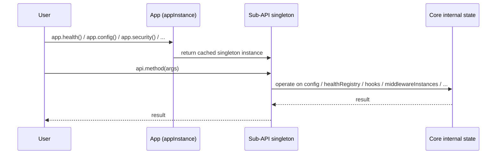
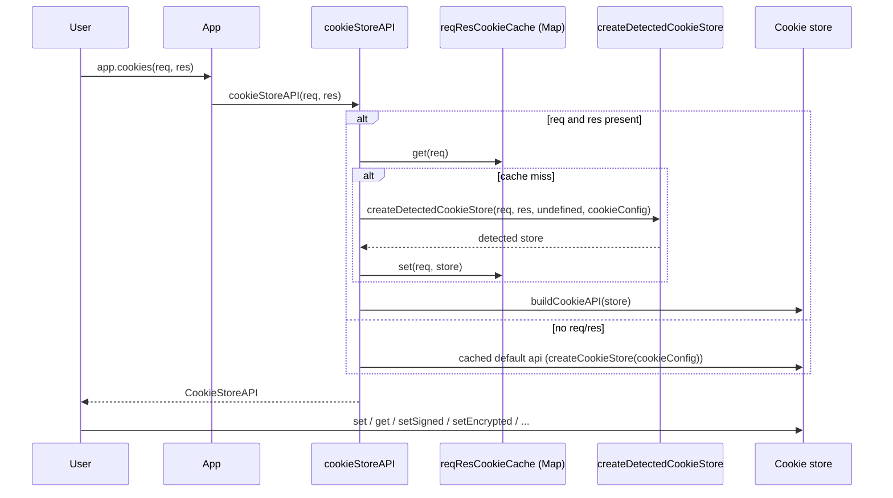
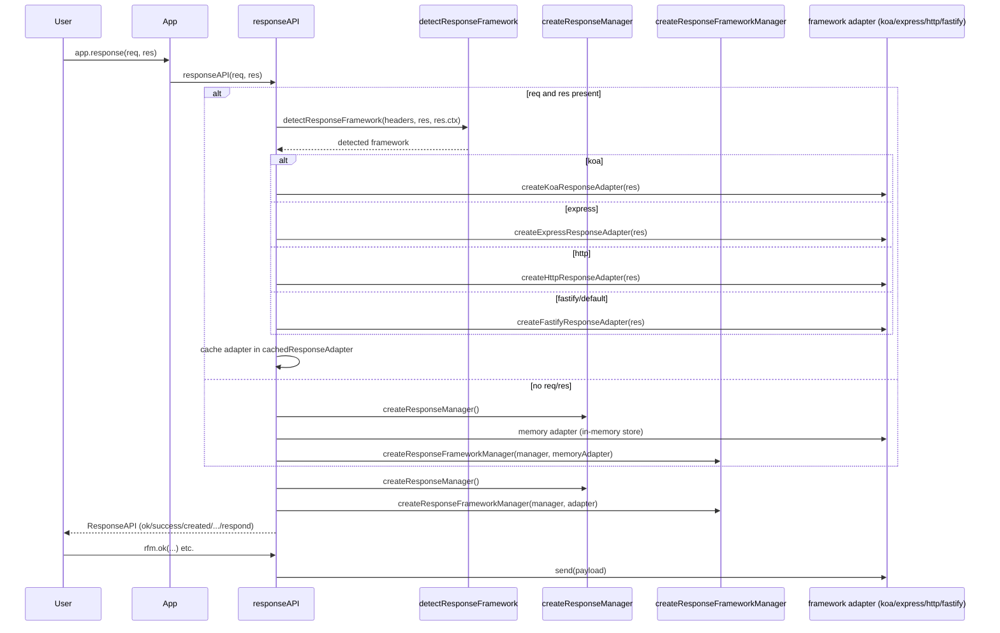

# Core — Architecture Specification

@oneunit/core v1.0.0

## Component Overview

**Purpose.** The Core feature is the unified public API and factory layer of the `@oneunit/core` package. It is the single entry point through which all framework capabilities — configuration, health checking, lifecycle management, cookies, security middleware, multipart handling, message packing, responses, and library utilities — are created, configured, and accessed.

**Scope.** This specification covers the `createApp()` factory and every sub-system it instantiates and owns: `Config`, `HealthRegistry`/`HealthRoute`, `Hooks`, cookie stores, `SecurityAPI`, `MultipartAPI`, `LifecycleManager`, `MsgPack`, `ResponseAPI`, and `LibAPI`. It does not cover the internal implementation of those sub-systems (config, health, hooks, cookie, security, multipart, lifecycle, msgpack, response-management, lib), which live in their own directories under `src/core/`. All context necessary to understand Core is contained in this file.

**Responsibilities.**
- Accept and normalize `AppOptions`, applying defaults for `serviceName`, `port`, `host`, and `nodeEnv`.
- Instantiate and own every sub-system manager; the Core is the root of the object graph.
- Expose a facade `App` interface so consumers call `app.method()` instead of wiring sub-systems directly.
- Cache and return singleton API instances on repeated calls.
- Detect the HTTP framework (koa, express, fastify, Node http) per request and select the appropriate cookie/response adapter.
- Merge per-call options over global defaults for security, multipart, and cookie configuration.
- Initialize the default `LifecycleManager` automatically.

## Source File Map

| File | Responsibility | Key exports |
|------|----------------|-------------|
| `src/core.ts` | Main implementation; `createApp()` factory, all API facades, internal state | `createApp`, `App`, `AppOptions`, `HealthAPI`, `HooksAPI`, `ConfigAPI`, `CookieStoreAPI`, `SecurityAPI`, `MultipartAPI`, `LifecycleAPI`, `MsgPackAPI`, `ResponseAPI`, `LibAPI`, `SecurityDefaults` |
| `src/core/core.ts` | DX wrapper; chainable convenience methods that delegate to the core `App` | `createApp`, `CoreApp` |
| `src/core/index.ts` | Barrel re-export of the public API | `createApp`, `CoreApp`, `App`, `HealthAPI`, `HooksAPI`, `ConfigAPI`, `CookieStoreAPI`, `SecurityAPI`, `MsgPackAPI`, `ResponseAPI`, `LibAPI`, `AppOptions` |

## Component Relationships Diagram (Mermaid)

```mermaid
graph TD
    Core[createApp() / App]
    Config[Config / ConfigAPI]
    Health[HealthRegistry + HealthRoute / HealthAPI]
    Hooks[Hooks / HooksAPI]
    Cookie[cookie stores / CookieStoreAPI]
    Security[SecurityAPI]
    Multipart[MultipartAPI]
    Lifecycle[LifecycleManager / LifecycleAPI]
    MsgPack[MsgPack / MsgPackAPI]
    Response[ResponseAPI + framework adapters]
    Lib[Lib / LibAPI]

    Core -->|owns/instantiates| Config
    Core -->|owns/instantiates| Health
    Core -->|owns/instantiates| Hooks
    Core -->|owns/instantiates| Cookie
    Core -->|owns/instantiates| Security
    Core -->|owns/instantiates| Multipart
    Core -->|owns/instantiates| Lifecycle
    Core -->|owns/instantiates| MsgPack
    Core -->|owns/instantiates| Response
    Core -->|owns/instantiates| Lib

    Security -.->|shares secret| Cookie
    Config -.->|shared options| Core
    Response -.->|detects framework| Cookie
```

**Legend.** Solid arrows = Core owns and instantiates the sub-system; every API method closes over Core's internal state. Dashed arrow = shared state (the cookie `secret` is shared with CSRF security).

## Initialization Flow (Mermaid)

```mermaid
flowchart TD
    A[User calls createApp(options)] --> B[Destructure AppOptions + defaults]
    B --> C[createConfig(configOptions) → Config]
    C --> D[createHealthRegistry() + createHealthRoute(health.path ?? "/health")]
    D --> E[createHooks() → Hooks]
    E --> F[Build cookieConfig = { secret, ...DEFAULT_COOKIE_CONFIG, ...cookie }]
    F --> G[namedCookieStores = new Map(); build default cookie API via buildCookieAPI()]
    G --> H[cookieStoreAPI: per-request detection vs cached default]
    H --> I[securityAPI: per-call merge over global defaults]
    I --> J[multipartAPI: per-call merge over global defaults]
    J --> K[new LifecycleManager(lifecycle options); initialize()]
    K --> L[lifecycleInstances Map: "default" → lifecycleManager]
    L --> M[createMsgPack() → MsgPack]
    M --> N[responseAPI: framework-detection caching + memory fallback]
    N --> O[libAPI]
    O --> P[Return appInstance with all methods]
```

## Data Flow Diagrams (Mermaid)

### 1. App method call → cached singleton → internal state operation



**Note.** Most sub-APIs (`health`, `hooks`, `config`, `security`, `multipart`, `lifecycle`, `msgpack`, `lib`) return the same singleton object on every call. `cookies(req, res)` and `response(req, res)` return per-request adapters when `req`/`res` are supplied, otherwise the cached default.

### 2. cookies(req, res) → framework detection → adapter creation → cookie store



### 3. response(req, res) → framework detection → adapter creation → response manager



**Framework detection priority.** `koa` → `express` → `http` → `fastify` (fallback/default). There is no "unknown" outcome; when none of the first three match, the fastify adapter is used. When `req`/`res` are omitted, a memory-based response adapter is used instead of throwing (the `ResponseRequiresRequestResponseError` is documented in the interface but not thrown in the current implementation).

## Internal State Model

| State | Type | Populated from | Description |
|-------|------|----------------|-------------|
| `config` | `Config` | `createConfig({ port, host, serviceName, nodeEnv })` | Resolved configuration; defaults `serviceName="app"`, `port=3000`, `host="localhost"` |
| `configAPI` | `ConfigAPI` | wrapper over `config` + `knownConfigKeys` set | Get/set with validation against known keys |
| `healthRegistry` | `HealthRegistry` | `createHealthRegistry()` | Map of registered health check providers |
| `healthRoute` | `HealthRoute` | `createHealthRoute(healthRegistry, { path: health.path ?? "/health", serviceName })` | Health endpoint route registration |
| `hooks` | `HooksImpl` | `createHooks()` | Hook event emitter |
| `cookieConfig` | `CookieConfig` | `{ secret, ...DEFAULT_COOKIE_CONFIG, ...cookie }` | Merged cookie configuration including `secret` |
| `namedCookieStores` | `Map<string, store>` | `createNamedCookieStore()` | Persisted per-name cookie stores |
| `api` | `CookieStoreAPI` | `buildCookieAPI(createCookieStore(cookieConfig))` | Cached default cookie API |
| `reqResCookieCache` | `Map<unknown, store>` | `cookieStoreAPI()` | Per-request detected cookie stores keyed by `req` |
| `securityAPI` | `SecurityAPI` | inline object | Per-call option merging over `security` defaults; CSRF merges `options.secret ?? secret` |
| `multipartAPI` | `MultipartAPI` | inline object | Per-call merge `{ ...multipart, ...options }` |
| `lifecycleManager` | `LifecycleManager` | `new LifecycleManager({ mode: "advanced", ... })` | Default lifecycle, auto-initialized |
| `lifecycleInstances` | `Map<string, LifecycleManager>` | `createLifecycle()` | `"default"` + named instances (`lifecycle-1`, `lifecycle-2`, …) |
| `msgpack` | `MsgPackImpl` | `createMsgPack()` | MessagePack encode/decode |
| `msgpackAPI` | `MsgPackAPI` | wrapper over `msgpack` | Cached singleton |
| `cachedResponseAdapter` | adapter or null | `responseAPI(req, res)` | Last-detected framework response adapter |
| `memoryResponse` | `Record<string, any>` | `responseAPI()` | In-memory response store when no req/res |
| `libAPI` | `LibAPI` | wrapper over `./lib` functions | `formatBytes`, `formatTime`, `timestamp`, `getSystemInfo`, `getSystemStatus` |
| `middlewares` | `Array<middleware>` | `use()` | Registered middleware functions |
| `appInstance` | `App` | assembled at end | Returned facade object |

## Design Patterns

| Pattern | Explanation | Where used |
|---------|-------------|------------|
| Factory | `createApp()` creates, configures, and returns a fully wired `App` instance | `src/core.ts:353` |
| Facade | `App` interface hides sub-system complexity behind one object | `src/core.ts:162`, `src/core.ts:813` |
| Singleton / Caching | Most sub-APIs return the same instance on repeated calls | `config`, `hooks`, `security`, `multipart`, `lifecycle`, `msgpack`, `lib`, default cookie API, cached response adapter |
| Closure | API methods close over Core's internal state (`config`, `healthRegistry`, `cookieConfig`, `lifecycleManager`, `msgpack`, `middlewares`, etc.) | Every API method body in `src/core.ts` |
| Adapter | `cookies`/`response` detect the HTTP framework and select the matching adapter | `cookieStoreAPI` (lines 557-567), `responseAPI` (lines 717-786) |

## Technical Implementation Details

- **`createConfig()` call.** `configOptions` is built with `port`, `host`, `serviceName`, `nodeEnv` and passed to `createConfig(configOptions)` (src/core.ts:366-373).
- **Health route.** Created with `health.path ?? "/health"` and the resolved `serviceName` (src/core.ts:411-414).
- **Cookie config merge.** `{ secret, ...DEFAULT_COOKIE_CONFIG, ...cookie }` — user `cookie` options override defaults, with `secret` set first (src/core.ts:487-491). Named stores reuse the same merge with an optional per-store `config` (src/core.ts:539-551).
- **Security merge.** Each security method merges `{ ...security.<x>, ...options }`; CSRF additionally sets `secret: options?.secret ?? secret` (src/core.ts:569-590).
- **Multipart merge.** `{ ...multipart, ...options }` per call (src/core.ts:592-597).
- **LifecycleManager initialization.** Constructed with `options?.lifecycle` fields (`mode` defaults to `"advanced"`, plus `executionTimeoutMs`, `throwOnError`, `maxMiddleware`, `maxPlugins`, `allowedMiddlewareTypes`, `autoRegisterEssential`) and `initialize()` is called immediately (src/core.ts:599-609). `createLifecycle()` builds additional named instances registered in `lifecycleInstances` (src/core.ts:652-703).
- **Response framework detection priority.** `detectResponseFramework(headers, res, res.ctx)` is checked in order: `koa` → `express` → `http` → `fastify` (fallback). Detected adapter is cached in `cachedResponseAdapter` (src/core.ts:717-786).
- **Framework detection caching.** The detected response adapter is cached so subsequent `response()` calls with `req`/`res` reuse it. Cookie stores are cached per `req` in `reqResCookieCache`.

## Concurrency Considerations

- All cached API instances are shared references. Node.js is single-threaded, so these are not thread-safe by design and no locking is required or provided.
- Per-request cookie stores (`reqResCookieCache`) and per-request response adapters are independent per `req` object, so concurrent requests with distinct `req` objects do not share mutable adapter state.
- `middlewares` array is appended to by `use()`; registration is not synchronized (single-threaded event loop assumption).
- `memoryResponse` is a shared in-memory record used by the memory response adapter when no `req`/`res` is supplied; concurrent users of that adapter share the same record.

## Error Model

- **ConfigAPI validation errors.** `ConfigAPI.set(key, value)` and `ConfigAPI.get(key)` throw `Error("Unknown config key: ${key}")` when `key` is not in `knownConfigKeys` (`port`, `host`, `serviceName`, `nodeEnv`, `isDevelopment`, `isProduction`, `isTest`) (src/core.ts:396-408).
- **ResponseRequiresRequestResponseError.** Documented as the error that would be thrown if `response()` is called without `req`/`res` on first use. In the current implementation this error is not thrown; instead a memory-based response adapter is returned (src/core.ts:736-764).
- Sub-system errors (health, lifecycle, security, cookie, msgpack, lib) propagate from their respective implementations and are not wrapped by Core.

## Complexity Analysis

| Operation | Time | Space | Notes |
|-----------|------|-------|-------|
| `createApp(options)` | O(1) (fixed number of sub-system instantiations) | O(1) fixed sub-system objects | Dominated by sub-system constructors |
| `app.method()` cached accessor | O(1) | O(1) | Returns stored reference |
| `ConfigAPI.get/set` | O(1) | O(1) | Set lookup in `knownConfigKeys` |
| `healthRegistry.register` / `checkAll` | O(1) / O(n) | O(n) | n = registered providers |
| `cookieStoreAPI(req, res)` cache hit | O(1) | O(1) | Map lookup keyed by `req` |
| `cookieStoreAPI(req, res)` cache miss | O(1) + adapter creation | O(1) | One store per distinct `req` |
| `createLifecycle()` | O(1) | O(1) | New `LifecycleManager` + map entry |
| `responseAPI(req, res)` | O(1) + framework detection | O(1) | Detected adapter cached |
| `use(middleware)` | O(1) amortized | O(1) per middleware | Array push |
| `lifecycleInstances.get(name)` | O(1) | O(k) | k = number of lifecycle instances |

End of specification.
