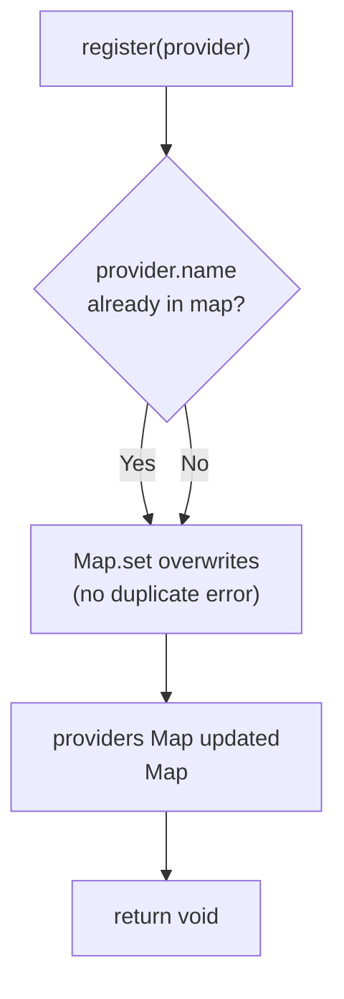
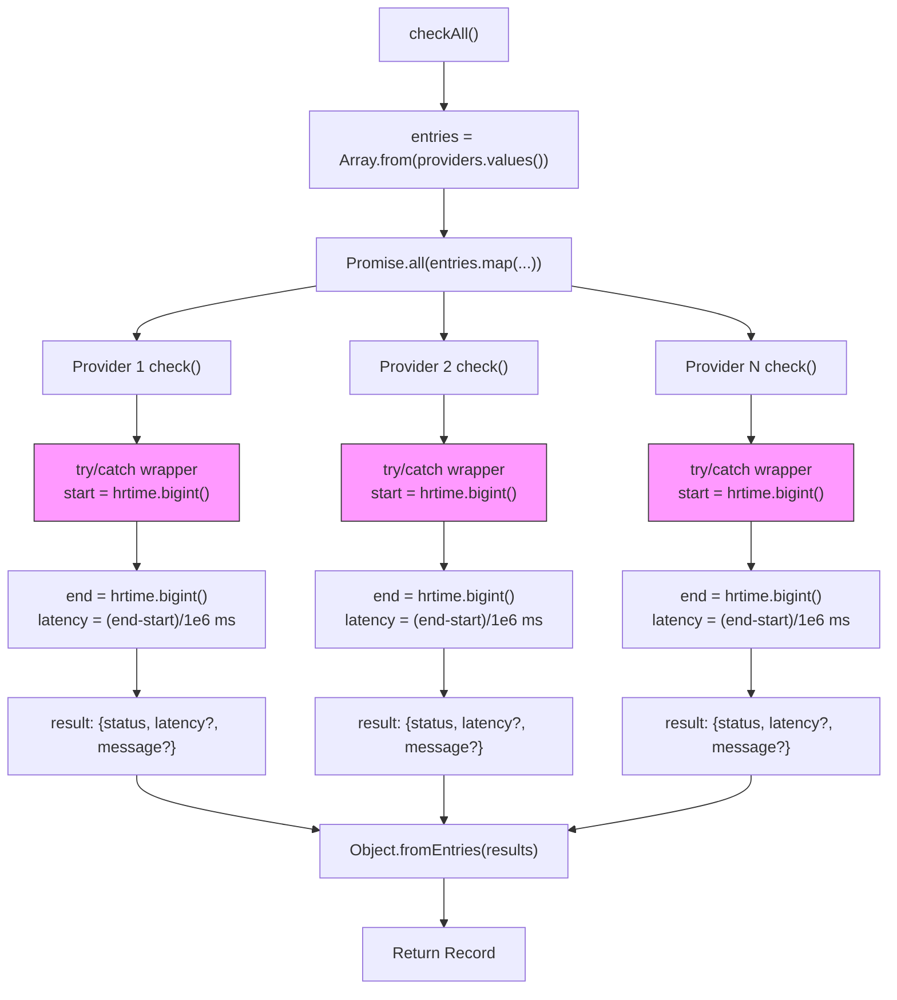
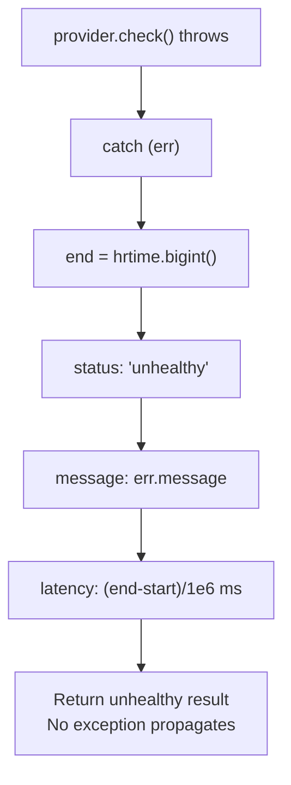
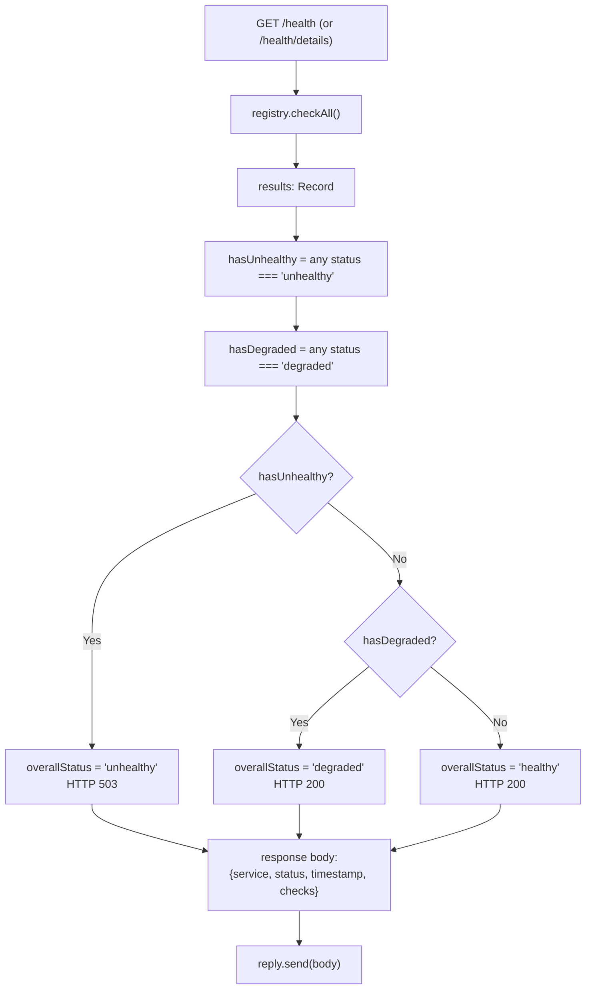

# Health — Architecture Specification

@oneunit/core v1.0.0

## Component Overview

**Purpose:** Provide a pluggable, framework-agnostic health checking subsystem for the @oneunit/core package. The Health feature allows applications to register named health check providers, execute all checks in parallel, aggregate their results into a single service status, and expose that status over HTTP via a configurable route.

**Scope:** The subsystem covers provider creation and registration, parallel check execution with error isolation and latency measurement, status aggregation, HTTP route registration (including an optional detailed endpoint), environment detection (system, docker, kubernetes), and built-in providers for system resources, Docker, Kubernetes, databases, Redis, and Kafka.

**Responsibilities:**
- Maintain a registry of named `HealthProvider` instances.
- Register, unregister, and enumerate providers.
- Execute all provider checks concurrently via `Promise.all`.
- Wrap each check in try/catch so a failing provider never throws from `checkAll()`.
- Measure per-check latency using `process.hrtime.bigint()`.
- Aggregate per-provider results into an overall service status (`healthy` | `degraded` | `unhealthy`).
- Expose the aggregated status over HTTP with status code 200 (healthy/degraded) or 503 (unhealthy).
- Optionally expose a detailed per-check endpoint at `<path>/details`.
- Detect the runtime environment (system, docker, kubernetes) and auto-register appropriate providers.

## Source File Map

| File Path | Responsibility | Key Exports |
|-----------|----------------|-------------|
| `src/health/types.ts` | Core type definitions and interfaces | `HealthStatus`, `HealthReply`, `HealthServer`, `HealthCheckResult`, `HealthCheck`, `HealthProvider`, `HealthRegistry`, `HealthRouteOptions` |
| `src/health/registry.ts` | Provider registry implementation | `createHealthRegistry` |
| `src/health/route.ts` | HTTP health check route handler | `createHealthRoute` |
| `src/health/provider.ts` | Generic and service-specific provider factories | `createHealthProvider`, `createDatabaseHealthProvider`, `createRedisHealthProvider`, `createKafkaHealthProvider` |
| `src/health/health-factory.ts` | High-level health convenience factory | `createHealth`, `registerHealth` |
| `src/health/system-health.ts` | System, Docker, Kubernetes providers and environment detection | `createSystemHealthProvider`, `createDockerHealthProvider`, `createKubernetesHealthProvider`, `detectHealthEnvironment`, `detectHealthEnvironmentAsync`, `createHealthProviders`, `createDetectedHealthProviders`, `registerHealthProviders`, `registerDetectedHealthProviders`, `DEFAULT_THRESHOLDS` (re-exported via `../lib/system-status.ts`) |
| `src/health/index.ts` | Barrel exports for the public API | All public functions and types from the modules above |

## Component Relationships Diagram (Mermaid)

```mermaid
graph TD
    subgraph HealthFeature["Health Feature (@oneunit/core v1.0.0)"]
        direction TB

        Registry["HealthRegistry<br/>providers: Map<string, HealthProvider>"]
        Route["HealthRoute<br/>createHealthRoute"]
        Server["HealthServer<br/>HTTP server adapter"]
        Providers["Providers<br/>system, docker, kubernetes,<br/>database, redis, kafka"]
        checkAll["checkAll()<br/>parallel + try/catch"]
        Aggregation["Status Aggregation<br/>unhealthy &gt; degraded &gt; healthy"]
        HTTPResp["HTTP Response<br/>200 healthy / 503 unhealthy"]

        Providers -->|register()| Registry
        Registry -->|getAll()/checkAll()| Route
        Route -->|GET handler| checkAll
        checkAll --> Aggregation
        Aggregation --> HTTPResp
        Route -->|registers handlers| Server
    end

    linkStyle default stroke-width:2px
```

## Data Flow Diagrams (Mermaid)

### 1. register() → providers Map



### 2. checkAll() → parallel execution → try/catch → latency → results Map



Error path within try/catch:


### 3. route() → GET handler → checkAll() → status aggregation → HTTP response (200/503)



## Internal State Model

### providers Map

```ts
providers: Map<string, HealthProvider>
```

- Key: provider `name` (string)
- Value: `HealthProvider` instance
- Operations: `set` (register), `delete` (unregister), `values`/`entries` (getAll/checkAll)
- Concurrency: Not thread-safe; Node.js is single-threaded, so no race conditions within the event loop, but `checkAll()` snapshots the provider list at invocation time.

### HealthProvider

```ts
interface HealthProvider {
    name: string;
    check: () => HealthCheckResult | Promise<HealthCheckResult>;
    critical?: boolean;
}
```

- `name`: Unique identifier used as the map key and result key.
- `check`: The health check function; may be synchronous or return a Promise.
- `critical`: Optional flag indicating whether the provider is critical (consumers may treat failure of critical providers more severely; the registry itself does not enforce special handling).

### HealthCheckResult

```ts
interface HealthCheckResult {
    status: "healthy" | "degraded" | "unhealthy";
    latency?: number;    // milliseconds, measured by the registry
    message?: string;    // human-readable status message
    details?: object;    // provider-specific diagnostic details
}
```

- `status`: One of `healthy`, `degraded`, `unhealthy`.
- `latency`: Check duration in milliseconds (added by `checkAll()`, not by the provider itself).
- `message`: Optional descriptive message.
- `details`: Optional structured diagnostic data (e.g., memory usage, Docker version, pod list).

### HealthStatus

```ts
type HealthStatus = "healthy" | "degraded" | "unhealthy";
```

Aggregation priority: `unhealthy` > `degraded` > `healthy`.

## Design Patterns

| Pattern | Role in Health Feature |
|---------|------------------------|
| Registry Pattern | `HealthRegistry` manages the lifecycle (register/unregister/getAll/checkAll) of `HealthProvider` instances keyed by name. |
| Observer Pattern | Providers are registered (observed) and executed on demand when `checkAll()` or an HTTP handler is invoked. |
| Strategy Pattern | Different provider types implement the same `HealthProvider` interface but embody distinct checking strategies: system resources, Docker socket/CLI, Kubernetes API/kubectl, database, Redis, Kafka, and custom user-supplied checks. |
| Factory Pattern | `createHealthProvider`, `createDatabaseHealthProvider`, `createRedisHealthProvider`, `createKafkaHealthProvider`, `createSystemHealthProvider`, `createDockerHealthProvider`, `createKubernetesHealthProvider`, `createHealthRegistry`, `createHealthRoute`, `createHealth`, `registerHealth` encapsulate object creation. |
| Facade Pattern | `createHealth` / `registerHealth` in `health-factory.ts` provide a simplified facade over registry + route composition. |

## Technical Implementation Details

### Parallel check execution

`checkAll()` collects all provider entries into an array and passes them to `Promise.all()`. All provider `check()` functions are invoked concurrently. The overall response time is bounded by the slowest provider, not the sum of all providers.

```ts
const results = await Promise.all(
    entries.map(async (provider) => { /* ... */ })
);
```

### Latency measurement

Each check is bracketed by `process.hrtime.bigint()` calls. Latency is computed as:

```ts
const start = process.hrtime.bigint();
// await provider.check()
const end = process.hrtime.bigint();
const latency = Number(end - start) / 1_000_000; // milliseconds
```

The latency is merged into the result object via spread: `{ ...result, latency }`.

### Error isolation

Every provider check is wrapped in try/catch. If a provider throws or rejects, the catch block returns:

```ts
{
    status: "unhealthy",
    latency: Number(end - start) / 1_000_000,
    message: err instanceof Error ? err.message : "Health check failed",
}
```

No exception propagates out of `checkAll()`; all provider failures are converted to unhealthy results.

### Status aggregation

The route handler aggregates results as follows:

1. If any check result has `status === "unhealthy"`, overall status is `unhealthy` → HTTP 503.
2. Else if any check result has `status === "degraded"`, overall status is `degraded` → HTTP 200.
3. Otherwise overall status is `healthy` → HTTP 200.

### HTTP response

Successful (healthy/degraded) response:

```json
{
    "service": "app",
    "status": "healthy",
    "timestamp": "2026-11-19T14:07:59.000Z",
    "checks": {
        "system": { "status": "healthy", "latency": 12.34 },
        "docker": { "status": "healthy", "latency": 5.67 }
    }
}
```

Unhealthy response uses the same body shape with `status: "unhealthy"` and HTTP 503.

### Default thresholds

Defined in `src/lib/system-status.ts` and consumed by `createSystemHealthProvider`:

```ts
DEFAULT_THRESHOLDS = {
    memory: { degraded: 75, unhealthy: 90 },
    load:   { degraded: 0.7, unhealthy: 1.0 }
};
```

System status evaluation order in `getSystemStatus`:
1. Any failed check → `unhealthy`.
2. Memory usage ≥ unhealthy threshold OR normalized load ≥ unhealthy threshold → `unhealthy`.
3. Memory usage ≥ degraded threshold OR normalized load ≥ degraded threshold → `degraded`.
4. Otherwise → `healthy`.

Normalized load = `loadAverage.oneMinute / cpu.cores` (or `Infinity` if cores is 0).

### Environment detection

`detectHealthEnvironment()` returns:

```ts
{
    system: true,                                    // always true
    docker: existsSync("/var/run/docker.sock"),      // Docker socket presence
    kubernetes: !!process.env.KUBERNETES_SERVICE_HOST // in-cluster env var
}
```

`detectHealthEnvironmentAsync()` additionally pings Docker and Kubernetes via their respective CLI/API endpoints with a configurable timeout (default 2000ms).

## Concurrency Considerations

- All provider checks run in parallel via `Promise.all`. No sequential chaining between providers.
- The `providers` Map is mutated by `register()` and `unregister()`. `checkAll()` snapshots the provider list with `Array.from(providers.values())` at invocation time, so concurrent mutations during iteration do not affect the in-flight check set.
- Node.js is single-threaded; there are no true multi-threaded race conditions. However, `register()` and `checkAll()` are not atomic with respect to each other across the event loop boundary.
- Each provider's async check may involve I/O (file system, network sockets, child processes). Timeouts are provider-specific (Docker: 3000ms default; Kubernetes: 5000ms default).

## Error Model

| Source | Behavior |
|--------|----------|
| Provider `check()` throws synchronously | Caught by try/catch → result `status: "unhealthy"`, `message: err.message` |
| Provider `check()` rejects | Caught by try/catch (await inside try) → result `status: "unhealthy"`, `message: err.message` |
| `checkAll()` itself | Never throws; all provider errors are converted to unhealthy results |
| Route handler | Calls `checkAll()` (which never throws); responds with 200 or 503 based on aggregated status |
| Docker socket/CLI failure | `pingDocker` returns `{ ok: false, error }` → provider result `status: "unhealthy"` |
| Kubernetes kubectl/API failure | `pingKubernetes` returns `{ ok: false, error }` → provider result `status: "unhealthy"` |

## Complexity Analysis

| Operation | Time Complexity | Space Complexity | Notes |
|-----------|-----------------|------------------|-------|
| `register(provider)` | O(1) | O(1) amortized | Map set operation |
| `unregister(name)` | O(1) | O(1) | Map delete operation |
| `getAll()` | O(n) | O(n) | Copies n providers into an array |
| `checkAll()` | O(max(check_i)) wall-clock / O(n·c) total CPU | O(n) | n checks run in parallel; c = cost of one check; results map holds n entries |
| Route aggregation | O(n) | O(n) | Single pass over n results to determine overall status |
| `detectHealthEnvironment()` | O(1) | O(1) | Synchronous file system stat + env var read |
| `detectHealthEnvironmentAsync()` | O(timeout) | O(1) | Docker and Kubernetes pings run in parallel |

Where n = number of registered providers.
