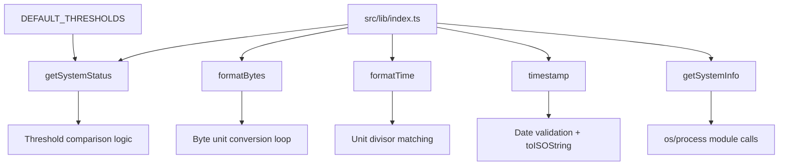
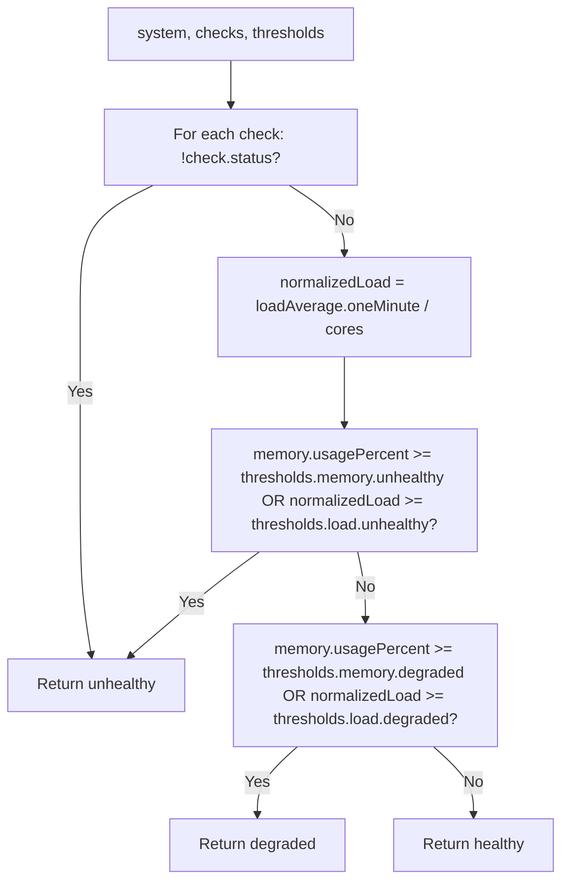

# Lib — Architecture Specification

@oneunit/core v1.0.0

## Component Overview

**Purpose:** The Lib feature provides low-level utility functions for byte formatting, time formatting, timestamp generation, system information retrieval, and system health status evaluation within the @oneunit/core package.

**Scope:** Internal mechanics of pure utility functions that operate on primitive inputs and return primitive outputs or plain objects. No external dependencies beyond Node.js built-in modules (`process`, `os`, `performance`).

**Responsibilities:**
- Convert byte counts into human-readable formatted strings with unit scaling
- Convert millisecond durations into human-readable time strings
- Generate ISO 8601 timestamps from Date objects
- Collect system information from the Node.js process and operating system
- Evaluate system health status based on configurable memory and load thresholds

## Source File Map

| File path | Responsibility | Key exports |
|-----------|---------------|-------------|
| `src/lib/index.ts` | Barrel exports for the Lib feature | All public Lib exports re-exported |
| `src/lib/system.ts` | Byte, time, and timestamp formatting utilities | `formatBytes`, `formatTime`, `timestamp` |
| `src/lib/system-status.ts` | System information and health status evaluation | `getSystemInfo`, `getSystemStatus`, `DEFAULT_THRESHOLDS` |
| `src/lib/docker.ts` | Docker-related utilities | Docker utility functions |
| `src/lib/kubernetes.ts` | Kubernetes-related utilities | Kubernetes utility functions |
| `src/lib/formatter.ts` | General formatting utilities | Formatting helper functions |

## Component Relationships Diagram (Mermaid)



## Data Flow Diagrams (Mermaid)

### formatBytes: input → validation → unit loop → formatted string

```mermaid
flowchart TD
    Input[bytes, decimals] --> V1[Number.isFinite(bytes)?]
    V1 -->|No| Err1[Throw InvalidBytesError]
    V1 -->|Yes| V2[bytes >= 0?]
    V2 -->|No| Err2[Throw NegativeBytesError]
    V2 -->|Yes| UL[Unit loop: while bytes >= 1024 and index < units.length-1]
    UL --> FS[${bytes.toFixed(decimals)} ${units[index]}]
    FS --> Output[Formatted string]
    Zero[bytes === 0] --> ZS["0 Bytes"]
    ZS --> Output
```

### formatTime: input → validation → divisor matching → formatted string

```mermaid
flowchart TD
    Input[ms] --> V1[Number.isFinite(ms)?]
    V1 -->|No| Err1[Throw InvalidTimeError]
    V1 -->|Yes| V2[ms >= 0?]
    V2 -->|No| Err2[Throw NegativeTimeError]
    V2 -->|Yes| DM[Match first unit where ms >= divisor]
    DM --> FS[Formatted time string]
    FS --> Output[Output string]
```

### timestamp: input → Date validation → ISO string

```mermaid
flowchart TD
    Input[date] --> V[date instanceof Date?]
    V -->|No| Err[Throw InvalidDateError]
    V -->|Yes| ISO[date.toISOString()]
    ISO --> Output[ISO 8601 string]
```

### getSystemStatus: system + checks + thresholds → check validation → memory/load comparison → status



## Internal State Model

- **No persistent state:** All functions are pure; they do not maintain or mutate any module-level mutable state.
- **DEFAULT_THRESHOLDS constant object:** A read-only configuration object exported from `system-status.ts` defining degraded and unhealthy thresholds for memory usage percent and load average.
- **Unit arrays for formatBytes and formatTime:** Static lookup arrays used for unit selection during formatting. These are immutable constants.

## Design Patterns

- **Pure Function Pattern:** All functions are pure — given the same inputs, they always produce the same outputs and have no side effects.
- **Validator Pattern:** Input validation is performed before any processing logic. Invalid inputs throw synchronously typed errors.
- **Threshold Pattern:** `getSystemStatus` uses configurable thresholds (via the `thresholds` parameter, defaulting to `DEFAULT_THRESHOLDS`) to determine health status.

## Technical Implementation Details

- `Number.isFinite` is used for non-finite checks on numeric inputs (`formatBytes`, `formatTime`).
- `process.memoryUsage()` provides memory metrics (rss, heapTotal, heapUsed, external, arrayBuffers).
- `os.cpus()`, `os.loadavg()`, `os.networkInterfaces()`, `os.userInfo()` provide operating system information for `getSystemInfo`.
- `Infinity` is used for zero-core load normalization in `getSystemStatus` (when `system.cpu.cores === 0`, `normalizedLoad = Infinity`, which triggers the unhealthy status).

## Concurrency Considerations

- **No shared state:** The module is thread-safe by design because there is no shared mutable state.
- **All functions are synchronous:** No asynchronous operations, promises, or callbacks are used.

## Error Model

| Error | Thrown by | Condition |
|-------|-----------|-----------|
| `InvalidBytesError` | `formatBytes` | `bytes` is not finite (`!Number.isFinite(bytes)`) |
| `NegativeBytesError` | `formatBytes` | `bytes` is negative (`bytes < 0`) |
| `InvalidTimeError` | `formatTime` | `ms` is not finite (`!Number.isFinite(ms)`) |
| `NegativeTimeError` | `formatTime` | `ms` is negative (`ms < 0`) |
| `InvalidDateError` | `timestamp` | Input is not an instance of `Date` |

All errors are thrown synchronously.

## Complexity Analysis

| Operation | Time Complexity | Space Complexity | Notes |
|-----------|----------------|------------------|-------|
| `formatBytes` | O(log₁₀₂₄(n)) | O(1) | Loop divides by 1024 until unit found; bounded by 9 units |
| `formatTime` | O(1) | O(1) | Fixed 6-unit divisor array; first match returned |
| `timestamp` | O(1) | O(1) | Single Date method call |
| `getSystemInfo` | O(1) | O(1) | Fixed set of os/process calls |
| `getSystemStatus` | O(c) where c = number of checks | O(1) | Linear scan of checks plus constant threshold comparisons |

## Detailed Function Specifications

### formatBytes(bytes, decimals = 2)

Validates that `bytes` is a finite number, throwing `InvalidBytesError` otherwise. Validates that `bytes` is non-negative, throwing `NegativeBytesError` otherwise. For zero, returns `"0 Bytes"`. Otherwise iterates through the units array `["Bytes", "KB", "MB", "GB", "TB", "PB", "EB", "ZB", "YB"]`, dividing by 1024 while `bytes >= 1024` and `index < units.length - 1`. Returns `${bytes.toFixed(decimals)} ${units[index]}`.

### formatTime(ms)

Validates that `ms` is a finite number, throwing `InvalidTimeError` otherwise. Validates that `ms` is non-negative, throwing `NegativeTimeError` otherwise. Iterates through the units array `[[1000*60*60*24*365, "y"], [1000*60*60*24, "d"], [1000*60*60, "h"], [1000*60, "m"], [1000, "s"], [1, "ms"]]` and returns the formatted string for the first divisor where `ms >= divisor`.

### timestamp(date)

Validates that `date` is an instance of `Date`, throwing `InvalidDateError` otherwise. Returns `date.toISOString()`.

### getSystemInfo()

Returns an object with the following shape:
- `process`: `{ pid, ppid, version, env.NODE_ENV, uptime }`
- `performance`: `{ uptime, now }` where `uptime` is `process.uptime()` and `now` is `Date.now()`
- `memory`: `process.memoryUsage()` result (`rss`, `heapTotal`, `heapUsed`, `external`, `arrayBuffers`)
- `cpu`: `{ arch, platform, model, cores, loadAverage }` from `os.arch()`, `os.platform()`, `os.cpus()[0].model`, `os.cpus().length`, `os.loadavg()`
- `network`: `os.networkInterfaces()`
- `user`: `os.userInfo()`

### getSystemStatus(system, checks, thresholds)

Uses `DEFAULT_THRESHOLDS` = `{ memory: { degraded: 75, unhealthy: 90 }, load: { degraded: 0.7, unhealthy: 1.0 } }` when no thresholds are provided. Computes `normalizedLoad = system.cpu.cores === 0 ? Infinity : system.cpu.loadAverage.oneMinute / system.cpu.cores`. For each check, if `!check.status` returns `"unhealthy"`. If `system.memory.usagePercent >= thresholds.memory.unhealthy` OR `normalizedLoad >= thresholds.load.unhealthy`, returns `"unhealthy"`. If `system.memory.usagePercent >= thresholds.memory.degraded` OR `normalizedLoad >= thresholds.load.degraded`, returns `"degraded"`. Otherwise returns `"healthy"`. Zero cores produces `normalizedLoad = Infinity`, which always triggers the unhealthy status.
