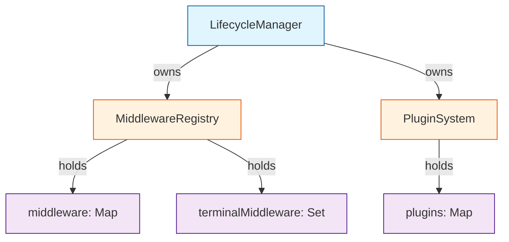

# Lifecycle — Architecture Specification

@oneunit/core v1.0.0

## Component Overview

**Purpose.** The Lifecycle feature provides a configurable execution pipeline for cross-cutting concerns in the @oneunit/core package. It manages middleware registration and execution, plus namespace-isolated plugin hooks, across three lifecycle modes that alter validation strictness, timeouts, and error handling.

**Scope.** The feature owns request/response/error middleware chaining (Chain of Responsibility), plugin hook execution (Plugin Pattern), conflict detection between middleware types, per-execution timeouts enforced by setTimeout, and validation/reporting of registration safety.

**Responsibilities.**
- Register, unregister, list, and query middleware and plugins.
- Execute middleware individually or as an ordered chain with abort semantics.
- Execute plugin hooks globally or isolated to a single namespace.
- Detect type conflicts (same type cannot register twice), header conflicts (multiple middleware track the same header), and plugin name conflicts within a namespace.
- Enforce maximum registration counts and allowed-type restrictions per mode.
- Track execution/error counts and expose a validation report.
- Provide a factory-style framework middleware builder (`createLifecycleMiddleware`).

**Modes.**
- `easy`: throwOnError=true, autoRegisterEssential=true, lenient defaults.
- `advanced` (default): throwOnError=false, executionTimeoutMs=5000, maxMiddleware/maxPlugins=50.
- `strict`: throwOnError=true, executionTimeoutMs=2000, maxMiddleware=20, maxPlugins=20.

## Source File Map

| File path | Responsibility | Key exports |
|-----------|----------------|-------------|
| `src/lifecycle/types.ts` | Type definitions, defaults, mode constants, conflict matrix | `LifecycleMode`, `LifecycleOptions`, `MiddlewareRegistration`, `PluginRegistration`, `ConflictInfo`, `HeaderConflict`, `LifecycleState`, `MiddlewareContext`, `PluginContext`, `MiddlewareResult`, `PluginResult`, `LIFECYCLE_MODES`, `DEFAULT_LIFECYCLE_OPTIONS`, `EASY_MODE_DEFAULTS`, `STRICT_MODE_DEFAULTS`, `ESSENTIAL_MIDDLEWARE_TYPES`, `MIDDLEWARE_CONFLICT_MATRIX` |
| `src/lifecycle/manager.ts` | Orchestrates MiddlewareRegistry and PluginSystem; public API surface | `LifecycleManager` |
| `src/lifecycle/middleware-registry.ts` | Middleware store, conflict detection, header-conflict detection, timeout-wrapped execution | `MiddlewareRegistry` |
| `src/lifecycle/plugin-system.ts` | Namespace-isolated plugin store, hook execution with per-listener timeouts | `PluginSystem` |
| `src/lifecycle/index.ts` | Barrel exports for the feature | `LifecycleManager`, adapters, types, constants |

## Component Relationships Diagram



## Data Flow Diagrams

### 1. registerMiddleware() flow

```mermaid
flowchart TD
    A[registerMiddleware(name, type, middleware, options)]
    B{initialized?}
    C[middleware.size >= maxMiddleware?]
    D{type in allowedTypes?}
    E[detectConflict: same type already registered?]
    F[store registration; terminal? add to terminalMiddleware]
    G[recompute headerConflicts]
    H[return {success, conflicts, headerConflicts}]

    A --> B
    B -- no --> Z1[error: Lifecycle not initialized]
    B -- yes --> C
    C -- yes --> Z2[error: Maximum middleware limit reached]
    C -- no --> D
    D -- no --> Z3[error: Middleware type not allowed]
    D -- yes --> E
    E -- conflict --> F
    E -- no conflict --> F
    F --> G
    G --> H
```

### 2. executeMiddleware() flow

```mermaid
flowchart TD
    A[executeMiddleware(name, req, res, phase)]
    B[build MiddlewareContext {req,res,next,phase,abort,aborted}]
    C[registry.get(name)]
    D{found?}
    E[setTimeout(executionTimeoutMs)]
    F[Promise.race(middleware(req,res,next), timeoutPromise)]
    G[clearTimeout]
    H[return MiddlewareResult {success, aborted, error?, durationMs}]
    I[error: Middleware not found]

    A --> B --> C --> D
    D -- no --> I
    D -- yes --> E --> F --> G --> H
```

### 3. executeMiddlewareChain() flow

```mermaid
flowchart TD
    A[executeMiddlewareChain(req, res, phase)]
    B[ordered = list() sorted by priority descending]
    C[iterate registrations]
    D{ctx.aborted?}
    E[nextCalled = false]
    F[execute(reg.name, ctx with trackNext)]
    G[result.aborted?]
    H{nextCalled && !terminal?}
    I[ctx.aborted = true; break]
    J[continue to next registration]
    K[return MiddlewareResult[]]

    A --> B --> C
    C --> D
    D -- yes --> K
    D -- no --> E --> F --> G
    G -- yes --> I --> K
    G -- no --> H
    H -- no --> I
    H -- yes --> J --> C
```

### 4. registerPlugin() flow

```mermaid
flowchart TD
    A[registerPlugin(name, namespace, hooks, options)]
    B{initialized?}
    C[plugins.size >= maxPlugins?]
    D[detectPluginConflict: same name in same namespace?]
    E[key = namespace:name; store; track namespace]
    F[return {success, conflicts}]

    A --> B
    B -- no --> Z1[error: Lifecycle not initialized]
    B -- yes --> C
    C -- yes --> Z2[error: Maximum plugin limit reached]
    C -- no --> D --> E --> F
```

### 5. executeHook() flow

```mermaid
flowchart TD
    A[executeHook(hookName, context)]
    B[ordered = list() sorted by priority descending]
    C[iterate registrations]
    D{hooks[hookName] exists?}
    E[iterate listeners]
    F[setTimeout(executionTimeoutMs)]
    G[Promise.race(listener(context), timeoutPromise)]
    H[clearTimeout; track anySucceeded]
    I[throwOnError? break on error]
    J[push success result if anySucceeded]
    K[return PluginResult[]]

    A --> B --> C --> D
    D -- no --> C
    D -- yes --> E --> F --> G --> H --> I --> J --> C
    C --> K
```

## Internal State Model

**LifecycleManager (top-level):**
- `mode: LifecycleMode` — `"easy" | "advanced" | "strict"`
- `executionTimeoutMs: number` — per-execution timeout in ms
- `throwOnError: boolean` — whether errors propagate vs. are isolated
- `maxMiddleware: number` — cap on middleware registrations
- `maxPlugins: number` — cap on plugin registrations
- `allowedMiddlewareTypes: string[] | null` — allowed types in easy mode (`null` = all)
- `autoRegisterEssential: boolean` — auto-register essential middleware in easy mode
- `middlewareRegistry: MiddlewareRegistry`
- `pluginSystem: PluginSystem`
- `initialized: boolean`
- `executionCount: number`, `errorCount: number`

**MiddlewareRegistry:**
- `middleware: Map<string, MiddlewareRegistration>` — name → registration
- `terminalMiddleware: Set<string>` — names marked terminal (skip next() requirement)
- `conflicts: ConflictInfo[]` — accumulated middleware conflicts
- `headerConflicts: HeaderConflict[]` — accumulated header conflicts
- `maxMiddleware: number`, `allowedTypes: Set<string> | null`, `executionTimeoutMs: number`

**PluginSystem:**
- `plugins: Map<string, PluginRegistration>` — keyed by `namespace:name`
- `namespaces: Set<string>` — active namespaces
- `throwOnError: boolean`, `executionTimeoutMs: number`, `maxPlugins: number`

**MiddlewareRegistration:**
- `name: string`, `type: string`
- `middleware: (req, res, next?) => void | Promise<void>`
- `priority: number` — higher executes first
- `conflictTypes?: string[]`, `version: string`, `trackHeaders?: string[]`

**PluginRegistration:**
- `name: string`, `namespace: string`
- `hooks: Record<string, Array<(context) => void | Promise<void>>>`
- `priority: number`, `version: string`

**MiddlewareContext:**
- `req: unknown`, `res: unknown`, `next: () => void`, `phase: "request" | "response" | "error"`
- `abort: () => void`, `aborted: boolean`

**PluginContext:**
- `name: string`, `namespace: string`, `emit: (event, data) => void`, `on: (event, listener) => void`

**MiddlewareResult / PluginResult:**
- `success: boolean`, `error?: Error`, `durationMs: number`
- `MiddlewareResult` additionally: `aborted: boolean`

**LifecycleState:**
- `mode`, `initialized`, `middlewareCount`, `pluginCount`, `conflicts`, `headerConflicts`, `executionCount`, `errorCount`

## Design Patterns

- **Registry Pattern** — `MiddlewareRegistry` and `PluginSystem` own the registration maps and provide register/unregister/list/has/size/clear.
- **Chain of Responsibility** — `executeMiddlewareChain` sorts middleware by priority (descending) and walks them; each non-terminal middleware must call `next()` or the chain aborts.
- **Plugin Pattern** — `PluginSystem` stores plugins keyed by `namespace:name`; hooks execute per namespace with isolation support via `executeHookIsolated`.
- **State Pattern** — lifecycle modes (`easy`/`advanced`/`strict`) change `throwOnError`, `executionTimeoutMs`, `maxMiddleware`, `maxPlugins`, `autoRegisterEssential`, and `allowedMiddlewareTypes` behavior.
- **Factory Pattern** — `createLifecycleMiddleware(framework)` builds a framework-specific middleware closure that runs the registered chain (Express/Fastify/Koa/node:http).
- **Timeout / Race Pattern** — each execution wraps the handler in `Promise.race(handler, setTimeoutPromise)` and clears the timer in `finally` so no lingering timers remain.

## Technical Implementation Details

**Timeout handling.** A `setTimeout` is created for every middleware/plugin execution. The handler and the timeout promise are raced via `Promise.race`. On timeout, the promise rejects with an `Error` whose message indicates the middleware/plugin name and hook. The timer is cleared in a `finally` block so no lingering timers remain. Timeout produces `MiddlewareTimeoutError`-equivalent or `PluginTimeoutError`-equivalent errors surfaced as `error` on the result (or thrown when `throwOnError` is true).

**Priority-based sorting.** `MiddlewareRegistry.list()` and `PluginSystem.list()` return registrations sorted by `priority` descending (`b.priority - a.priority`). Default priority is `0`.

**next() required / abort semantics.** In `executeAll`, each middleware runs with a wrapped `next` that sets `nextCalled = true`. After execution, if `nextCalled` is false and the middleware is not in `terminalMiddleware`, the chain aborts (`ctx.aborted = true`, loop breaks). `abort()` sets `ctx.aborted = true` and also breaks the chain.

**Namespace isolation for plugins.** Plugins are keyed by `namespace:name`. A plugin name may exist in multiple namespaces; the same name within the same namespace is a conflict. `executeHookIsolated` runs hooks only for registrations in the requested namespace.

**Conflict detection matrix for middleware.** `MIDDLEWARE_CONFLICT_MATRIX` maps a type to the set of conflicting types (by default each type conflicts only with itself: cors→cors, csrf→csrf, helmet→helmet, compression→compression, sanitize→sanitize, multipart→multipart). Registering a middleware whose type conflicts with an existing registration yields a `ConflictInfo` with `severity: "error"`.

**Header conflicts.** Middleware declaring `trackHeaders` registers interest in headers. After each registration/unregistration, header conflicts are recomputed: any header tracked by more than one middleware yields a `HeaderConflict` with `severity: "warning"` (not an error).

**Validation.** `getValidationReport()` returns `safe` (no error-severity conflicts and no header conflicts), `conflicts`, `headerConflicts`, `warnings`, and `errors`. `isSafe()` returns true when there are no error-severity conflicts.

## Concurrency Considerations

- All state lives in JavaScript `Map`/`Set` instances. Node.js is single-threaded for the event loop, so these structures are not accessed concurrently by multiple threads; no locking is required.
- Timeout promises are cleared via `clearTimeout` in `finally` blocks to prevent lingering timers from keeping the process alive or causing duplicate rejections.
- Async execution is sequential within a chain (awaited one at a time), not parallel, preserving deterministic ordering.

## Error Model

| Error | Triggered by |
|-------|--------------|
| `MiddlewareLimitError` (message: `Maximum middleware limit (N) reached`) | `register` when `middleware.size >= maxMiddleware` |
| `MiddlewareTypeNotAllowedError` (message: `Middleware type "X" is not allowed in current mode`) | `register` when `allowedTypes` is set and type not present |
| `MiddlewareNotFoundError` (message: `Middleware "name" not found`) | `execute` when registration missing |
| `MiddlewareTimeoutError` (message: `Middleware "name" timed out`) | `execute` when timeout wins the race |
| `PluginLimitError` (message: `Maximum plugin limit (N) reached`) | `PluginSystem.register` when `plugins.size >= maxPlugins` |
| `PluginAlreadyExistsError` (message: `Plugin "name" already exists in namespace "X"`) | `PluginSystem.register` when same name in same namespace |
| `MiddlewareConflictError` / `MiddlewareTypeConflictError` | `register` when conflict matrix detects a type conflict (`severity: "error"`) |
| `HeaderConflictError` | Header conflict tracking (`severity: "warning"`; reported but not blocking) |
| `LifecycleNotInitializedError` (message: `Lifecycle not initialized`) | `registerMiddleware`/`registerPlugin` when `initialized === false` |

Errors surface through returned result objects (`{ success: false, error }`) and, when `throwOnError` is true, are re-thrown by `LifecycleManager`. Timeout and not-found errors are `Error` instances placed on `MiddlewareResult.error` / `PluginResult.error`.

## Complexity Analysis

| Operation | Time | Space | Notes |
|-----------|------|-------|-------|
| `MiddlewareRegistry.register` | O(M + H) | O(1) amortized | M = middleware count (conflict scan + header recompute), H = header entries |
| `MiddlewareRegistry.unregister` | O(C + M) | O(1) | C = conflicts count; recomputes header conflicts |
| `MiddlewareRegistry.execute` | O(1) | O(1) | Timeout race; duration measured via `Date.now` |
| `MiddlewareRegistry.executeAll` | O(M log M + M·E) | O(M) | Sort by priority then sequential execution; E = per-middleware execution |
| `PluginSystem.register` | O(P) | O(1) | P = plugin count (conflict scan) |
| `PluginSystem.unregister` | O(P) | O(1) | Namespace cleanup scan |
| `PluginSystem.executeHook` | O(P · L · T) | O(R) | P = plugins, L = listeners per hook, T = timeout race; R = results |
| `PluginSystem.executeHookIsolated` | O(N · L · T) | O(1) | N = plugins in namespace |
| `LifecycleManager.getState` / `getValidationReport` | O(M + P) | O(M + P) | Aggregates sub-system state |
| `createLifecycleMiddleware` | O(M) per invocation | O(M) | Builds ctx and iterates registrations |

M = middleware count, P = plugin count, N = plugins in a namespace, L = listeners per hook, C = conflicts count, H = header entries, R = result count.
