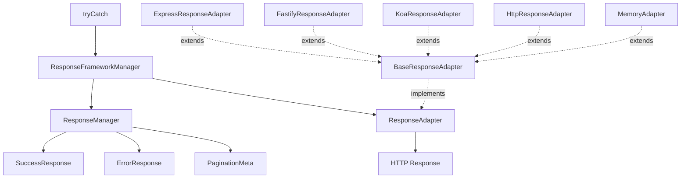
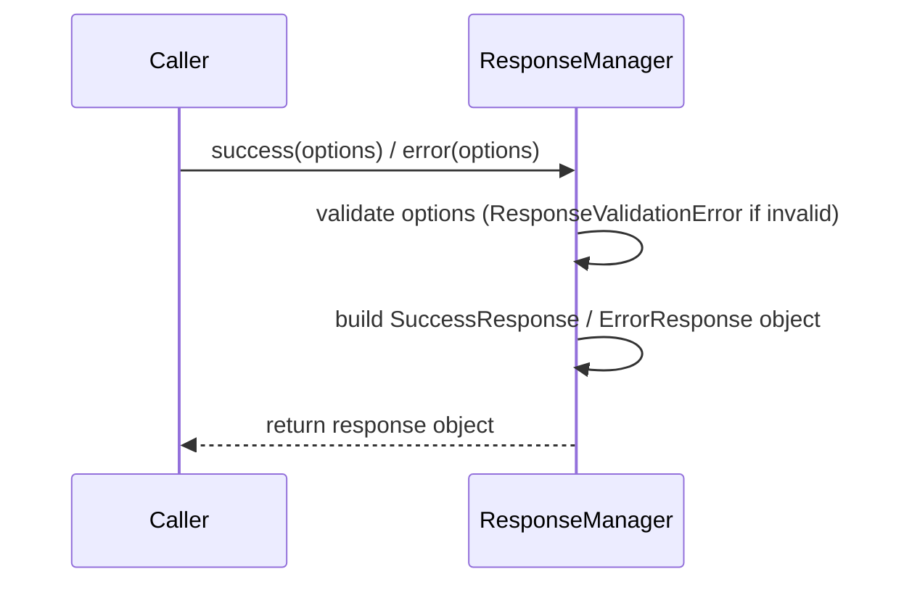
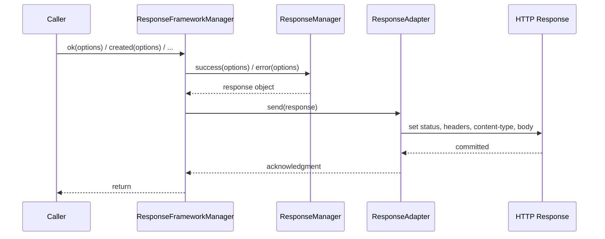
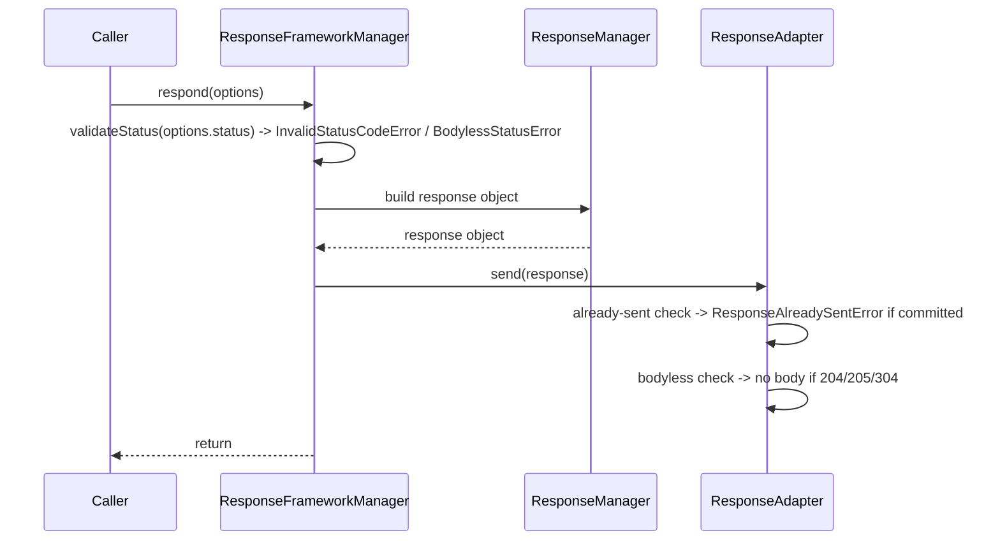

# Response Management — Architecture Specification

@oneunit/core v1.0.0

This document is a standalone technical architecture specification for the Response Management feature of the @oneunit/core package. It is completely self-contained and references no external documentation.

## Component Overview

**Purpose.** The Response Management feature provides a consistent, framework-agnostic API for constructing and sending HTTP responses (success, error, paginated) across multiple Node.js web frameworks. It decouples response construction from framework-specific response objects so that business logic remains portable.

**Scope.** The feature covers response object construction (SuccessResponse, ErrorResponse, PaginationMeta, FieldError), framework adapter abstractions (Express, Fastify, Koa, node:http, memory fallback), status-code validation, error handling, and request-handler wrapping with optional error catching.

**Responsibilities.**
- Build standardized success and error response objects.
- Attach pagination metadata to success responses.
- Send responses through framework-specific adapters with correct headers, status, and content type.
- Validate HTTP status codes and reject unsupported or invalid options.
- Detect already-committed responses to prevent double-sends.
- Wrap async request handlers with optional try/catch error handling.
- Auto-detect the hosting framework and select the matching response adapter.

## Source File Map

| File path | Responsibility | Key exports |
|-----------|----------------|-------------|
| `src/response-mangement/index.ts` | Barrel exports and manager factory functions | `createResponseManager`, `createResponseFrameworkManager`, re-exports of types and registry |
| `src/response-mangement/types.ts` | Response type definitions, status constants, error classes | `ResponseOptions`, `ErrorOptions`, `RespondOptions`, `SuccessResponse`, `ErrorResponse`, `PaginationMeta`, `FieldError`, `HTTP_STATUS`, `ERROR_RESPONSES`, `SUCCESS_RESPONSES`, `AdapterError`, `ResponseAlreadySentError`, `BodylessStatusError`, `InvalidStatusCodeError`, `ResponseValidationError` |
| `src/response-mangement/registry.ts` | Stateless response manager and framework-bound manager classes | `ResponseManager`, `ResponseFrameworkManager` |
| `src/response-mangement/trycatch.ts` | Async handler wrapper with optional error catching | `tryCatch` |
| `src/adapters/response/base.ts` | Abstract base response adapter defining the send() contract | `BaseResponseAdapter` |
| `src/adapters/response/express.ts` | Express response adapter | `ExpressResponseAdapter` |
| `src/adapters/response/fastify.ts` | Fastify response adapter | `FastifyResponseAdapter` |
| `src/adapters/response/koa.ts` | Koa response adapter | `KoaResponseAdapter` |
| `src/adapters/response/http.ts` | node:http response adapter | `HttpResponseAdapter` |
| `src/adapters/response/types.ts` | Adapter interface and send options | `ResponseAdapter`, `ResponseSendOptions` |
| `src/adapters/response/index.ts` | Adapter barrel exports and factory functions | Adapter factory functions, barrel re-exports |

## Component Relationships Diagram



## Data Flow Diagrams

### 1. success() / error() → build response object → return



### 2. ok / created / etc.() → manager method → adapter.send() → HTTP response



### 3. respond() → validateStatus → build response → adapter.send()



### 4. wrapHandler() → try/catch → handler → success/error response

```mermaid
sequenceDiagram
    participant C as Caller
    participant RFM as ResponseFrameworkManager
    participant H as Async Handler
    participant TC as tryCatch
    participant RA as ResponseAdapter
    participant HTTP as HTTP Response
    C->>RFM: wrapHandler(handler)
    RFM->>TC: wrap async handler
    TC->>H: invoke handler
    alt handler resolves
        H-->>TC: value
        TC-->>RFM: value
        RFM->>RFM: ok / created / etc. send
    alt handler rejects
        H-->>TC: error
        TC->>TC: catch error
        RFM->>RFM: error response (defaultErrorStatusCode)
        RFM->>RA: send error response
        RFM->>RFM: next() after error (potential double-response)
    end
```

### 5. Framework detection → adapter selection → send()

```mermaid
flowchart TD
    Start[Request received] --> Detect[Framework auto-detection]
    Detect -->|ctx.cookies present| Koa[Koa adapter]
    Detect -->|res.raw.send + code present| Fastify[Fastify adapter]
    Detect -->|res.status + json + send present| Express[Express adapter]
    Detect -->|res.setHeader present| HTTP[node:http adapter]
    Detect -->|fallback| Memory[Memory adapter]
    Koa --> Send[adapter.send()]
    Fastify --> Send
    Express --> Send
    HTTP --> Send
    Memory --> Send
    Send --> HTTPResp[HTTP response committed]
```

## Internal State Model

**ResponseManager (stateless).**
- Holds no instance state.
- `success(options)`, `error(options)`, `paginated(options)` construct and return response objects without side effects.
- `static pagination(total, page, pageSize)` computes and returns a `PaginationMeta` value object.
- No stored configuration; pure functions over inputs.

**ResponseFrameworkManager (framework-bound).**
Instance state:
- `manager: ResponseManager` — used to build response objects.
- `adapter: ResponseAdapter` — used to send responses to the HTTP layer.
- `config: { tryCatchEnabled: boolean; defaultErrorStatusCode: number }` — behavior flags.

**Adapters (framework-specific I/O).**
- Hold a reference to the framework's native response object.
- Perform framework-specific I/O: setting status, headers, content type, and writing the body.
- Track whether the response has already been committed to enforce the already-sent contract.

## Design Patterns

**Factory Pattern.**
- `createResponseManager()` produces a `ResponseManager` instance.
- `createResponseFrameworkManager()` produces a `ResponseFrameworkManager` instance bound to a specific manager, adapter, and config.

**Strategy Pattern.**
- Framework-specific response adapters (Express, Fastify, Koa, node:http, memory) implement the same `ResponseAdapter` interface. The active adapter is selected at construction time based on framework auto-detection or explicit injection.

**Template Pattern.**
- `respond(options)` defines the invariant algorithm: validate status, build the response via the manager, then send via the adapter. Subclasses or callers supply only the options; the validation/build/send sequence is fixed.

**Decorator Pattern.**
- `wrapHandler(handler)` decorates an async request handler by adding error handling (try/catch when `tryCatchEnabled` is true) and post-error flow (calling `next()`), without modifying the handler's own logic.

## Technical Implementation Details

- `tryCatchEnabled` defaults to `true`. When `true`, `wrapHandler` catches thrown/rejected errors and sends an error response using `defaultErrorStatusCode`.
- `noContent()` bypasses `respond()` validation: it calls `adapter.send()` directly with status 204 and no body, skipping `validateStatus()`.
- `wrapHandler` calls `next()` after sending an error response, which can cause a double-response if the downstream middleware or framework also attempts to send.
- Framework auto-detection priority: Koa → Fastify → Express → node:http → memory fallback.
- Detection signals:
  - Koa: `ctx.cookies` present.
  - Fastify: `res.raw.send` and `res.raw.code` present.
  - Express: `res.status`, `res.json`, and `res.send` present.
  - node:http: `res.setHeader` present.
  - Fallback: memory adapter.
- Status code validation (`validateStatus`):
  - Valid range: 200–599 inclusive; outside this range throws `InvalidStatusCodeError`.
  - Success range: 2xx excluding bodyless statuses (204, 205).
  - Error range: 4xx and 5xx.
  - Bodyless statuses: 204, 205, 304 — no body is written.
  - 3xx statuses are not supported.
  - Field errors are permitted only on 4xx/5xx responses.
- `send()` contract (`BaseResponseAdapter`):
  - Sets HTTP status, response headers, and `content-type: application/json`.
  - For bodyless statuses, writes no body.
  - Detects already-committed responses and throws `ResponseAlreadySentError`.

## Concurrency Considerations

- No shared mutable state exists between concurrent responses; each response is built from its own input options.
- The adapter's already-sent detection guards against double-send within a single response lifecycle.
- `wrapHandler`'s `next()` call after error may interleave with downstream middleware; callers must ensure idempotency or guard against duplicate sends where the framework does not short-circuit.

## Error Model

| Error | Trigger |
|-------|---------|
| `ResponseManagementError` | Base class for all response management errors. |
| `ResponseAlreadySentError` | `send()` invoked on a response that has already been committed. |
| `BodylessStatusError(status)` | A body was provided for a bodyless status (204, 205, 304). |
| `InvalidStatusCodeError(status)` | Status code outside the valid range 200–599. |
| `ResponseValidationError` | Invalid response options (e.g., field errors on non-4xx/5xx, missing required fields). |

## Complexity Analysis

- **Time complexity:** O(B) where B is the size of the response body (serialization and body writing dominate). Status validation, metadata computation, and header setting are O(1). Pagination meta computation is O(1).
- **Space complexity:** O(B) to hold the serialized response body before writing; O(1) auxiliary state per response. No retained state across responses.
