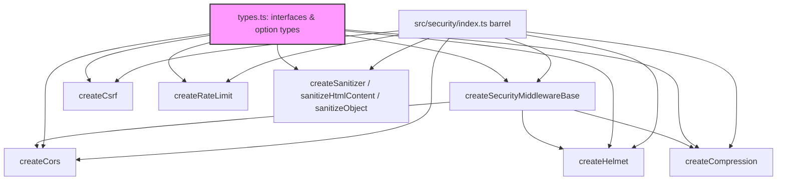

# Security — Architecture Specification

@oneunit/core v1.0.0

## Component Overview

**Purpose:** The Security feature of `@oneunit/core` provides framework-agnostic middleware utilities for securing HTTP applications. It includes CORS handling, CSRF protection (double-submit cookie), security HTTP headers (Helmet-style), response compression, HTML/object sanitization, and sliding-window rate limiting.

**Scope:** All security middleware lives under `src/security/` and is barrel-exported through `src/security/index.ts`. Each middleware follows the Express-style signature `(req, res, next) => void` and is constructed via factory functions (`createCors`, `createCsrf`, `createHelmet`, `createCompression`, `createRateLimit`, `createSanitizer`). Shared boilerplate (enabled toggle, options getter, middleware wrapper) is centralized in `createSecurityMiddlewareBase`.

**Responsibilities:**
- CORS: origin resolution, preflight OPTIONS handling, Access-Control-* headers.
- CSRF: token generation, cookie management, double-submit validation, constant-time comparison.
- Helmet: security response headers (CSP, HSTS, X-Frame-Options, etc.).
- Compression: accept-encoding negotiation, response body patching, gzip/deflate/brotli compression.
- Sanitize: HTML sanitization via `sanitize-html`, recursive object sanitization.
- Rate Limit: sliding window per key, 429 responses, rate limit headers.

## Source File Map

| File Path | Responsibility | Key Exports |
|-----------|----------------|-------------|
| `src/security/index.ts` | Barrel exports for the security module | `createCors`, `createCsrf`, `createSanitizer`, `sanitizeHtmlContent`, `sanitizeObject`, `createCompression`, `createHelmet`, `createSecurityMiddlewareBase`, `createRateLimit`, plus all type re-exports |
| `src/security/types.ts` | Type definitions and interfaces for all security types | `SecurityOptions`, `CorsOptions`, `CsrfOptions`, `SanitizeOptions`, `HelmetOptions`, `CompressionOptions`, `SecurityMiddleware`, `CorsMiddleware`, `CsrfMiddleware`, `HelmetMiddleware`, `CompressionMiddleware`, `SecurityContext`, `SecurityResult`, `RateLimitMiddleware`, `RateLimitOptions`, `RateLimitInfo`, `SecurityProvider` |
| `src/security/cors.ts` | CORS middleware: origin validation, preflight handling, header building | `DEFAULT_CORS_OPTIONS`, `createCors`, `CorsMiddleware`, `CorsOptions` type re-export |
| `src/security/csrf.ts` | CSRF middleware: double-submit cookie pattern, token validation | `DEFAULT_CSRF_OPTIONS`, `createCsrf`, `CsrfMiddleware`, `CsrfOptions` type re-export |
| `src/security/helmet.ts` | Security headers middleware (CSP, HSTS, referrer policy, etc.) | `DEFAULT_HELMET_OPTIONS`, `createHelmet`, `HelmetMiddleware`, `HelmetOptions` type re-export |
| `src/security/compression.ts` | Response body compression middleware | `DEFAULT_COMPRESSION_OPTIONS`, `createCompression`, `CompressionMiddleware`, `CompressionOptions` type re-export |
| `src/security/sanitize.ts` | HTML and object sanitization using `sanitize-html` | `DEFAULT_SANITIZE_OPTIONS`, `sanitizeHtmlContent`, `sanitizeObject`, `Sanitizer`, `createSanitizer`, `SanitizeOptions` type re-export |
| `src/security/rate-limit.ts` | Sliding-window rate limiter middleware | `DEFAULT_WINDOW_MS`, `DEFAULT_MAX_REQUESTS`, `DEFAULT_STATUS_CODE`, `DEFAULT_MESSAGE`, `WindowEntry` (class), `createRateLimit`, `RateLimitMiddleware`, `RateLimitOptions`, `RateLimitInfo` type re-exports |
| `src/security/middleware-base.ts` | Shared enabled-toggle middleware wrapper base | `createSecurityMiddlewareBase` |

## Component Relationships Diagram



The `SecurityMiddleware` interface (`name`, `enabled`, `options`, `enable()`, `disable()`, `toggle()`) is implemented by `CorsMiddleware`, `CsrfMiddleware`, `HelmetMiddleware`, `CompressionMiddleware`, and `RateLimitMiddleware`. `createSecurityMiddlewareBase` constructs the shared enabled-state + middleware wrapper used by CORS, Helmet, and Compression. CSRF and Rate Limit implement their own enabled-state logic inline but conform to the same interface shape.

## Data Flow Diagrams

### 1. CORS Data Flow

```mermaid
flowchart TD
    A[Incoming HTTP Request] --> B[coreMiddleware invoked]
    B --> C[headers() builds Access-Control-* map]
    C --> D[Set headers on response via setHeader]
    D --> E{Method is OPTIONS?}
    E -->|Yes| F[Preflight path]
    E -->|No| G[Call next() to continue chain]
    F --> H{origin allowed?}
    H -->|No & origin != *| I[403 Forbidden, end response]
    H -->|Yes / origin == *| J{preflightContinue?}
    J -->|Yes| G
    J -->|No| K[Set status to optionsSuccessStatus (204), end response]
```

### 2. CSRF Data Flow

```mermaid
flowchart TD
    A[Incoming HTTP Request] --> B[middleware() invoked]
    B --> C{Method in ignoreMethods?}
    C -->|Yes| D[Call next(), skip validation]
    C -->|No| E[getTokenFromRequest: header, query, or body]
    E --> F[getTokenCookie: regex on Cookie header]
    F --> G[validateToken: constantTimeCompare]
    G -->|Invalid / missing| H[403 Forbidden: CSRF token missing or invalid]
    G -->|Valid| I[Call next()]
    I --> J[middlewareWithToken: optionally re-issue Set-Cookie]
```

### 3. Helmet Data Flow

```mermaid
flowchart TD
    A[Incoming HTTP Request] --> B[coreMiddleware invoked]
    B --> C[headers() builds header map]
    C --> D[Iterate entries, call res.setHeader for each]
    D --> E[Call next()]
```

### 4. Compression Data Flow

```mermaid
flowchart TD
    A[Incoming HTTP Request] --> B[coreMiddleware invoked]
    B --> C{shouldCompress: accept-encoding present?}
    C -->|No| D[Call next(), no patching]
    C -->|Yes| E[selectEncoding: br > gzip > deflate]
    E --> F{__oneunit_compression_patched marker?}
    F -->|Yes| D
    F -->|No| G[Patch res.write: collect chunks into buffer array]
    G --> H[Patch res.end: on final, concat chunks]
    H --> I{body.length >= threshold?}
    I -->|No| J[Send uncompressed]
    I -->|Yes| K[compressSync via node:zlib]
    K --> L{compression error?}
    L -->|Yes| J
    L -->|No| M[Set Content-Encoding, Vary, remove Content-Length; send compressed]
```

### 5. Rate Limit Data Flow

```mermaid
flowchart TD
    A[Incoming HTTP Request] --> B[middleware() invoked]
    B --> C{enabled?}
    C -->|No| D[Call next(), no rate limiting]
    C -->|Yes| E[getKey: x-forwarded-for > x-real-ip > connection.remoteAddress > socket.remoteAddress > unknown]
    E --> F[getWindow(key): create or retrieve WindowEntry from Map]
    F --> G[window.add(now): push timestamp, prune expired]
    G --> H{window.count > maxRequests?}
    H -->|Yes| I[429 Too Many Requests, set rate limit headers, end]
    H -->|No| J[Set X-RateLimit-* headers on success, call next()]
```

## Internal State Model

### SecurityMiddleware

Each middleware created via `createSecurityMiddlewareBase` maintains:

- `enabled: boolean` — defaults to `true`. When `false`, the wrapped middleware calls `next()` immediately without executing security logic. Modified via `enable()`, `disable()`, `toggle()`.
- `options: Record<string, unknown>` — getter returns a shallow copy (`{ ...options }`) to prevent external mutation of internal options.

### Rate Limit

- `windows: Map<string, WindowEntry>` — singleton map shared across all requests within the same process instance. Key is the client identifier (typically IP), value is a `WindowEntry`.
- `WindowEntry`:
  - `timestamps: number[]` — array of request timestamps within the current window.
  - `add(timestamp)` — pushes timestamp, then prunes entries older than `windowMs`.
  - `prune(currentTime)` — removes timestamps `<= currentTime - windowMs` from the front of the array.
  - `count` (getter) — `timestamps.length`.
  - `oldest` (getter) — `timestamps[0]` or `null`.
  - `reset()` — clears the timestamps array.

### CSRF

No persistent state. Tokens are generated per call via `randomBytes(32).toString("hex")`. Validation compares the token from the request against the token in the Cookie header using constant-time comparison.

### Compression

No persistent state. The compression patch (`__oneunit_compression_patched` marker) is applied per response object and discarded when the response completes.

### Helmet

No persistent state. Headers are computed on each request from the merged options.

### CORS

No persistent state. Origin resolution is computed per request from the merged options and the incoming `Origin` header.

## Design Patterns

| Pattern | Description |
|---------|-------------|
| Strategy Pattern | `createSecurityMiddlewareBase` provides a framework-agnostic middleware base; each security feature (CORS, CSRF, Helmet, Compression, Rate Limit) implements its own strategy while conforming to the `SecurityMiddleware` interface. |
| Middleware Pattern | All security middleware use Express-style `(req, res, next) => void` signatures, composable in any HTTP framework. |
| Singleton Pattern | The rate limiter's `windows` map is a module-level singleton shared across all requests in the process. |
| Decorator Pattern | Compression monkey-patches `res.write` and `res.end` to intercept and transform the response body, guarded by the `__oneunit_compression_patched` marker to ensure patching happens once per response. |

## Technical Implementation Details

### CORS Origin Resolution

`resolveOrigin(originHeader, allowed)` handles three forms of the `origin` option:
- `boolean true` — reflects the request origin back (`Access-Control-Allow-Origin: <origin>`).
- `boolean false` — returns `null` (no CORS headers).
- `string` — if `"*"`, returns `"*"`; otherwise matches against `originHeader` and returns the allowed string or `null`.
- `string[]` — if `originHeader` is in the array, returns `originHeader`; otherwise `null`.

`isOriginAllowed(origin, allowed)` is the boolean preflight check variant of the same logic.

When `credentials === true` and `origin === "*"` and an `Origin` header is present, `Access-Control-Allow-Origin` is overridden to reflect the request origin (browsers do not allow wildcard with credentials).

Preflight `OPTIONS` requests return 403 if the origin is not allowed and `origin !== "*"`; otherwise they set status to `optionsSuccessStatus` (default 204) and end the response.

### CSRF Constant-Time Comparison

`constantTimeCompare(a, b)` first checks `a.length !== b.length` and returns `false` immediately on mismatch. If lengths match, it uses Node's `timingSafeEqual` on `Buffer.from(a)` and `Buffer.from(b)` to prevent timing attacks.

`generateToken()` returns `randomBytes(32).toString("hex")` — 64 hex characters from 32 random bytes.

Token extraction order: custom header (lowercased `headerName`), then query parameter named `cookieName`, then body field named `cookieName`.

### Helmet CSP Object-to-Header Conversion

When `contentSecurityPolicy` is a `Record<string, string[]>` (object format), each directive maps to a space-joined list of values, and directives are joined with `; `:

```
{ "default-src": ["'self'"], "img-src": ["'self'", "https:"] }
→ "default-src 'self'; img-src 'self' https:"
```

When `contentSecurityPolicy` is a string, it is used verbatim.

HSTS accepts `boolean` or `{ maxAge, includeSubDomains, preload }`. When `true` with no sub-options, the header value is empty (`Strict-Transport-Security: `). When an object, parts are `max-age=<n>`, `includeSubDomains`, and `preload`, joined with `; `.

### Compression Monkey-Patching with Once-Per-Response Guard

`selectEncoding(acceptEncoding)` priority: `br` (brotli) > `gzip` > `deflate` > `null`.

The middleware patches `res.write` to push chunks into an array and `res.end` to concatenate, compress if above threshold, set `Content-Encoding`, `Vary: Accept-Encoding`, remove `Content-Length`, then send. Errors during compression are caught and the body is sent uncompressed.

The `__oneunit_compression_patched` symbol property on `res` ensures the patch is applied only once per response object.

Supported encodings via `node:zlib`: `brotliCompressSync`, `gzipSync`, `deflateSync`.

### Rate Limit Sliding Window with Pruning

Each `WindowEntry.add(timestamp)` appends the timestamp then prunes all timestamps `<= now - windowMs`. This keeps only entries within the sliding window. `count` reflects the current window occupancy. `resetTime` is computed from `oldest + windowMs`.

### gzip/deflate/brotli via node:zlib

- `gzipSync(data, { level })`
- `deflateSync(data, { level })`
- `brotliCompressSync(data, { params: { [BROTLI_PARAM_QUALITY]: level } }`

## Concurrency Considerations

- Node.js is single-threaded; the rate limiter `windows` Map is shared across all requests without explicit locking. Since JavaScript execution is interleaved (no true parallelism within the event loop), map reads/writes are safe from torn reads but long-running synchronous operations (e.g., compression of very large bodies) block the event loop.
- Compression patching mutates `res.write` and `res.end` on a per-response basis. Each response object is handled by a single request handler, so there is no cross-request contention.
- The `windows` map grows unboundedly as new keys are added; `resetKey(key)` and `resetAll()` are provided for manual eviction. There is no automatic garbage collection of stale windows.

## Error Model

| Component | Error Condition | Response |
|-----------|----------------|----------|
| CORS | Origin not allowed on preflight `OPTIONS` (and `origin !== "*"`) | 403 Forbidden, body `{"error": "CORS origin not allowed"}` |
| CSRF | Missing or invalid token/cookie on non-ignored methods | 403 Forbidden, body `{"error": "CSRF token missing or invalid"}` |
| Compression | `compressSync` throws | Caught; body sent uncompressed without `Content-Encoding` |
| Rate Limit | `window.count > maxRequests` | 429 Too Many Requests, JSON body with `error`, `statusCode`, `retryAfter`; headers `X-RateLimit-Limit`, `X-RateLimit-Remaining: 0`, `X-RateLimit-Reset`, `Retry-After` (if enabled) |

No security middleware throws on missing `res` or `next`; defensive null checks are used throughout.

## Complexity Analysis

| Operation | Time Complexity | Space Complexity | Notes |
|-----------|----------------|------------------|-------|
| `resolveOrigin` | O(1) for boolean/string; O(n) for array where n = number of allowed origins | O(1) | Array membership via `Array.prototype.includes` |
| `isOriginAllowed` | O(1) for boolean/string; O(n) for array | O(1) | Same as resolveOrigin |
| CSRF `generateToken` | O(1) | O(1) | 32 random bytes → 64-char hex |
| CSRF `validateToken` | O(n) where n = token length | O(1) | `timingSafeEqual` is O(n) |
| CSRF `getTokenCookie` | O(m) where m = cookie header length | O(1) | Regex match |
| Helmet `headers()` | O(d) where d = number of CSP directives/features | O(d) | Builds header map |
| Compression `selectEncoding` | O(1) | O(1) | Substring checks on accept-encoding |
| Compression patch + compress | O(b) where b = body size | O(b) | Chunks accumulated, then compressed |
| Rate Limit `window.add` | O(k) where k = timestamps in window (shift on prune) | O(k) | `Array.prototype.shift` is O(k) |
| Rate Limit `getKey` | O(1) | O(1) | Header lookups |
| Rate Limit `resetAll` | O(w) where w = number of windows | O(1) | `Map.clear()` |
| Sanitize `sanitizeHtmlContent` | O(h) where h = HTML length | O(h) | Delegates to `sanitize-html` |
| Sanitize `sanitizeObject` | O(v) where v = total values in object tree | O(v) | Recursive traversal |
